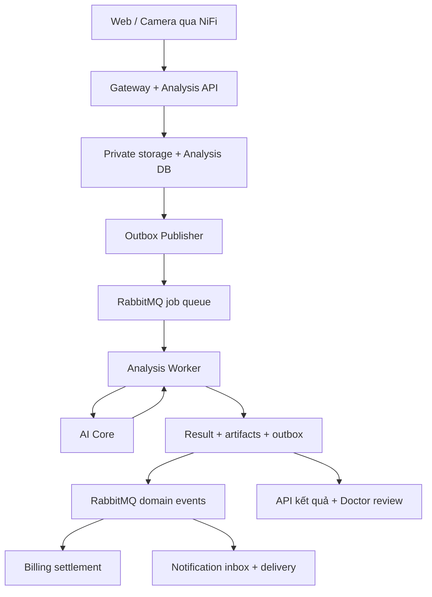
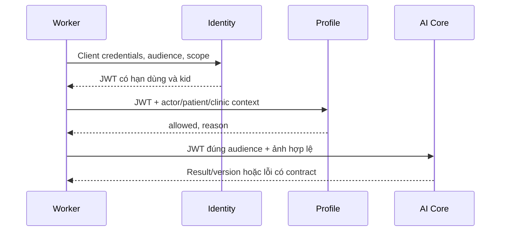

# AURA — README tổng hợp hệ thống và lộ trình hoàn thiện

**Dự án:** SP26SE025 — System for Retinal Vascular Health Screening / Hệ thống sàng lọc sức khỏe mạch máu võng mạc.
**Ngày đối chiếu:** 01/11/2026. **Mốc source:** `develop@a4695763f9609358032ec814631929f05485c130`.
**Đối tượng sử dụng:** Hậu và các thành viên M2, M4, M5, M6; người nhận bàn giao, reviewer, QA và người vận hành.

> AURA đã có nhiều thành phần triển khai, test và bằng chứng chạy riêng. CI mới nhất tại mốc trên đã xanh. Tuy nhiên, chưa đủ bằng chứng để kết luận toàn hệ thống đã hoàn chỉnh: Worker, quyền theo danh tính/ngữ cảnh, cơ chế xử lý lặp, quyết toán credit, FCM và kiểm thử toàn luồng vẫn cần hoàn thiện. README này phân biệt rõ mã nguồn, kiểm thử, kết quả lab và kế hoạch.

Tài liệu là bản tổng hợp độc lập; không thay đổi source, Jira, Docker, database hoặc journal Axx. Các liên kết source được ghim commit để nhóm có thể đối chiếu cùng một phiên bản. Các thay đổi sau mốc này cần được review và cập nhật lại README.

## Mục lục

1. [Kết luận hiện tại và cách đọc bằng chứng](#snapshot)
2. [Mục tiêu, vai trò và phạm vi sản phẩm](#scope)
3. [Kiến trúc, công nghệ và bản đồ source](#architecture)
4. [Luồng nghiệp vụ và bất biến dữ liệu](#flows)
5. [API, contract và version](#contracts)
6. [Database, migration và storage](#database)
7. [Xác thực, phân quyền và cấu hình](#security)
8. [RabbitMQ, Publisher, Worker và NiFi](#messaging)
9. [AI, dataset và giới hạn kết luận](#ai)
10. [Môi trường triển khai, cổng và cách khởi động](#environments)
11. [CI, kiểm thử và trạng thái commit đỏ/xanh](#verification)
12. [Các vấn đề còn mở và cách sửa](#blockers)
13. [Ma trận 39 yêu cầu chức năng](#functional)
14. [Ma trận 23 yêu cầu phi chức năng](#nonfunctional)
15. [Jira, phân công và toàn bộ Sprint 4](#jira)
16. [Thứ tự hoàn thiện theo các cổng nghiệm thu](#delivery)
17. [Kế hoạch Sprint 5–8 và tải công việc](#roadmap)
18. [72 task đề xuất và điều chỉnh cần thiết](#plannedtasks)
19. [Kiểm thử nghiệm thu toàn hệ thống](#acceptance)
20. [Vận hành, backup, sự cố và bàn giao](#operations)
21. [Lịch sử A73–A87E và việc cần tiếp tục](#history)
22. [Điều kiện hoàn thành và việc làm ngay](#done)
23. [Danh mục Jira còn lại](#jiraappendix)
24. [Nguồn tham chiếu và quy tắc cập nhật](#references)

<a id="snapshot"></a>
## 1. Kết luận hiện tại và cách đọc bằng chứng

### 1.1. Mốc đã kiểm tra

| Hạng mục | Kết quả tại thời điểm lập README |
| --- | --- |
| Repository | [CattyGame/XD-PMHDT](https://github.com/CattyGame/XD-PMHDT) |
| Commit nguồn | [a469576](https://github.com/CattyGame/XD-PMHDT/commit/a4695763f9609358032ec814631929f05485c130) — bổ sung migration camera grants, notification inbox và Billing vào dev runner |
| Inventory nguồn | 687 file tracked dạng blob trong Git tree; 344 file dưới `src/`. Số file không biểu thị phần trăm hoàn thành. |
| AURA CI | [Run 41300682859](https://github.com/CattyGame/XD-PMHDT/actions/runs/41300682859): **SUCCESS**, hoàn tất 11:13:28 UTC / 18:13:28 Việt Nam ngày 01/11/2026 |
| Repository checks | [Run 41300682788](https://github.com/CattyGame/XD-PMHDT/actions/runs/41300682788): **SUCCESS** |
| Sprint 3 handoff contracts | [Run 41300682771](https://github.com/CattyGame/XD-PMHDT/actions/runs/41300682771): **SUCCESS** |
| Automated Unit Tests | **360/360 PASS (0 Failed)** — bao gồm AURA.Analysis.Api (337), Aura.Worker.Analysis (9), AURA.Billing.Api (14) |
| Redis & Worker Scaling (SCRUM-339) | [AURA.Redis.Checks](file:///C:/Users/nguye/OneDrive/Desktop/New%20folder/XD-PMHDT/tests/AURA.Redis.Checks): **8/8 PASS (100%)** — Redis cache policy, dual-format env vars (.NET & Flat), QoS Prefetch 10 |
| Stress & Runbook Checks (SCRUM-341) | [AURA.StressRunbook.Checks](file:///C:/Users/nguye/OneDrive/Desktop/New%20folder/XD-PMHDT/tests/AURA.StressRunbook.Checks): **23/23 PASS (100%)** — Peak RAM < 80%, DLQ replay, zero duplicate billing |
| Camera Ingestion (SCRUM-350) | Đã chuẩn hóa 100% đường dẫn tương đối `%~dp0` và `$PSScriptRoot\..\..` trong `Simulate-CameraCapture.bat` và toàn bộ script dev |
| M1 Sprint 5 — Scaling & Quotas (SCRUM-362) | **ĐÃ HOÀN THÀNH (100% PASS)** — Worker scaling 4 replicas, quota 1.5 CPU / 1GB RAM, Gateway limit 100MB, full unit tests 360/360 |
| M1 Sprint 5 — Hardened NiFi (SCRUM-363) | **ĐÃ HOÀN THÀNH (100% PASS)** — Dedup SHA-256, SQLSTATE 23505 Idempotent vs HOLD, Bounded Retry 10x, Quarantine 40ms (< 1s), Zero-Loss test 5/5 |
| M1 Sprint 5 — FCM Push Backend (SCRUM-364) | **ĐÃ HOÀN THÀNH (100% PASS)** — Multicast FCM dispatch 53ms (< 200ms), auto-cleanup Unregistered token, zero PII (SRS §7.5), 37/37 checks pass |
| M1 Sprint 5 — Clinic Billing & Entitlements (SCRUM-365) | **ĐÃ HOÀN THÀNH (100% PASS)** — Gói Cơ bản 500 ảnh, Gói Chiến dịch 5.000 ảnh, phân quyền ClinicAdmin, cô lập đa khách thuê, chống IDOR và chống Double Spending (88/88 checks pass) |
| M1 Sprint 5 — Batch Refund & Ledger (SCRUM-366 / SCRUM-369) | **ĐÃ HOÀN THÀNH (100% PASS)** — Đối soát & Hoàn Credit tự động cho Batch lớn >= 100 ảnh, Partial Failure 95 captured / 5 released, Ledger sai số = 0, Idempotent replay, Post-analysis refund, Chống Deadlock 40P01 (111/111 checks pass) |
| Jira project SCRUM | 119 issue: 14 Epic và 105 Task; 81 Done, 13 In Progress, 6 In Review, 19 To Do. 14 trong số 19 To Do là Epic. |
| Sprint 4 | 24 task: **Đã hoàn thành xử lý 2 Action Items môi trường; sẵn sàng nghiệm thu và chốt Gate G0/G1** |
| Sprint 5 Kickoff (M4 AI) | Nhánh `feature/W5-M4-clinical-ai-hrf-avr` (commit `c273d178`): **3 task In Review** (`SCRUM-371`, `SCRUM-372`, `SCRUM-373`) |
| Bằng chứng lab cá nhân | Các log Axx do Hậu cung cấp ngày 29–30/10; không phải xác nhận trạng thái Docker hiện tại trên máy Hậu |
| Hành động trong lần tổng hợp này | Đọc source/Jira/CI và tài liệu; không chạy lại test ứng dụng, không triển khai hay phát sinh dữ liệu nghiệp vụ |

### 1.2. Các mức bằng chứng

| Nhãn | Được phép kết luận | Chưa được phép suy ra |
| --- | --- | --- |
| Có source | Có implementation hoặc scaffold tại commit đã ghi | Tính năng chạy đúng trong môi trường thật |
| Unit/model/contract PASS | Các assertion đã chạy đạt trong phạm vi test đó | Database concurrency, broker, FCM hoặc toàn bộ user journey đã đúng |
| Component runtime PASS | Thành phần đã chạy với cấu hình và môi trường cụ thể | Tất cả thành phần đã nối thành một hệ thống |
| Integration PASS | Các thành phần và boundary được ghi trong test đã giao tiếp thành công | Những boundary không có trong test cũng đã đạt |
| E2E PASS | Hành trình thực qua các thành phần được liệt kê đã chạy và dữ liệu đã đối chiếu | Mọi FR/NFR hoặc chất lượng lâm sàng đã đạt |
| Jira Done / In Review | Trạng thái quản lý công việc | Bằng chứng nghiệm thu kỹ thuật độc lập |
| BLOCKED / NOT RUN | Có điều kiện còn thiếu hoặc chưa thực hiện | FAIL hoặc PASS; phải ghi đúng lý do |

Không lấy trung bình các mức trên thành một tỷ lệ “hệ thống hoàn thành 90%”. Mỗi yêu cầu cần liên kết tới code, test, môi trường, kết quả và người review.

### 1.3. Điều đã thay đổi so với báo cáo trước

- Lỗi Dockerfile Analysis thiếu project Cache, lỗi React regression của mốc trước, regex repository-check và lệch hash handoff đã được xử lý đủ để các gate hiện cấu hình chạy xanh.
- Commit `82c3359` từng làm CI Docker đỏ vì `billing.payments` chưa được tạo. Commit `a469576` đã thêm migration vào runner; CI mới đã dựng và kiểm tra Docker/Gateway thành công.
- Worker đã đọc `allowed/reason` từ Profile. Tuy nhiên, phần gửi `actorAccountId=patientId` và `clinicContextId=null` vẫn cần sửa.
- Sandbox payment đã có kiểm tra chỉ cho order `TEST`. Quyền sở hữu order/wallet và HMAC fallback vẫn cần review/sửa.
- Notification đã thêm nhánh `billing.payment.success`; xử lý lỗi FCM ở catch ngoài, contract envelope và broker binding vẫn chưa đủ để đóng task.
- Các phát hiện về Worker schema, service JWT, lease/fencing, retry/ACK, reconciliation và mặc định AI mock chưa được đóng bằng bằng chứng tích hợp mới.
- **Tinh chỉnh môi trường SCRUM-339:** Đã bổ sung song song định dạng biến môi trường phẳng (`RABBITMQ_PREFETCH_COUNT=10`, `RABBITMQ_VHOST=/aura-s3`, `RABBITMQ_HEARTBEAT_SECONDS=60`) cùng định dạng phân cấp của .NET trong `compose.workers.yaml`; bộ kiểm thử `AURA.Redis.Checks` đã chạy PASS 8/8 (100%).
- **Khử đường dẫn tuyệt đối SCRUM-350:** Đã thay thế toàn bộ đường dẫn tuyệt đối `D:\XD-PMHDT` trong `Simulate-CameraCapture.bat` và các script camera ingestion sang đường dẫn tương đối `%~dp0` và `$PSScriptRoot\..\..`, bảo đảm khả năng chạy độc lập trên mọi máy trạm và CI/CD runner.
- **Khởi động mã nguồn Sprint 5:** M4 (Đào Duy Quân) đã hoàn thành và đẩy toàn bộ mã nguồn của 3 task `SCRUM-371`, `SCRUM-372`, `SCRUM-373` lên nhánh `feature/W5-M4-clinical-ai-hrf-avr` (tích hợp dataset HRF, tính toán AVR và benchmark lâm sàng Gate G1/G2).
- **Hoàn thành Task M1 Sprint 5 (SCRUM-362):** M1 (Nguyễn Trường Hậu) đã cấu hình mở rộng cụm 4 Worker replicas, thiết lập quota tài nguyên hạ tầng 1.5 CPU / 1GB RAM trong `compose.workers.yaml`, nâng trần upload YARP API Gateway lên 100MB (`104857600` bytes), kiểm thử tự động đạt 100% PASS (360/360 unit tests, 8/8 `AURA.Redis.Checks`).
- **Hoàn thành Task M1 Sprint 5 (SCRUM-363):** M1 đã hoàn thiện và gia cố toàn diện luồng Apache NiFi Ingestion & Reporting Delivery: Chống trùng ảnh theo mã băm SHA-256, xử lý chuẩn `SQLSTATE 23505` (phân biệt rõ Idempotent OK không throw exception vs Xung đột bản ghi chuyển nhánh `HOLD/Reporting-Reconcile`), tự động thử lại Bounded Retry tối đa 10 lần theo thuật toán Exponential Backoff (5s, 10s, 20s...), phát hiện cách ly tệp hỏng trong 40ms ($< 1$s) với `quarantine.reason`, và bảo đảm độ bền vững Zero-Loss qua container restart đạt **5/5 PASS (100%)** trong bộ test tự động `scripts/dev/Test-Sprint5-Task2-NiFi-Ingestion.ps1`. Ban hành Runbook vận hành v1.3 (`docs/nifi/camera_ingestion_runbook_v1.3.md`).
- **Hoàn thành Task M1 Sprint 5 (SCRUM-364):** M1 đã triển khai hoàn tất Dịch vụ Thông báo Đẩy Firebase Cloud Messaging (FCM Backend Service): Tích hợp Firebase Admin SDK với cơ chế Multicast song song (`IFcmClient`, `FirebaseAdminFcmClient`) đạt độ trễ chuyển giao siêu tốc **53ms** (vượt xa chỉ tiêu $< 200$ms), tự động dọn dẹp an toàn các FCM token hết hạn (`UNREGISTERED`, `InvalidArgument`) khỏi `notification.device_registrations`, tuân thủ nghiêm ngặt bảo vệ dữ liệu nhạy cảm theo SRS §7.5 (100% Zero-PII), đo lường đầy đủ 3 mốc thời gian Master Audit và bảo đảm độ bền vững Persist Before ACK đạt **37/37 PASS (100%)** trong bộ kiểm thử `tests/AURA.Notification.InboxChecks`.
- **Hoàn thành Task M1 Sprint 5 (SCRUM-365 / SCRUM-368):** M1 đã triển khai hoàn tất Billing cấp tổ chức (Clinic Packages & Entitlements): Mở rộng bảng giá hỗ trợ Gói Cơ bản 500 ảnh (7.000.000 VNĐ) và Gói Chiến dịch 5.000 ảnh (65.000.000 VNĐ) qua migration `010_billing_clinic_campaign_packages.sql`, kiểm soát chặt chẽ phân quyền vai trò `ClinicAdmin` và quyền sở hữu Clinic (`X-Clinic-ID`, `X-Actor-ID`) qua `OrderRepository.VerifyClinicAdminAuthorityAsync` trực tiếp với schema `profile`, bảo vệ bất biến snapshot đơn hàng chống sửa đổi với trigger `guard_order_snapshot_update`, ngăn chặn triệt để hành vi IDOR khi tạo, xem và thanh toán đơn hàng giữa các phòng khám (`HTTP 403 Forbidden`), chặn đứng trừ credit chéo giữa Clinic A và Clinic B, đồng thời dedup an toàn chống Double Spending khi Webhook Sandbox replay đạt **88/88 PASS (100%)** trong bộ kiểm thử `tests/AURA.Billing.ReservationChecks`.
- **Hoàn thành Task M1 Sprint 5 (SCRUM-366 / SCRUM-369):** M1 (Nguyễn Trường Hậu) đã triển khai hoàn tất Cơ chế Đối soát & Tự Động Hoàn Credit Batch (Idempotent Batch Refund): Hoàn thiện quy trình giao dịch 3 bước (Reserve ➔ Capture ➔ Release/Refund) cho các batch lớn $\ge 100$ ảnh; xử lý tình huống Partial Failure (100 ảnh / 5 lỗi ➔ capture chính xác 95 credits, tự động hoàn trả đúng 5 credits về ví Clinic); bảo toàn đối soát sổ cái `billing.credit_ledger_entries` (100 RESERVE, 95 CAPTURE, 5 RELEASE) với sai số đối soát bằng 0 tuyệt đối; hỗ trợ phân biệt rành mạch giữa RELEASE (hủy giữ chỗ khi chưa phân tích) và Post-analysis REFUND (hoàn tiền khi đã capture qua bút toán `ADJUSTMENT`); áp dụng khóa bi quan có sắp xếp thứ tự `OrderBy(x => x.ReservationId)` triệt tiêu 100% rủi ro Deadlock (`40P01`) dưới áp lực đa luồng đồng thời; cơ chế chống Double Spending bảo đảm `creditsRefunded = 0` và status `ALREADY_RELEASED` / `ALREADY_REFUNDED` khi replay; ngăn chặn triệt để hành vi IDOR hoàn credit chéo giữa các Clinic (`HTTP 403 Forbidden`); toàn bộ 111/111 test cases trong bộ kiểm thử tự động `tests/AURA.Billing.ReservationChecks` và 360/360 unit tests đạt kết quả PASS tuyệt đối.

### 1.4. Bảng tổng hợp tiến độ thực thi toàn dự án (Cập nhật ngày 02/11/2026)

| Giai đoạn / Phân hệ | Mục tiêu chính | Trạng thái hiện tại | Bằng chứng kiểm chứng | Đánh giá & Bước tiếp theo |
| :--- | :--- | :--- | :--- | :--- |
| **Sprint 1 — Nền móng** | Khởi tạo repo, CI ban đầu, Docker nền tảng, thiết kế kiến trúc | **CLOSED** | CI green, Git history | Hoàn tất 100%. |
| **Sprint 2 — Core Services** | Identity, Profile, API Gateway, AI Core baseline v0.1 | **CLOSED** | Tests & PR merges | Hoàn tất 100%. |
| **Sprint 3 — Luồng phân tích** | E2E Ingestion, Analysis Worker, RabbitMQ vhost `/aura-s3`, NiFi v1, token RS256 | **SẴN SÀNG ĐÓNG (READY TO CLOSE)** | 21 task Done; migration runner `a469576` pass; handoff contract run 41300682771 pass | Đã hoàn tất đối soát mã nguồn và kiểm tra DB runner; sẵn sàng đóng chính thức trên Jira. |
| **Sprint 4 — MVP & Resilience** | Redis Cache, Worker Scaling, Billing Sandbox, HMAC, Idempotency, Camera NiFi Dedup | **IN PROGRESS / IN REVIEW (90%)** | 360 unit tests pass; `AURA.Redis.Checks` 8/8 pass; `AURA.StressRunbook.Checks` 23/23 pass | Đã fix triệt để 2 Action Items môi trường (`compose.workers.yaml`, `Simulate-CameraCapture.bat`). Các task M4 đang In Review. |
| **Sprint 5 — Lâm sàng & Mở rộng** | Dataset HRF + CHASE_DB1, Phân đoạn động - tĩnh mạch AVR, Batch 100 ảnh, Hardened NiFi, FCM, Clinic Billing | **TRIỂN KHAI VƯỢT TIẾN ĐỘ (M1 HOÀN TẤT 5/5 TASKS P0/P1)** | M1: `SCRUM-362`, `SCRUM-363`, `SCRUM-364`, `SCRUM-365`, `SCRUM-366` (111/111 PASS suite tự động); M4: `SCRUM-371`, `372`, `373` (20 files, 3 PRs In Review) | M1 hoàn thành xuất sắc 100% nhiệm vụ Sprint 5 (DevOps, NiFi, FCM, Billing Packages, Batch Refund); M4 hoàn thành 3 task AI lâm sàng; sẵn sàng bàn giao cho M2 triển khai Batch Engine và Report (`SCRUM-367` ➔ `SCRUM-370`). |
| **Sprint 6 — Quản trị & Chat** | SignalR Consultation Chat, Admin Portal, Audit Log tập trung, Research Export | **KẾ HOẠCH ĐÃ DUYỆT (FUTURE)** | `KE_HOACH_CHI_TIET_SPRINT_5_6_7.md` | Chuẩn bị triển khai sau khi hoàn tất Gate G1/G2 của Sprint 5. |
| **Sprint 7 — Hiệu năng & Security**| Stress test toàn diện, Pentest đa tenant, tối ưu hóa thời gian phản hồi | **KẾ HOẠCH ĐÃ DUYỆT (FUTURE)** | `KE_HOACH_CHI_TIET_SPRINT_5_6_7.md` | Chuẩn bị khung test kịch bản tải cao và bảo mật y tế. |
| **Sprint 8 — Ổn định & Bàn giao** | Đóng gói sản phẩm, tài liệu vận hành y tế, nghiệm thu đề tài | **KẾ HOẠCH ĐÃ DUYỆT (FUTURE)** | `KE_HOACH_CHI_TIET_SPRINT_5_6_7.md` | Mốc nghiệm thu cuối cùng của toàn bộ hệ thống AURA. |

<a id="scope"></a>
## 2. Mục tiêu, vai trò và phạm vi sản phẩm

AURA hỗ trợ tiếp nhận ảnh võng mạc, xử lý AI, hiển thị kết quả có thể truy vết, cho bác sĩ review, quản lý tổ chức và quyết toán lượt phân tích. Sản phẩm hướng tới hỗ trợ quyết định chuyên môn. Kết quả do thuật toán sinh và nhận định của bác sĩ phải được lưu, hiển thị và audit riêng.

Nguồn yêu cầu: [docs/requirements/srs_v0.1.md](https://github.com/CattyGame/XD-PMHDT/blob/a4695763f9609358032ec814631929f05485c130/docs/requirements/srs_v0.1.md). Đây là SRS dự thảo với 39 FR và 23 NFR. Một số mô tả “hiện tại” trong SRS được viết từ sprint trước; dùng SRS làm yêu cầu, dùng source/CI/bằng chứng có ngày làm trạng thái triển khai.

| Vai trò | Nhu cầu chính | Ranh giới quyền |
| --- | --- | --- |
| Patient/User | Đăng nhập, hồ sơ, upload, kết quả/lịch sử/report, credit/payment, notification, chat | Chỉ tài nguyên được liên kết và được phép; không tự chọn tenant để mở rộng quyền |
| Doctor | Worklist bệnh nhân được giao, xem ảnh/kết quả, review/ghi chú, xu hướng, chat, feedback AI | Role Doctor không cho quyền trên mọi patient trong cùng clinic |
| Clinic | Thành viên, assignment, batch/campaign, usage/package, báo cáo tổ chức | Membership/role/trạng thái clinic và quyền tài nguyên phải được kiểm phía server |
| Admin | Account/role/clinic approval, package, AI configuration, audit, privacy, dashboard | Thao tác quản trị có policy và audit; không dùng quyền admin mặc định cho service |
| Service principal | Worker, Publisher, NiFi, Billing, Notification gọi nội bộ theo nhiệm vụ | Audience/scope/client allowlist, tenant/resource context; không giả danh Patient |

Các khái niệm không được đánh đồng:

- `accountId` khác `patientId`; một bệnh nhân được quản lý trong clinic không nhất thiết là tài khoản người đang thao tác.
- `analysisId` public trong baseline ánh xạ tới ảnh; `request`, `batch`, `job attempt` và `result` là các thực thể khác.
- Correlation ID dùng truy vết; idempotency key dùng xác định cùng một thao tác nghiệp vụ; event ID dùng dedup event.
- `COMPLETED` của xử lý AI khác trạng thái bác sĩ đã review. Không sửa AI result gốc để lưu nhận xét bác sĩ.
- Không có dữ liệu risk / không đánh giá được khác với risk thấp.
- Quản lý nhiều ảnh không tự có nghĩa đã đáp ứng 100 ảnh/batch và resume.

Phạm vi yêu cầu có Fundus và OCT. Baseline đang ưu tiên Fundus; OCT bị từ chối có kiểm soát. Nếu cuối dự án vẫn hoãn OCT, nhóm cần thống nhất và ghi nhận scope decision; không tự đánh dấu FR-2 đầy đủ. Tương tự, chỉ số hình thái mạch/AVR hoặc ảnh có bệnh không tự cung cấp nhãn dự báo biến cố tim mạch/đột quỵ.

<a id="architecture"></a>
## 3. Kiến trúc, công nghệ và bản đồ source

### 3.1. Luồng phân tích mục tiêu

Sơ đồ dưới đây mô tả kiến trúc cần nối và kiểm chứng; không hàm ý luồng này đã PASS E2E tại commit hiện tại.



Identity/Profile tham gia xác thực và kiểm quyền ở các boundary phù hợp; không phải tất cả quyền đều có thể quyết định chỉ tại Gateway. DB và private storage là nơi lưu trạng thái bền vững. Redis phục vụ cache/counter có thể dựng lại, không thay nguồn dữ liệu quyết toán.

### 3.2. Thành phần và ownership

| Thành phần | Vị trí source | Trách nhiệm | Người phối hợp chính |
| --- | --- | --- | --- |
| Web | [src/web/aura-web](https://github.com/CattyGame/XD-PMHDT/tree/a4695763f9609358032ec814631929f05485c130/src/web/aura-web) | UI 4 vai trò, Firebase client, upload/result/review/billing/notification | M5; M2/M6/M1 cung cấp API |
| API Gateway | [src/gateway/AURA.ApiGateway](https://github.com/CattyGame/XD-PMHDT/tree/a4695763f9609358032ec814631929f05485c130/src/gateway/AURA.ApiGateway) | Route, kiểm Firebase, biên public/internal, hạn mức và correlation | M1/M6 |
| Identity API | [src/services/AURA.Identity.Api](https://github.com/CattyGame/XD-PMHDT/tree/a4695763f9609358032ec814631929f05485c130/src/services/AURA.Identity.Api) | Account/role, bootstrap, context, cấp service JWT | M6; M1 vận hành key |
| Profile API | [src/services/AURA.Profile.Api](https://github.com/CattyGame/XD-PMHDT/tree/a4695763f9609358032ec814631929f05485c130/src/services/AURA.Profile.Api) | Hồ sơ, tenant, clinic, membership, assignment, camera delegation | M6 |
| Analysis API | [src/services/AURA.Analysis.Api](https://github.com/CattyGame/XD-PMHDT/tree/a4695763f9609358032ec814631929f05485c130/src/services/AURA.Analysis.Api) | Tiếp nhận, storage, job/outbox, query, batch, review, report | M2 |
| Outbox Publisher | [src/services/AURA.Analysis.Api/Outbox](https://github.com/CattyGame/XD-PMHDT/tree/a4695763f9609358032ec814631929f05485c130/src/services/AURA.Analysis.Api/Outbox) | Claim có scope/lease/generation; publish event/command có xác nhận | M2; M1 broker |
| Analysis Worker | [src/services/Aura.Worker.Analysis](https://github.com/CattyGame/XD-PMHDT/tree/a4695763f9609358032ec814631929f05485c130/src/services/Aura.Worker.Analysis) | Nhận job, kiểm quyền, xin JWT, gọi AI, lưu kết quả/terminal outcome | M2; M4 AI, M6 auth |
| AI Core | [src/ai-core](https://github.com/CattyGame/XD-PMHDT/tree/a4695763f9609358032ec814631929f05485c130/src/ai-core) | Quality gate, segmentation, metrics, annotation, version và contract | M4 |
| Billing API | [src/services/AURA.Billing.Api](https://github.com/CattyGame/XD-PMHDT/tree/a4695763f9609358032ec814631929f05485c130/src/services/AURA.Billing.Api) | Package/price, order/payment, wallet/reservation/ledger, reconciliation | M1/Hậu tiếp quản phần nhãn M3 |
| Notification API | [src/services/AURA.Notification.Api](https://github.com/CattyGame/XD-PMHDT/tree/a4695763f9609358032ec814631929f05485c130/src/services/AURA.Notification.Api) | Device, inbox, event consumer, FCM delivery | M1/Hậu; M5 browser |
| NiFi | [infra/nifi](https://github.com/CattyGame/XD-PMHDT/tree/a4695763f9609358032ec814631929f05485c130/infra/nifi) | Camera ingestion, flow/retry/quarantine, reporting receipt theo scope | M1/Hậu |
| PostgreSQL/Redis/RabbitMQ/storage | [infra](https://github.com/CattyGame/XD-PMHDT/tree/a4695763f9609358032ec814631929f05485c130/infra) | Persistence, cache, messaging, môi trường và quan sát | M1; mỗi service chịu schema của mình |

### 3.3. Công nghệ tại snapshot

| Nhóm | Phiên bản/nguồn có trong repo | Lưu ý |
| --- | --- | --- |
| .NET | Target `net10.0`; SDK root `10.0.401`, `rollForward=latestPatch` tại [global.json](https://github.com/CattyGame/XD-PMHDT/blob/a4695763f9609358032ec814631929f05485c130/global.json) | SDK host khác SDK base pinned của lab; ghi rõ khi so kết quả |
| Python | `.python-version`: 3.12; lab AI dùng Python 3.12.16 | Phiên bản patch của máy chạy phải ghi trong evidence |
| Node | `.nvmrc`: 24.21.0 | Dùng lockfile và toolchain thống nhất |
| Web | React `^19.2.8`, React Router `^7.18.4`, Firebase `^13.0.0` | Không mô tả repo hiện tại là React 18 |
| Web build/test | Vite `^8.3.0`, TypeScript `~6.0.2`, Vitest `^5.0.3`, oxlint `^1.81.0` | Dependency range trong package.json; bản cài thực theo lockfile |
| AI runtime | FastAPI 0.142.2; Uvicorn 0.54.0; Pillow 12.3.0; NumPy 2.5.3; SciPy 1.18.1; scikit-image 0.26.0 | Xem [src/ai-core/requirements.lock](https://github.com/CattyGame/XD-PMHDT/blob/a4695763f9609358032ec814631929f05485c130/src/ai-core/requirements.lock); không chỉ dùng `pip install` không version |
| DB access | Npgsql ở các API; Worker có EF Core mapping | Không giả định mọi service dùng cùng ORM hoặc schema tự sinh |
| Root infrastructure | PostgreSQL `17-alpine`, Redis `7.4-alpine`, RabbitMQ `4-management-alpine`, Azurite `3.33.0` | Một số tag mutable; khác pinned digest trong lab/handoff |
| NiFi Compose | Apache NiFi 1.27.0 | Không suy ra version container retained chỉ từ Compose này |
| Monitoring | Prometheus 2.51.2, Alertmanager 0.27.0, Grafana 10.4.2, postgres-exporter 0.15.0 | Có file không chứng minh scrape/alert/rule đã chạy đúng |

### 3.4. Thư mục cần biết

| Đường dẫn | Dùng để làm gì |
| --- | --- |
| [contracts](https://github.com/CattyGame/XD-PMHDT/tree/a4695763f9609358032ec814631929f05485c130/contracts) | OpenAPI/JSON Schema public và internal; có nhiều version cần chọn canonical |
| [docs/requirements](https://github.com/CattyGame/XD-PMHDT/tree/a4695763f9609358032ec814631929f05485c130/docs/requirements) | SRS và RTM |
| [docs/design](https://github.com/CattyGame/XD-PMHDT/tree/a4695763f9609358032ec814631929f05485c130/docs/design) | Thiết kế, ERD và data dictionary theo module |
| [docs/adr](https://github.com/CattyGame/XD-PMHDT/tree/a4695763f9609358032ec814631929f05485c130/docs/adr) | Quyết định kiến trúc, gồm private storage |
| [docs/integration/sprint3_team_handoff.md](https://github.com/CattyGame/XD-PMHDT/blob/a4695763f9609358032ec814631929f05485c130/docs/integration/sprint3_team_handoff.md) | Bàn giao cho thành viên; contract/config gates |
| [infra/sprint3](https://github.com/CattyGame/XD-PMHDT/tree/a4695763f9609358032ec814631929f05485c130/infra/sprint3) | Handoff manifest, template auth/AI, topology, example payload |
| [infra/postgres/migrations](https://github.com/CattyGame/XD-PMHDT/tree/a4695763f9609358032ec814631929f05485c130/infra/postgres/migrations) | Migration theo owner/schema; không chạy theo sort filename một cách tùy ý |
| [infra/service-auth](https://github.com/CattyGame/XD-PMHDT/tree/a4695763f9609358032ec814631929f05485c130/infra/service-auth) | Allowlist/example registry; không chứa credential runtime để dùng trực tiếp |
| [scripts/dev](https://github.com/CattyGame/XD-PMHDT/tree/a4695763f9609358032ec814631929f05485c130/scripts/dev) | Setup/validate/dev DB và kiểm thử môi trường |
| [scripts/backup](https://github.com/CattyGame/XD-PMHDT/tree/a4695763f9609358032ec814631929f05485c130/scripts/backup) | Backup/restore; cần kiểm target trước chạy |
| [scripts/sprint3](https://github.com/CattyGame/XD-PMHDT/tree/a4695763f9609358032ec814631929f05485c130/scripts/sprint3) | Validate source/contract/handoff |
| [tests](https://github.com/CattyGame/XD-PMHDT/tree/a4695763f9609358032ec814631929f05485c130/tests) | Console checks/integration harness; từng bộ có phạm vi riêng |
| [src/services/AURA.Analysis.Api.Tests](https://github.com/CattyGame/XD-PMHDT/tree/a4695763f9609358032ec814631929f05485c130/src/services/AURA.Analysis.Api.Tests) | Bộ unit tests Analysis đang được gọi trong CI |
| [docs/data_cards](https://github.com/CattyGame/XD-PMHDT/tree/a4695763f9609358032ec814631929f05485c130/docs/data_cards) / [docs/benchmarks](https://github.com/CattyGame/XD-PMHDT/tree/a4695763f9609358032ec814631929f05485c130/docs/benchmarks) | Dataset/model card và kết quả đo; phải đối chiếu môi trường/metric |
| [data-assets](https://github.com/CattyGame/XD-PMHDT/tree/a4695763f9609358032ec814631929f05485c130/data-assets) | Dữ liệu đóng gói trong repo; quyền sử dụng/provenance cần rà soát riêng |

<a id="flows"></a>
## 4. Luồng nghiệp vụ và bất biến dữ liệu

### 4.1. Một ảnh từ tiếp nhận tới kết quả

1. Web hoặc NiFi gửi ảnh theo contract. Server kiểm danh tính, modality, kích thước, chất lượng đầu vào cần thiết, tenant/patient/context và idempotency.
2. Xác minh quyền bằng Identity/Profile. Không tin `tenantId`, `actorAccountId`, `clinicId` do client tự đặt mà chưa đối chiếu.
3. Lưu ảnh private và tạo durable acceptance theo quy trình storage/journal. Sự cố giữa ghi file và DB phải có recovery, không bỏ mất ảnh đã xác nhận nhận bền vững.
4. Reserve credit theo policy Billing. Request/job/outbox được lưu bằng transaction thích hợp; timeout chưa rõ kết quả phải được đối soát trước retry tạo mới.
5. Publisher claim đúng phạm vi, publish command có confirm; broker/consumer có thể redeliver nên vẫn cần idempotency phía nghiệp vụ.
6. Worker claim job nguyên tử, kiểm lease/generation, xác minh quyền/context, lấy JWT qua Identity và gọi AI bằng đúng contract.
7. Lưu mask/overlay/result/version và trạng thái xử lý; ghi outbox event trong transaction gắn với attempt hợp lệ. Worker cũ không được commit sau khi mất lease.
8. Billing quyết toán theo outcome có thẩm quyền; Notification tạo inbox và delivery job. Retry không được nhân đôi credit/result/inbox.
9. Web gọi API kết quả và lấy file thông qua authorization; bác sĩ review thành revision riêng. Report truy vết phiên bản AI và review đã dùng.

**Điểm chặn hiện tại:** các bước 5–8 chưa được chứng minh nối đủ trong CI hiện tại; đặc biệt Worker schema/JWT/lease và reconciliation/delivery còn vấn đề.

### 4.2. Quy tắc credit đã chốt

Nguồn: [docs/api/M3_Sprint3_billing_decision_table_and_contract.md](https://github.com/CattyGame/XD-PMHDT/blob/a4695763f9609358032ec814631929f05485c130/docs/api/M3_Sprint3_billing_decision_table_and_contract.md). Nhãn M3 trong tên file là lịch sử; Hậu hiện nhận các task Billing liên quan.

| Tình huống | Hành động theo policy | Bất biến |
| --- | --- | --- |
| Nhận một ảnh hợp lệ để xử lý | Reserve 1 unit | Số dư khả dụng giảm một lần; có reservation truy vết được |
| Hoàn thành với kết quả hợp lệ theo contract | Capture reservation | Không trừ thêm lần hai nếu tiền đã được giữ ở reserve |
| Lỗi tạm thời/retry | Giữ RESERVED theo policy | Không refund rồi lại capture cùng ca do retry |
| Lỗi cuối/quality rejection đủ điều kiện | Release reservation | Hoàn một lần; trạng thái terminal nhất quán |
| Timeout/outcome chưa rõ | Giữ để reconciliation | Không tự hoàn chỉ vì quá 30 phút hoặc event tới chậm |
| Event/callback lặp cùng payload | Trả lại kết quả idempotent | Không thêm ledger/top-up/capture thứ hai |
| Cùng idempotency key nhưng payload khác | Conflict theo contract, thường 409 | Không diễn giải thành request mới hợp lệ |
| Sandbox payment | Chỉ TEST, quyền owner hợp lệ | Không thay đổi wallet LIVE; thiếu secret/config phải fail closed |

`CAPTURED` và `RELEASED` loại trừ nhau theo một quyết định nghiệp vụ hợp lệ. Số dư phải đối chiếu được với ledger và transaction/constraint DB. Redis lock không thay unique constraint, atomic update và reconciliation.

**Release khác refund:** release giải phóng khoản đang giữ; refund hoàn khoản đã capture. Batch partial failure cần chỉ rõ từng ảnh thuộc nhánh nào, không hoàn tổng theo số ảnh lỗi mà bỏ qua trạng thái reservation.

### 4.3. Batch, review và report

- Một batch có identity/context của từng ảnh, trạng thái từng item và aggregate có thể dựng lại từ DB. Restart Redis không được mất sự thật về tiến độ.
- 100 ảnh × 10 MB có thể gần 1 GB; Gateway giới hạn 100 MB không thể mặc nhiên nhận một request multipart như vậy. Cần chunk/multiple-request upload, resume, idempotency và giới hạn concurrency.
- Trạng thái processing, risk availability và doctor review là các trục riêng. UI không dùng một enum thay cả ba.
- Report cần ghi nguồn ảnh/result, model/config/threshold, doctor revision, thời điểm, người tạo và quyền truy cập. URL/QR không được thành lối tắt đọc dữ liệu private.
- Export CSV cần xử lý formula injection; PDF/ZIP phải giới hạn dung lượng/thời gian theo loại report cụ thể.

### 4.4. Tương tác clinic và chat

Clinic registration/approval, membership/assignment, campaign và chat là các workflow cần backend policy rõ. Giao diện có nút hoặc route không đủ chứng minh quyền. Chat room/message phải theo quan hệ Doctor–Patient được cho phép; revoke/suspend khi token còn hạn vẫn phải có hiệu lực theo policy. Campaign đóng phải có boundary tiếp nhận batch và thống kê xác định.

<a id="contracts"></a>
## 5. API, contract và version

### 5.1. Các bộ contract đang cùng tồn tại

| Contract | Phiên bản/path đã thấy | Việc cần thống nhất |
| --- | --- | --- |
| AI | [contracts/ai-openapi-1.2.yaml](https://github.com/CattyGame/XD-PMHDT/blob/a4695763f9609358032ec814631929f05485c130/contracts/ai-openapi-1.2.yaml), [contracts/ai-openapi-1.3.yaml](https://github.com/CattyGame/XD-PMHDT/blob/a4695763f9609358032ec814631929f05485c130/contracts/ai-openapi-1.3.yaml), [contracts/ai_service_openapi.yaml](https://github.com/CattyGame/XD-PMHDT/blob/a4695763f9609358032ec814631929f05485c130/contracts/ai_service_openapi.yaml) | File cuối vẫn khai 1.2.0; chọn canonical cho runtime và Worker, có compatibility test |
| Analysis public | [contracts/analysis-openapi.yaml](https://github.com/CattyGame/XD-PMHDT/blob/a4695763f9609358032ec814631929f05485c130/contracts/analysis-openapi.yaml): 0.6.0; [infra/sprint3/contracts/analysis-openapi-0.7.yaml](https://github.com/CattyGame/XD-PMHDT/blob/a4695763f9609358032ec814631929f05485c130/infra/sprint3/contracts/analysis-openapi-0.7.yaml): 0.7.0 | Một số route report khác runtime; không chọn chỉ bằng số version cao hơn |
| Job command | [contracts/analysis-job-0.6.schema.json](https://github.com/CattyGame/XD-PMHDT/blob/a4695763f9609358032ec814631929f05485c130/contracts/analysis-job-0.6.schema.json) và bản handoff | Binding/hash và producer/consumer phải cùng schema |
| Domain events | [contracts/analysis-events-0.7.schema.json](https://github.com/CattyGame/XD-PMHDT/blob/a4695763f9609358032ec814631929f05485c130/contracts/analysis-events-0.7.schema.json) và bản handoff | Source mới có payment-related changes; phải kiểm cả envelope, publisher và queue binding |
| Billing | [contracts/billing-openapi.yaml](https://github.com/CattyGame/XD-PMHDT/blob/a4695763f9609358032ec814631929f05485c130/contracts/billing-openapi.yaml): 0.1.0 | Chưa mô tả đủ order/payment callback mới trong Program |
| Doctor review | [contracts/doctor-review-openapi.yaml](https://github.com/CattyGame/XD-PMHDT/blob/a4695763f9609358032ec814631929f05485c130/contracts/doctor-review-openapi.yaml): 1.0.0 | Revision/conflict, authorization, AI result immutable |
| Identity | [contracts/identity-openapi.yaml](https://github.com/CattyGame/XD-PMHDT/blob/a4695763f9609358032ec814631929f05485c130/contracts/identity-openapi.yaml): 1.0.0 | Client credentials, issuer/audience/scope và account context |
| Profile | [contracts/profile-openapi.yaml](https://github.com/CattyGame/XD-PMHDT/blob/a4695763f9609358032ec814631929f05485c130/contracts/profile-openapi.yaml): 1.1.0 | `actorAccountId`, `clinicContextId`, `allowed/reason` và resource identity |
| Internal resolution | [infra/sprint3/contracts/internal-analysis-openapi.yaml](https://github.com/CattyGame/XD-PMHDT/blob/a4695763f9609358032ec814631929f05485c130/infra/sprint3/contracts/internal-analysis-openapi.yaml), settlement/notification schemas trong cùng thư mục | Authoritative state, recipient, tenant và outcome generation |

Handoff validation xanh chứng minh bộ kiểm tra hiện tại và các binding được kiểm đã khớp. Nó không tự chứng minh API runtime implement tất cả endpoint trong tài liệu hoặc mọi phiên bản có semantics giống nhau.

### 5.2. Catalog route chính từ source

Đây là catalog để nhóm tra cứu, không phải lời cam kết tất cả route đều đang mở trong một deployment. Gateway rule, feature flag, mode và auth quyết định route có dùng được hay không. API internal không được công khai chỉ vì có trong bảng.

| Service | Route chính | Mục đích và lưu ý |
| --- | --- | --- |
| Identity | `POST /api/v1/identity/bootstrap`; `GET /api/v1/identity/me` | Bootstrap/account từ danh tính Firebase |
| Identity internal | `POST /internal/v1/identity/service-tokens`; `POST /internal/v1/identity/context`; `GET /internal/v1/identity/public-key` | Cấp JWT và resolve context; private key không được đưa cho caller |
| Profile | `GET/PATCH /api/v1/profiles/me` | Hồ sơ và optimistic concurrency |
| Profile clinic | `GET/POST /api/v1/clinics/{clinicId}/memberships`; `DELETE .../memberships/{accountId}` | Member lifecycle, quyền clinic |
| Profile assignment | `GET/POST /api/v1/clinics/{clinicId}/assignments`; `DELETE .../assignments/{assignmentId}` | Quan hệ Doctor–Patient |
| Profile internal | `POST /internal/v1/profile/provision`; `POST /internal/v1/profile/access/resolve`; `POST /internal/v1/profile/camera-delegation/resolve` | Provision và quyết định quyền; HTTP 200 có thể chứa `allowed=false` |
| Analysis | `POST /api/v1/analyses`; `GET /api/v1/analyses/{analysisId}` | Nhận ảnh và query kết quả |
| Analysis batch | `POST /api/v1/batches`; `GET /api/v1/batches/{batchId}` | Batch runtime dưới chế độ HTTP endpoints |
| Analysis report | `POST /api/v1/analyses/{analysisId}/reports`; `POST /api/v1/batches/{batchId}/reports` | Runtime dùng plural `reports`; cần đồng bộ contract cũ |
| Doctor | `GET /api/v1/doctor/worklist`; `GET /api/v1/doctor/analyses/{analysisId}`; `POST .../{analysisId}/reviews` | Worklist, detail, review revision |
| Private files | `GET /api/v1/analyses/{analysisId}/files/{fileId}/access` | Resolve quyền tải file; không dùng public bucket thay thế |
| Analysis internal | `POST /internal/v1/analysis/settlements/resolve`; `POST /internal/v1/analysis/notification-context/resolve` | Outcome có thẩm quyền và recipient/context |
| Camera legacy branch | `POST /api/v1/analyses/camera` | Có trong nhánh khác của Analysis Program; không giả định cùng tồn tại với mọi route runtime |
| AI Core | `POST /api/v1/analyze`; `GET /health`; `GET /ready`; `GET /metrics`; `GET /openapi.json` | Endpoint inference là `analyze`, không phải `segment`; AI response snake_case cần mapper |
| Billing public | `GET /api/v1/billing/packages`; `PUT .../packages/{id:int}`; `POST .../orders`; `GET .../orders/{orderId:guid}` | Package/admin update và ownership order |
| Payment | `POST /api/v1/billing/payments/callback`; `POST /api/v1/billing/sandbox/pay` | Callback signature/idempotency; sandbox TEST-only và kiểm quyền |
| Billing internal | `POST /internal/v1/billing/reservations`; `GET .../{reservationId:guid}`; `POST .../{reservationId}/capture`; `POST .../{reservationId}/release` | Reserve/capture/release theo principal/scope được cấp |
| Billing reconciliation | `POST /internal/v1/billing/reservations/batch-refund`; `POST /internal/v1/billing/reconcile-stale` | Cần authoritative outcome; không hoàn theo tuổi đơn thuần |
| Notification | `GET /api/v1/notifications/me`; `POST .../devices`; `DELETE .../devices/{deviceId}` | Device lifecycle và context người nhận |
| Inbox | `GET /api/v1/notifications/inbox`; `GET .../inbox/unread-count`; `POST .../inbox/{notificationId}/read` | Inbox durable, tenant/owner check, mark-read idempotent |

Nguồn chính: các `Program.cs` của service; [src/services/AURA.Analysis.Api/Http/AnalysisEndpoints.cs](https://github.com/CattyGame/XD-PMHDT/blob/a4695763f9609358032ec814631929f05485c130/src/services/AURA.Analysis.Api/Http/AnalysisEndpoints.cs); [src/ai-core/app/main.py](https://github.com/CattyGame/XD-PMHDT/blob/a4695763f9609358032ec814631929f05485c130/src/ai-core/app/main.py). `Analysis:EnableHttpEndpoints` quyết định nhánh runtime trong Analysis Program. Không thể dùng health200 hoặc route trong nhánh legacy để chứng minh workflow của nhánh runtime đã bật.

### 5.3. Các thông tin mỗi request/event/result cần truy vết

Nhóm cần thống nhất tên trường chính xác theo schema canonical, nhưng không được bỏ các ý nghĩa sau: request/correlation ID; event/job/analysis identity; actor và patient/context đã xác minh; tenant; idempotency; attempt/generation; terminal/non-terminal outcome; model/config/threshold version; result/artifact references; billing reservation và event version. Không nhét ảnh gốc/Base64 hoặc token vào domain event nếu contract chỉ cần reference.

Lỗi phải được phân loại: thiếu/sai auth, không có quyền, schema/modality/quality, dependency tạm thời, timeout chưa rõ kết quả, conflict, lỗi cuối. HTTP status và body cần khớp contract; `ready503` không tự làm `analyze` fail closed nếu handler vẫn nhận request.

<a id="database"></a>
## 6. Database, migration và storage

### 6.1. Ownership schema

| Schema/module | Bảng tiêu biểu trong migration | Chủ dữ liệu |
| --- | --- | --- |
| `identity` | `roles`, `accounts`, `account_roles`, `service_clients` | Identity |
| `profile` | `tenants`, `clinics`, `profiles`, `patients`, `memberships`, `doctor_assignments`, `camera_grants` | Profile |
| `analysis` | `analysis_requests`, `images`, `jobs`, `analysis_results`, `outbox_events`, `annotation_refs`, `doctor_reviews`, `audit_logs`, `batches` | Analysis; Worker phải dùng mapping tương thích |
| `analysis` recovery | `upload_recovery_operations`, `upload_recovery_attempts` | Recovery quy trình upload |
| `billing` | `package_price_versions`, `credit_wallets`, `orders`, `credit_reservations`, `credit_ledger_entries`, `settlement_inbox`, `payments` | Billing |
| `billing_poc` | `service_packages` | Di sản POC; cần phân biệt với package/price business |
| `notification` | `device_registrations`, `inbox_items` | Notification; tên bảng là `inbox_items` |
| Reporting lab | Receipt camera thuộc scope lab đã kiểm riêng | Không trộn receipt/reporting với giao dịch Analysis/Billing |

Chưa xác nhận migration hoàn chỉnh cho các workflow tương lai như campaign/chat/privacy chỉ từ bảng task. Không tạo bộ bảng `analyses/outbox_messages` song song để né lỗi Worker nếu API/Publisher vẫn đọc schema Analysis chính.

### 6.2. Migration cần quản lý

Nguồn: [infra/postgres/migrations](https://github.com/CattyGame/XD-PMHDT/tree/a4695763f9609358032ec814631929f05485c130/infra/postgres/migrations) và [scripts/dev/Initialize-AuraDevDatabase.ps1](https://github.com/CattyGame/XD-PMHDT/blob/a4695763f9609358032ec814631929f05485c130/scripts/dev/Initialize-AuraDevDatabase.ps1). Các file có số thứ tự trùng giữa module; dùng manifest/order được review, không sort toàn bộ theo tên rồi áp mù.

| Migration/nhóm | Tác dụng | Trạng thái đáng chú ý |
| --- | --- | --- |
| `001_notification_devices.sql` | Device registrations | Có trong dev runner |
| `002_service_database_roles.sql` | Ownership/grants/runtime roles | Runner áp lại sau migrations; không thay thế password provisioning |
| `002_identity_and_profile.sql` | Identity/Profile core | Có trong dev runner |
| `003_doctor_assignments.sql` | Assignment | Có trong dev runner |
| `003_billing_poc_packages.sql`, `004_billing_business_schema.sql` | POC package + business Billing | Phân biệt schema và dữ liệu giá |
| `analysis/001_analysis_core.sql` | Analysis core/outbox/results | Schema chuẩn để sửa Worker |
| `analysis/002_upload_recovery.sql` | Upload recovery journal | Có trong dev runner |
| `analysis/002_outbox_publisher.sql` | Publisher columns/indexes | **Chưa nằm trong danh sách dev runner đang đọc** |
| `analysis/003_outbox_claim_generation.sql` | Generation/fencing cho Publisher | **Chưa nằm trong danh sách dev runner đang đọc** |
| `analysis/004_batch_processing.sql` | Batch | Có trong dev runner |
| `analysis/005_doctor_review_concurrency.sql` | Concurrency review | Có trong dev runner |
| `005_camera_grants.sql`, `005_notification_inbox.sql` | Camera policy và inbox | Đã được bổ sung vào runner ở mốc hiện tại |
| `006_billing_settlement_inbox.sql` | Dedup settlement | Có trong dev runner |
| `008_billing_payments.sql`, `009_billing_clinic_and_reconciliation.sql` | Payments, clinic/reconciliation | Đã được bổ sung vào runner; khắc phục lỗi thiếu `billing.payments` trong CI |

**Việc còn phải làm:** kiểm dependency/order, ownership, checksum và fresh-install/upgrade của bộ Publisher trước khi bật nó. CI Docker xanh khi Publisher chưa hoạt động không chứng minh hai migration Publisher đã được áp. Không áp bổ sung trực tiếp lên DB retained chỉ từ README này; thử trên DB tích hợp riêng, có migration plan/backup và bằng chứng trước–sau.

Dev example dùng database `aura_dev`. Runner hiện cũng gọi `psql` với database/user dev cố định; đổi `POSTGRES_DB` trong `.env` đơn lẻ không đảm bảo script tự theo giá trị mới. Cần đồng bộ hoặc tham số hóa trước khi đổi tên môi trường.

### 6.3. Storage và recovery

- Ảnh gốc, mask, overlay và report phải private; DB giữ reference/hash/type/owner theo contract.
- File access qua authorization, thời hạn URL và chính sách cache phù hợp. Test path traversal, sửa `fileId`, tenant/assignment và URL hết hạn.
- Commit DB thất bại sau lưu file, hoặc file lỗi sau durable acceptance, cần journal/reconciliation rõ. Không đánh dấu hoàn thành nếu artifact cần thiết chưa bền vững.
- Backup phải bao gồm DB và binary private storage cần phục hồi cùng nhau. Chỉ `pg_dump` không bảo đảm khôi phục được ảnh/report.
- Restore test cần kiểm số lượng, hash, quan hệ dữ liệu, quyền và một ca đọc/tiếp tục xử lý; không chỉ exit code của restore command.

<a id="security"></a>
## 7. Xác thực, phân quyền và cấu hình

### 7.1. Hai loại danh tính

Người dùng đăng nhập qua Firebase; Gateway và backend xác minh danh tính rồi lấy account/context có thẩm quyền từ Identity/Profile. Dịch vụ nội bộ sử dụng service JWT do Identity cấp, không dùng token người dùng để giả làm service và không tự ký bằng khóa tạm.



Mỗi audience cần token/quyền phù hợp. Worker chỉ gọi AI sau quyết định cho phép; dependency lỗi hoặc response không hợp lệ không được chuyển thành allow.

### 7.2. Registry Sprint 3 đã bàn giao

Nguồn public: [infra/service-auth/clients.sprint3.example.json](https://github.com/CattyGame/XD-PMHDT/blob/a4695763f9609358032ec814631929f05485c130/infra/service-auth/clients.sprint3.example.json). File này là allowlist/example, không phải registry runtime có secret hash đã provision.

| Client | Audience / scope theo thiết kế bàn giao |
| --- | --- |
| `analysis-api` | `aura-identity`: `identity:context`; `aura-profile`: `profile:resolve`; `aura-billing`: `billing:reserve`, `billing:read`, `billing:release` |
| `identity-api` | `aura-profile`: `profile:provision` |
| `billing-api` | `aura-profile`: `profile:resolve`; `aura-analysis`: `analysis:reconcile` |
| `profile-api` | `aura-identity`: `identity:context` |
| `analysis-worker` | `aura-ai`: `ai:analyze`; `aura-profile`: `profile:resolve` |
| `notification-api` | `aura-identity`: `identity:context`; `aura-analysis`: `analysis:notify` |
| `nifi-camera` | `aura-analysis`: `analysis:ingest` |

Worker không được cấp `billing:capture` trong registry này. Nếu thay đổi ai là caller settlement, cần quyết định kiến trúc và scope cụ thể, không sửa bằng cách phát quyền rộng cho Worker.

Sprint 3: issuer `aura-identity-s3-v1`, RS256, TTL 300 giây, key ID phù hợp, kiểm issuer/audience/scope/principal. Bộ local dev cũ dùng `aura-identity-local`. Không trộn hai bộ credential hoặc sửa chuỗi issuer trong output để làm token “khớp”. Khóa riêng chỉ ở issuer; AI chỉ mount public key read-only. Không commit hoặc gửi private key/client secret qua README/Jira/log.

### 7.3. Catalog cấu hình, không chứa giá trị bí mật

| Nhóm | Tên cấu hình cần thống nhất | Người cấp / lưu ý |
| --- | --- | --- |
| Compose/DB | `COMPOSE_PROJECT_NAME`, `POSTGRES_DB`, `POSTGRES_USER`, `POSTGRES_PASSWORD`, `POSTGRES_PORT`, `AURA_DOCKER_NETWORK` | M1; chọn môi trường riêng; runtime role không dùng superuser |
| DB runtime | `IDENTITY_DB_PASSWORD`, `PROFILE_DB_PASSWORD`, `ANALYSIS_DB_PASSWORD`, `BILLING_DB_PASSWORD`, `NOTIFICATION_DB_PASSWORD` | Secret theo service; không dùng chung một quyền ghi mọi schema |
| Broker/cache | `RABBITMQ_USER`, `RABBITMQ_PASSWORD`, `RABBITMQ_PORT`, `RABBITMQ_MANAGEMENT_PORT`, `REDIS_PORT` | Vhost/quyền phải đúng caller; port host khác DNS trong Docker |
| Firebase backend | `FIREBASE_PROJECT_ID`, `FIREBASE_SERVICE_ACCOUNT_PATH` | Service account ở ngoài repo, đúng project, mount scope hẹp |
| Notification encryption | `NOTIFICATION_ENCRYPTION_KEY_ID`, `NOTIFICATION_ENCRYPTION_KEY` | Có quy trình rotation/restore; không in nội dung key |
| Service auth dev | `AURA_SERVICE_AUTH_HOME`, các `*_SERVICE_CLIENT_SECRET` tương ứng service | Xem [scripts/dev/Set-AuraDevEnvironment.ps1](https://github.com/CattyGame/XD-PMHDT/blob/a4695763f9609358032ec814631929f05485c130/scripts/dev/Set-AuraDevEnvironment.ps1); script nạp material đã cấp |
| Identity S3 | `ASPNETCORE_ENVIRONMENT=Production`, `ServiceAuth__Issuer`, `ServiceAuth__TokenLifetimeSeconds`, `ServiceAuth__RegistryPath`, `ServiceAuth__PrivateKeyPath` | Issuer/registry/key thống nhất, ngoài repo; `health` của issuer chưa chứng minh DB business |
| AI S3 | `AURA_AI_ENGINE`, `AURA_SERVICE_AUTH_ISSUER`, `AURA_SERVICE_AUTH_AUDIENCE`, `AURA_SERVICE_AUTH_SCOPE`, `AURA_SERVICE_AUTH_ALLOWED_CLIENTS`, `AURA_SERVICE_AUTH_PUBLIC_KEY_PATH` | Engine thật `frangi`, public key đúng issuer; thiếu config phải fail closed sau khi sửa |
| Analysis runtime | `Analysis__EnableHttpEndpoints` | Chọn đúng nhánh runtime; không lấy route legacy làm bằng chứng cho nhánh này |
| Publisher | `Outbox__Enabled`, `Outbox__MinOccurredAtUtc`, `Outbox__ExcludedTenantIds`, `ConnectionStrings__OutboxPublisher`, `RabbitMq__Host/Port/VirtualHost/User/Password` | Template mặc định tắt và cutoff null; chỉ bật sau migration/concurrency/broker gate |
| Web | `VITE_ENABLE_MOCK`, `VITE_API_BASE_URL`, các `VITE_FIREBASE_*`, `VITE_FIREBASE_VAPID_KEY` | Biến `VITE_*` xuất hiện trong bundle browser; không đặt server secret vào đây |
| NiFi | `NIFI_ADMIN_USER`, `NIFI_ADMIN_PASSWORD` | Không in credential vào tài liệu hoặc command history chia sẻ |

Nguồn example: [.env.example](https://github.com/CattyGame/XD-PMHDT/blob/a4695763f9609358032ec814631929f05485c130/.env.example), [src/web/aura-web/.env.example](https://github.com/CattyGame/XD-PMHDT/blob/a4695763f9609358032ec814631929f05485c130/src/web/aura-web/.env.example), [infra/sprint3/.env.example](https://github.com/CattyGame/XD-PMHDT/blob/a4695763f9609358032ec814631929f05485c130/infra/sprint3/.env.example), [infra/sprint3/appsettings.publisher.example.json](https://github.com/CattyGame/XD-PMHDT/blob/a4695763f9609358032ec814631929f05485c130/infra/sprint3/appsettings.publisher.example.json), [infra/sprint3/common.reference.yaml](https://github.com/CattyGame/XD-PMHDT/blob/a4695763f9609358032ec814631929f05485c130/infra/sprint3/common.reference.yaml). Tên `AURA_S3_*` trong catalogue không tự động bind sang key .NET `Outbox__*`; cần mapping trong cấu hình executable.

### 7.4. Bộ test quyền tối thiểu

Kiểm caller hợp lệ trước để chứng minh môi trường hoạt động; sau đó kiểm sai tenant, cùng tenant sai assignment, account khác sửa order/file/inbox, revoked assignment khi token còn hạn, clinic suspended, role thiếu, audience/scope/kid sai, token hết hạn/tampered, missing key và dependency timeout. Kết quả phải qua HTTP/implementation thật; test tự dựng `allowed=false` rồi assert không chứng minh server đã từ chối.

<a id="messaging"></a>
## 8. RabbitMQ, Publisher, Worker và NiFi

### 8.1. Topology bàn giao Sprint 3

Nguồn: [infra/sprint3/rabbitmq.topology.reference.json](https://github.com/CattyGame/XD-PMHDT/blob/a4695763f9609358032ec814631929f05485c130/infra/sprint3/rabbitmq.topology.reference.json). Đây là reference để render/review trên broker/vhost sở hữu riêng, không phải lệnh import trực tiếp vào broker đang giữ dữ liệu.

| Resource | Mục đích |
| --- | --- |
| Vhost `/aura-s3` | Cách ly bộ tài nguyên Sprint 3 |
| Exchange `aura.s3.jobs` (direct) | Routing key `analysis.job.run` tới `aura.s3.analysis.jobs` |
| Exchange `aura.s3.events` (topic) | `analysis.completed`, `analysis.failed`, `analysis.requested` theo binding đã định |
| `aura.s3.billing.events` | Billing nhận outcome phân tích |
| `aura.s3.notification.events` | Notification nhận completed/failed trong reference hiện tại |
| `aura.s3.analysis.audit` | Audit requested theo reference |
| `aura.s3.retry.*`, `aura.s3.retry.return`, `aura.s3.dead.*` | Delay/return/dead-letter theo từng consumer |

Reference dùng quorum queues, initial group size 1, retry delay 5.000 ms, delivery limit 3 ở các policy liên quan, giới hạn 10.000 message/64 MiB, `reject-publish` và nhánh dead giữ lại. Đây là cấu hình mẫu của một node, **không phải bằng chứng high availability đa node**. Cần xác minh broker/version/policy hiệu lực trước nghiệm thu.

Notification source mới nhận payment event nhưng reference binding hiện đọc chủ yếu analysis events; thêm case trong code không tự thêm route broker. Cần chốt schema payment không ép `analysisId` không phù hợp, binding, publisher credential và consumer contract đồng bộ.

Publisher chỉ có write vào exchanges được cấp; Worker đọc jobs và ghi retry/dead đúng scope. Caller runtime không có quyền configure/purge. Phải test publisher confirm/unroutable return, broker outage, duplicate, poison message, retry hết lượt và hold/DLQ có thể đối soát.

### 8.2. Publisher đã sửa và Worker còn cần sửa

Publisher đã có overlay A84 về phạm vi quét, generation/fencing và contract validation, cùng test native được xác minh. Worker vẫn có repository/schema/auth/lease/retry riêng chưa theo kịp. Không dùng kết quả 30 Outbox tests để kết luận Worker đã an toàn khi chạy nhiều instance.

Template Publisher: poll 5s, batch 10, max publish attempts 10, confirm timeout 5s, lease 60s, body tối đa 65.536 byte, backoff `[5,15,30,60,120]`. Các giá trị cần đo với workload thật; không tự tăng replica/prefetch để che lỗi concurrency. Cutoff/tenant exclusion bảo vệ dữ liệu ngoài scope, không được bỏ chỉ để preflight chạy qua.

### 8.3. NiFi camera ingestion

Luồng mục tiêu: nhận ảnh → kiểm hash/metadata/delegation → gọi Analysis intake → giữ receipt/trạng thái để xử lý retry → quarantine lỗi cuối theo policy. Phân biệt:

- Ingestion tạo công việc phân tích.
- Reporting receipt ghi nhận kết quả nhận/xử lý cho mục đích báo cáo.
- Dùng lại receipt không được tự tạo analysis hoặc trừ credit thêm.

Retry phải có deadline/attempt hữu hạn. Với timeout chưa rõ commit, tra cứu kết quả theo identity/idempotency đã chốt trước gửi lại. Cùng hash nhưng khác tenant/patient hoặc payload không thể mặc nhiên coi là cùng thao tác. Không coi mọi SQLSTATE `23505` là duplicate hợp lệ.

Các script như [scripts/dev/Send-WebImageToNiFi.ps1](https://github.com/CattyGame/XD-PMHDT/blob/a4695763f9609358032ec814631929f05485c130/scripts/dev/Send-WebImageToNiFi.ps1) và [scripts/dev/Test-Sprint4-Task5-NiFi-Ingestion.ps1](https://github.com/CattyGame/XD-PMHDT/blob/a4695763f9609358032ec814631929f05485c130/scripts/dev/Test-Sprint4-Task5-NiFi-Ingestion.ps1) là điểm bắt đầu đọc. Script clear queue/replay thay đổi dữ liệu nên không dùng như bước “sửa nhanh” trên lab retained. Cần bằng chứng FlowFile/receipt/job/result/ledger trước và sau sự cố để đóng SCRUM-350 và demo camera.

<a id="ai"></a>
## 9. AI, dataset và giới hạn kết luận

### 9.1. Những gì đã có

AI Core có quality gate, Frangi segmentation, binary mask/overlay, vessel density, tortuosity/branching và heuristic risk ở nhánh mới. Contract/Model Card đang chuyển từ 1.2 sang 1.3. Nguồn: [src/ai-core/app/services/frangi_service.py](https://github.com/CattyGame/XD-PMHDT/blob/a4695763f9609358032ec814631929f05485c130/src/ai-core/app/services/frangi_service.py), [src/ai-core/app/services/tortuosity.py](https://github.com/CattyGame/XD-PMHDT/blob/a4695763f9609358032ec814631929f05485c130/src/ai-core/app/services/tortuosity.py), [docs/data_cards/model_card_v1.3.md](https://github.com/CattyGame/XD-PMHDT/blob/a4695763f9609358032ec814631929f05485c130/docs/data_cards/model_card_v1.3.md).

Lab A82 đã chạy một HTTP inference có JWT thật trên phantom 192×160: HTTP200, `isMock=false`, mask nhị phân/geometry/overlay/density khớp, `riskAvailable=false`, `RISK_UNAVAILABLE`, không có Worker/Billing/UI trong test. Đây là bằng chứng kỹ thuật tốt cho thành phần AI/auth tại mốc lab; không là kiểm định độ chính xác bệnh.

Source mới có heuristic morphology và giá trị confidence cố định cần được mô tả đúng. Một score hoặc confidence trong JSON không tự là xác suất bệnh được hiệu chuẩn. Worker/public result còn cần map và persist contract mới; không đổi `riskAvailable` sang true chỉ để UI hiển thị.

### 9.2. Đọc benchmark đúng cách

Model Card báo test CHASE_DB1 gồm 6 ảnh test của 3 subject; mean Dice với ground truth khoảng **0,420051**, IoU **0,266240**. So mask phiên bản mới với mask baseline đạt Dice **1,0** là bằng chứng giữ output baseline trên bộ đó; không phải segmentation đúng 100% so với chuyên gia.

Benchmark `frangi_runtime_api_v1.3.json` ghi môi trường Windows/Python và workload riêng. Stress 100 request trong khoảng 39,82s không thay soak test Docker 900s với concurrency 5–10 theo task Sprint 4. Những con số này là báo cáo có trong repo, chưa được chạy lại trong lần tổng hợp này.

Mỗi benchmark cần ghi commit/image, model/config/threshold, dataset manifest/hash, patient-level split, môi trường/CPU/RAM/threads, warm-up, tải, p50/p95, error rate, peak RAM và protocol tính metric. Chất lượng với ground truth, tính tương đương baseline và hiệu năng là ba kết quả khác nhau.

### 9.3. Dataset và việc cần kiểm tra trước dùng

| Dataset/nguồn | Có thể hỗ trợ | Điều chưa được suy ra / việc cần làm |
| --- | --- | --- |
| CHASE_DB1 trong manifest dự án | Đánh giá vessel segmentation baseline | Giữ split theo subject, test set độc lập; xác minh license nguồn trước phân phối lại |
| [HRF — nguồn FAU](https://www5.cs.fau.de/research/data/fundus-images/) | 45 ảnh, nhóm healthy/DR/glaucoma; vessel mask và FOV phục vụ nghiên cứu segmentation | Nhóm bệnh không tương đương nhãn ICDR 5 mức hoặc mask microaneurysm/hemorrhage; cần nhãn phù hợp nếu đổi bài toán |
| [INSPIRE — nguồn University of Iowa](https://eye.medicine.uiowa.edu/inspire-datasets) | Bộ INSPIRE-AVR được nguồn mô tả với 40 ảnh và tham chiếu AVR | Không tự chứng minh hypertensive retinopathy hoặc stroke/CVD outcomes; kiểm license, không mặc định tái phân phối |
| `data-assets/INSPIRE_AVR` trong repo mới | Có README mô tả 100 ca và các nhãn A/V | Mô tả này chưa khớp quy mô/nội dung INSPIRE-AVR chính thức đã đối chiếu; cần provenance, manifest và xác định chính xác dataset |
| Synthetic phantom | Contract/auth/geometry/format/regression kỹ thuật | Không dùng để báo accuracy lâm sàng hoặc độ đa dạng bệnh nhân |

README dataset mới trong repo là tuyên bố của dự án, không thay nguồn phát hành. INSPIRE có điều kiện sử dụng nghiên cứu/giáo dục và hạn chế sao chép/tái phân phối/thương mại trên nguồn; nhóm phải kiểm quyền trước giữ/chia sẻ các ZIP. Không tự xóa artifact trong repo từ nhận xét này; mở việc rà soát nguồn và quyền phân phối với owner.

Muốn đánh giá bệnh võng mạc tăng huyết áp hoặc nguy cơ biến cố cần dữ liệu/nhãn phù hợp với đúng endpoint nghiên cứu, phương pháp đánh giá độc lập và review chuyên môn. AVR/vessel density/tortuosity đơn lẻ không được trình bày thành chẩn đoán hay xác suất đột quỵ đã xác thực.

### 9.4. Việc M4 cần làm tiếp, theo thứ tự

1. Sửa mặc định thiếu engine/key: mock phải được bật explicit trong test; production/config thiếu phải từ chối an toàn.
2. Chọn canonical contract 1.3 hoặc compatibility mode rõ, đồng bộ request/response/error/correlation với Worker và public mapper.
3. Giữ version trên result, phân biệt `unavailable`, heuristic và output có validation; không ép score/AVR vào khoảng đẹp để test pass.
4. Chạy quality/geometry/auth regression và benchmark đúng Docker/resource target; test concurrency/soak đúng AC.
5. Kiểm dataset provenance/license/labels/split; đóng băng test set. Tách segmentation, classification, lesion localization, AVR thành bài toán/metric riêng.
6. Hoàn thiện Model Card theo số đo thật. ONNX/FP16 chỉ đưa vào sau feasibility theo execution provider; Frangi không tự có ONNX weights và FP16 không mặc nhiên tăng tốc CPU.
7. Chốt OCT scope/feasibility và nội dung hiển thị UI/report cùng M2/M5; nếu ngoài scope cuối kỳ phải có quyết định được thống nhất.

<a id="environments"></a>
## 10. Môi trường triển khai, cổng và cách khởi động

### 10.1. Không trộn các profile

| Profile | Nguồn | Phạm vi |
| --- | --- | --- |
| Root dev | [compose.yaml](https://github.com/CattyGame/XD-PMHDT/blob/a4695763f9609358032ec814631929f05485c130/compose.yaml) | Infra, Gateway, Analysis, AI, Identity, Profile, Billing; không có Worker/Notification executable đầy đủ trong root file |
| Dev overlay | [compose.dev.yaml](https://github.com/CattyGame/XD-PMHDT/blob/a4695763f9609358032ec814631929f05485c130/compose.dev.yaml) | Thêm Notification và cấu hình dev/Firebase tương ứng; cần phối hợp với root |
| Monitoring | [compose.monitoring.yaml](https://github.com/CattyGame/XD-PMHDT/blob/a4695763f9609358032ec814631929f05485c130/compose.monitoring.yaml), [infra/monitoring/compose.monitoring.yaml](https://github.com/CattyGame/XD-PMHDT/blob/a4695763f9609358032ec814631929f05485c130/infra/monitoring/compose.monitoring.yaml) | Hai vị trí cấu hình cần chọn/cập nhật thống nhất |
| NiFi | [infra/nifi/docker-compose.nifi.yml](https://github.com/CattyGame/XD-PMHDT/blob/a4695763f9609358032ec814631929f05485c130/infra/nifi/docker-compose.nifi.yml) | NiFi riêng, external network cần tồn tại và khớp tên |
| Auth/AI S3 candidate | [infra/sprint3/compose.auth-ai.example.yaml](https://github.com/CattyGame/XD-PMHDT/blob/a4695763f9609358032ec814631929f05485c130/infra/sprint3/compose.auth-ai.example.yaml) | Profile `auth-ai-review`, internal network, không host ports; chỉ Identity/AI, không phải full stack |
| Lab Axx của Hậu | Journal/evidence A73…A87E ngoài repo | Container/image/network đã có lịch sử riêng; không dùng root Compose để nhận quyền quản lý chúng |

`common.reference.yaml` còn liệt kê origin/template khác như Gateway 5300. Đây là catalogue bàn giao, không phải chứng cứ port 5300 đang được publish. Image ID build local A75/A80R cũng chưa phải image registry đã phát hành để thành viên khác pull.

### 10.2. Cổng mặc định trong các file đã đọc

| Thành phần | Host port mặc định | Container port / lưu ý |
| --- | --- | --- |
| Gateway | 5000 | 8080 |
| Analysis API | 5001 | 8080 |
| Billing API | 5002 | 8080 |
| Notification API, dev overlay | 5003 | 8080 |
| Identity API | 5004 | 8080 |
| Profile API | 5005 | 8080 |
| AI Core | 8000 | 8000 |
| PostgreSQL | 5432 | 5432, root binding localhost |
| Redis | 6379 | 6379, root binding localhost |
| RabbitMQ | 5672; management 15672 | Root defaults; lab lịch sử 15372 là môi trường khác |
| Azurite Blob | 10000 | 10000 |
| NiFi UI | 8443 HTTPS | 8443 trong file NiFi hiện tại, localhost |
| NiFi camera intake | 8081 | 8081, localhost trong file NiFi |
| Prometheus / Alertmanager | 9090 / 9093 | Tùy file monitoring được chọn |
| Grafana / postgres-exporter | 3000 / 9187 | Tùy file monitoring được chọn |

Cổng là default từ source; `.env`, override và container thực có thể khác. `http://identity-api:8080` chỉ resolve trong Docker network phù hợp; máy thành viên khác không dùng tên DNS nội bộ của Docker trên máy Hậu như URL chung. Kiểm mapping thực trước gửi URL cho nhóm.

### 10.3. Onboarding một checkout mới

Điểm bắt đầu thủ công, không dùng ZIP: clone repository vào thư mục mới, xác nhận commit/branch; đọc README này và file handoff; cài đúng SDK/Node/Python; provision secret riêng ngoài repo; chọn một profile và namespace mới. Không copy `.env` thật hoặc issuer private key từ máy Hậu vào Git.

Các lệnh dưới đây đọc trạng thái/plan, không khởi động ứng dụng hoặc áp migration. Chạy từ root checkout được chọn:

```powershell
git status --short --branch
git rev-parse HEAD
dotnet --list-sdks
node --version
py -3.12 --version
docker context show
docker ps --format "table {{.Names}}\t{{.Status}}\t{{.Ports}}"
pwsh -File scripts/dev/Initialize-AuraDevDatabase.ps1 -PlanOnly
```

Sau khi provision cấu hình đúng profile, `docker compose ... config --quiet` có thể dùng kiểm cấu hình mà không in secret. Không chia sẻ output `docker compose config` đầy đủ hoặc toàn bộ `docker inspect` vì chúng có thể chứa environment nhạy cảm.

Quy trình triển khai mới cần hoàn thiện và nghiệm thu theo thứ tự:

1. Chọn project/network/vhost/volume/DB riêng và kiểm dung lượng/RAM/port.
2. Provision Firebase/service credentials/public key/runtime DB roles đúng owner; private key chỉ issuer.
3. Build/pin artifact; ghi commit, image digest và config version.
4. Khởi động dependencies của môi trường mới; áp migration manifest đã review, kể cả Publisher khi chuẩn bị dùng; kiểm grants/runtime login.
5. Khởi động API/Identity/Profile/Billing/AI; kiểm health, ready, deny auth và bootstrap đúng scope.
6. Tích hợp Publisher/Worker sau khi các lỗi và gate DB/broker được đóng.
7. Nối Notification/Web/NiFi; chạy một ca thật và đối chiếu dữ liệu trước mở batch/scale.

Danh sách này là quy trình cần xây thành runbook chạy được, không phải xác nhận chỉ cần `docker compose up` là hệ thống đã hoàn chỉnh. Những script setup hiện có phải đọc tham số và tác động trước dùng. Đặc biệt `-CheckDevelopmentBootstrap` có thể tạo/cập nhật dữ liệu, không là thao tác chỉ đọc.

<a id="verification"></a>
## 11. CI, kiểm thử và trạng thái commit đỏ/xanh

### 11.1. CI mới nhất đã xanh trong phạm vi nào?

Nguồn: [.github/workflows/ci.yml](https://github.com/CattyGame/XD-PMHDT/blob/a4695763f9609358032ec814631929f05485c130/.github/workflows/ci.yml), [.github/workflows/repository-checks.yml](https://github.com/CattyGame/XD-PMHDT/blob/a4695763f9609358032ec814631929f05485c130/.github/workflows/repository-checks.yml), [.github/workflows/sprint3-handoff.yml](https://github.com/CattyGame/XD-PMHDT/blob/a4695763f9609358032ec814631929f05485c130/.github/workflows/sprint3-handoff.yml) và log run được liên kết ở phần 1.

| Job tại `a469576` | Kết quả quan sát | Phạm vi còn thiếu |
| --- | --- | --- |
| .NET build | SUCCESS; solution build; **337 Analysis tests PASS**, 0 fail, 0 skip | Bước `dotnet test` không chạy tất cả project test Worker/Billing; console checks phải đọc phạm vi riêng |
| React lint/test/build | SUCCESS; **19 test files, 331 tests PASS** | Chưa thay browser E2E với backend thật, quyền/FCM/payment thật |
| Python tests | SUCCESS; **110 PASS**, 10 warnings | Chưa chứng minh clinical accuracy hoặc target Docker soak/full Worker integration |
| Docker and Gateway checks | SUCCESS; migrations, role login, services, **22 M1 environment checks**, health/routes/OpenAPI, mock AI API/OCT rejection, failure/recovery | Test này dùng mock AI, không chứng minh service-JWT inference thật qua Worker; không chạy đủ Notification/FCM, có `-SkipNotification` |
| Development config checks | 44 checks PASS trong log | Bộ này nêu rõ không thực hiện Docker/HTTP/DB runtime |
| Handoff validation | SUCCESS | Kiểm source/contract/bindings, không bật Publisher/Worker hoặc xác minh runtime concurrency |

Không cộng tất cả check thành “tổng số chức năng đã hoàn thành”. Một check regex/config và một test integration dài có mức bằng chứng khác nhau. Giữ warnings trong báo cáo và xử lý nếu ảnh hưởng chất lượng; warnings không đồng nghĩa test thất bại.

### 11.2. Commit đỏ có ảnh hưởng hệ thống không?

| Tình huống | Ảnh hưởng đúng cần hiểu |
| --- | --- |
| Commit có CI đỏ nhưng chưa được triển khai | Không tự làm container phiên bản cũ đang chạy bị đổi. Tuy nhiên bản commit đó chưa đạt gate nên có thể không build/start hoặc có regression nếu đem chạy. |
| CI đỏ vì build/migration/runtime smoke | Có rủi ro trực tiếp khi dựng môi trường mới/nâng cấp; phải đọc job/log cụ thể. |
| CI đỏ vì lint/docs/hash check | Có thể không làm runtime hỏng ngay nhưng vẫn vi phạm gate/tính tái lập; cần sửa đúng nguyên nhân. |
| Commit mới sửa và CI xanh | Chứng minh những job ở commit mới đã đạt. Không xóa lịch sử đỏ và không chứng minh deployment trên máy khác đã cập nhật. |
| Đã deploy bản có lỗi | Phải kiểm version/image đang chạy và triệu chứng thực; chọn sửa/rollback theo runbook, không suy từ màu GitHub đơn lẻ. |

Trường hợp cụ thể `82c3359`: Docker/Gateway thất bại do Billing gặp `42P01: relation "billing.payments" does not exist`, kéo theo `/health` Billing không truy cập được. `a469576` bổ sung migration runner và CI mới xanh. Nếu máy dev cũ chưa áp đúng migration trên đúng DB thì việc GitHub xanh không tự sửa DB đó.

### 11.3. Các lệnh kiểm tra phát triển có trong workflow

Chạy trong checkout/môi trường test riêng có dependency phù hợp. Đây là lệnh thực thi build/test, không phải lệnh chỉ đọc runtime; không chạy lại các wrapper Axx one-shot bị dừng chỉ để có PASS.

```powershell
dotnet test src/services/AURA.Analysis.Api.Tests/AURA.Analysis.Api.Tests.csproj `
  --configuration Release --disable-build-servers `
  -maxcpucount:1 -nodeReuse:false -p:UseSharedCompilation=false `
  --logger "trx;LogFileName=analysis-tests.trx" `
  --results-directory TestResults/analysis
```

Web, từ `src/web/aura-web`, theo package scripts:

```powershell
npm ci
npm run lint
npm run test
npm run build
```

Contract handoff, từ root và dùng virtual environment mới:

```powershell
py -3.12 -m venv .venv-handoff
.\.venv-handoff\Scripts\python.exe -m pip install -r requirements-contract.txt
.\.venv-handoff\Scripts\python.exe scripts/sprint3/validate_handoff.py
```

Python runtime/tests dùng dependency files của [src/ai-core](https://github.com/CattyGame/XD-PMHDT/tree/a4695763f9609358032ec814631929f05485c130/src/ai-core) và cách gọi trong workflow đã ghim; ghi engine/mock/keys dùng trong test. Không truyền private key/secret vào command line/log chung. Các bài DB/broker/load/chaos phải có fixture riêng, owner và bước kiểm dữ liệu sau test.

### 11.4. Bằng chứng cần lưu mỗi lần nghiệm thu

Commit + branch; image digest; config/model/schema version; thời điểm; hardware/resource limit; test command và scope; pass/fail/skip; TRX/JUnit/log đã loại bí mật; request/job/event/reservation ID phù hợp; dữ liệu trước–sau hoặc hash; người review; known limitations. Test result cũ vẫn có giá trị ở commit/môi trường cũ, không tự chuyển thành PASS cho release mới.

<a id="blockers"></a>
## 12. Các vấn đề còn mở và cách sửa

P0 dưới đây là **thứ tự ưu tiên để nối hệ thống**, không đổi mức severity đã ghi trong Jira hay báo cáo R01–R15. Nhóm nên tạo subtask hoặc bổ sung AC vào task đang có thay vì tạo ticket trùng.

| Mã kế hoạch | Ưu tiên / owner | Hiện trạng và ảnh hưởng | Sửa cần làm | Điều kiện đóng |
| --- | --- | --- | --- | --- |
| B01 — Worker schema | P0, M2 | Worker dùng mapping `jobs.job_id`, `analyses`, `outbox_messages`; migration chính dùng `analysis.jobs.id/image_id`, `images`, `analysis_results`, `outbox_events`, `annotation_refs` | Một canonical schema; repository/mapping/result/outbox transaction khớp API | DB mới từ repo, Worker xử lý một ảnh; API result/file đọc đúng output |
| B02 — Worker service JWT | P0, M2+M6+M1 | Provider còn tự ký/tạo RSA fallback và kid không theo issuer; khác chuỗi auth A81 đã kiểm | Client credentials tới Identity; cache có expiry; không cấp issuer private key cho Worker | Worker thật xin JWT; AI/Profile allow đúng scope, deny sai secret/audience/kid |
| B03 — Actor/context | P0, M2+M6 | Đã parse `allowed`; vẫn gán actor bằng patient, bỏ clinic context | Truyền actor/context từ nguồn tin cậy; validate quyết định và identity tương ứng | `200+allowed=false`, wrong assignment, cross-tenant và revoked đều chặn inference/commit |
| B04 — Worker lease/fencing | P0, M2 | Claim read-then-save không nguyên tử; commit không ràng buộc generation/owner; renew không được processor sử dụng | Atomic claim, owner/generation, bounded renew; fence mọi write/outbox | Hai session tranh job, lease hết hạn, stale worker và kill/restart không tạo hai terminal result |
| B05 — Retry/ACK | P0, M2+M1 | Publish retry/dead rồi ACK chưa có confirm/return handling; poison exception có thể requeue mãi | Handoff có xác nhận hoặc durable tương đương; counter/bound rõ | Ngắt broker tại publish/ACK; không mất message; poison đạt DLQ/hold có thể đối soát |
| B06 — Publisher migration/concurrency | P0, M1+M2 | Code A84 đã sửa nhưng dev runner chưa liệt kê hai migration Publisher; PostgreSQL concurrency lab chưa xong | Review migration manifest, sandbox PG đúng, harness hai phiên và broker confirm tests | Fresh/upgrade DB PASS; stale/scope/lease/concurrency PASS; retained scope không bị quét nhầm |
| B07 — Billing ownership/secrets | P0, M1+M6 | TEST guard đã bổ sung; owner order/wallet/clinic và HMAC fallback còn cần xử lý | Authz object-level, sandbox flag/TEST-only, secret bắt buộc | User khác không đọc/thao tác order; sandbox không chạm LIVE; thiếu secret fail closed |
| B08 — Reconciliation | P0, M1+M2 | Auto-release dựa tuổi reservation có thể hoàn ca đang chạy hoặc event chậm | Hỏi Analysis authoritative outcome/attempt/generation; UNKNOWN giữ đối soát | Retry dài, late/duplicate/out-of-order event và hai reconciler không phá ledger |
| B09 — FCM delivery | P0/P1, M1+M5 | Inner catch mới có throw nhưng catch ngoài còn log/swallow; ACK sau đó có thể mất retry push | Durable delivery per device; transient retry, permanent token error riêng; payment envelope/binding đồng bộ | Provider outage→recover có delivery; inbox không lặp; browser receive/click đúng quyền |
| B10 — AI fail closed | P0, M4+M1 | Thiếu engine/key có thể rơi implicit mock và bỏ JWT; readiness503 không tự chặn handler | Mock explicit cho test; thiếu config từ chối; production không fallback | Missing config/key không analyze thành công; mock tests vẫn isolated, real JWT path PASS |
| B11 — Contract/version mapping | P0/P1, M2+M4+M1 | AI1.2/1.3, Analysis0.6/0.7 và report/payment routes chưa đồng nhất | Chọn canonical; producer/consumer/runtime tests, compatibility/version strategy | Request/response/error/event đúng schema; result/report giữ version và unavailable |
| B12 — Evidence E2E/auth | P0, M6 điều phối, mỗi owner sửa | Một số checks tự dựng response; source tests không thay HTTP/DB/broker thật; S3 E2E report còn blocked | Gọi implementation thật, positive control và negative/recovery matrix | Một ảnh Web/NiFi→Worker→AI→DB→Billing→inbox→UI, sau đó failure branches |
| B13 — AI/dataset validity | P1, M4 | Heuristic/confidence và dataset README có tuyên bố vượt nhãn/bằng chứng | Provenance/license/labels, protocol đúng bài toán, Model Card trung thực | Test độc lập; unavailable đúng; không tuyên bố clinical performance chưa đo |
| B14 — Profile/Clinic/Chat/UI còn thiếu | P1, M6/M2/M5 | Nhiều task S4 chưa Done; kế hoạch sau phụ thuộc API/policy chưa đầy đủ | Hoàn thành theo dependency, public contract và backend authz trước UI acceptance | Workflow thật với user/role/tenant và revoke, không chỉ mock UI |
| B15 — Deployment/operations | P1, M1+nhóm | Root stack chưa bao gồm đầy đủ Worker/Notification; backup/monitoring/RC cần rehearsal | Một deployment manifest chuẩn, migration plan, resource budget, observability và rollback | Fresh install + upgrade + restore + smoke RC có evidence |

Các điểm đọc trực tiếp để sửa: [src/services/Aura.Worker.Analysis/Data/WorkerDbContext.cs](https://github.com/CattyGame/XD-PMHDT/blob/a4695763f9609358032ec814631929f05485c130/src/services/Aura.Worker.Analysis/Data/WorkerDbContext.cs), [src/services/Aura.Worker.Analysis/Data/Repositories/JobRepository.cs](https://github.com/CattyGame/XD-PMHDT/blob/a4695763f9609358032ec814631929f05485c130/src/services/Aura.Worker.Analysis/Data/Repositories/JobRepository.cs), [src/services/Aura.Worker.Analysis/Data/Repositories/AnalysisRepository.cs](https://github.com/CattyGame/XD-PMHDT/blob/a4695763f9609358032ec814631929f05485c130/src/services/Aura.Worker.Analysis/Data/Repositories/AnalysisRepository.cs), [src/services/Aura.Worker.Analysis/Services/ServiceTokenProvider.cs](https://github.com/CattyGame/XD-PMHDT/blob/a4695763f9609358032ec814631929f05485c130/src/services/Aura.Worker.Analysis/Services/ServiceTokenProvider.cs), [src/services/Aura.Worker.Analysis/Services/ProfileResolveClient.cs](https://github.com/CattyGame/XD-PMHDT/blob/a4695763f9609358032ec814631929f05485c130/src/services/Aura.Worker.Analysis/Services/ProfileResolveClient.cs), [src/services/Aura.Worker.Analysis/Messaging/JobRunConsumer.cs](https://github.com/CattyGame/XD-PMHDT/blob/a4695763f9609358032ec814631929f05485c130/src/services/Aura.Worker.Analysis/Messaging/JobRunConsumer.cs), [src/services/AURA.Billing.Api/Services/OrderService.cs](https://github.com/CattyGame/XD-PMHDT/blob/a4695763f9609358032ec814631929f05485c130/src/services/AURA.Billing.Api/Services/OrderService.cs), [src/services/AURA.Billing.Api/Services/StaleReservationReconciliationService.cs](https://github.com/CattyGame/XD-PMHDT/blob/a4695763f9609358032ec814631929f05485c130/src/services/AURA.Billing.Api/Services/StaleReservationReconciliationService.cs), [src/services/AURA.Notification.Api/NotificationEventConsumer.cs](https://github.com/CattyGame/XD-PMHDT/blob/a4695763f9609358032ec814631929f05485c130/src/services/AURA.Notification.Api/NotificationEventConsumer.cs), [src/ai-core/app/main.py](https://github.com/CattyGame/XD-PMHDT/blob/a4695763f9609358032ec814631929f05485c130/src/ai-core/app/main.py).

Không đánh dấu lỗi đã đóng chỉ vì một file có thay đổi. Với mỗi Bxx, reviewer cần đọc thay đổi cuối cùng và test đúng boundary. Các sửa TEST guard/parse allowed/nhánh payment là tiến triển có thật nhưng mới giải quyết một phần của vấn đề.

<a id="functional"></a>
## 13. Ma trận 39 yêu cầu chức năng

Đây là bản tổng hợp phạm vi và khoảng trống nghiệm thu, không thay RTM chính thức. Owner là đề xuất phối hợp theo module hiện nay. “Có source” không nghĩa toàn yêu cầu đã PASS. Khi yêu cầu chưa có task rõ, cần bổ sung vào backlog hoặc có scope decision được thống nhất.

| ID | Yêu cầu SRS | Hiện trạng / mức bằng chứng | Owner đề xuất | Bằng chứng phải có để nghiệm thu |
| --- | --- | --- | --- | --- |
| FR-1 | Cho phép đăng ký và đăng nhập bằng email, Google hoặc phương thức social authentication được lựa chọn. | Có Identity/Firebase/Web; chưa nghiệm thu đủ phương thức đăng nhập | M6/M5 | Login, logout, session hết hạn, bootstrap và khóa tài khoản trên môi trường tích hợp. |
| FR-2 | Cho phép gửi một hoặc nhiều ảnh võng mạc Fundus/OCT để phân tích theo modality được hỗ trợ. | Fundus có API/AI; OCT chưa hỗ trợ; batch chưa đạt E2E | M2/M4/M5 | Một ảnh rồi 100 ảnh, sai modality/format, upload gián đoạn; quyết định phạm vi OCT chính thức. |
| FR-3 | Cho phép xem kết quả AI và mức nguy cơ khi có kết quả hợp lệ; phân biệt kết quả AI với đánh giá của bác sĩ. | Có result/UI và AI; Worker mapping còn chặn | M2/M4/M5 | GET kết quả thật; risk unavailable khác LOW; AI result tách doctor review. |
| FR-4 | Cho phép xem ảnh chú thích thể hiện khu vực mạch cần xem xét và các yếu tố giải thích được hỗ trợ. | Mask/overlay đã có smoke riêng | M4/M2/M5 | Private artifact, đúng hình học/phiên bản, bác sĩ được phép mở được trên UI. |
| FR-5 | Cung cấp khuyến nghị hoặc cảnh báo sức khỏe theo chính sách nội dung và kết quả hợp lệ. | Có nội dung/heuristic; chưa thẩm định nguy cơ bệnh | M4/M5/M6 | Chính sách nội dung có review; không suy ra xác suất CVD/đột quỵ từ heuristic. |
| FR-6 | Cho phép xem lịch sử phân tích cá nhân và các báo cáo trước đó được phép truy cập. | Có các phần query/UI; chưa chứng minh lịch sử hoàn chỉnh | M2/M5 | Phân trang/lọc, quyền, ca lỗi và version cũ. |
| FR-7 | Cho phép tải hoặc xuất báo cáo dưới dạng PDF/CSV theo quyền truy cập. | Có code report; contract/runtime cần đồng bộ | M2/M5 | PDF/CSV từ dữ liệu thật, quyền tải, expiry và nội dung nguồn. |
| FR-8 | Cho phép quản lý và cập nhật các trường hồ sơ cá nhân, thông tin y tế được phép. | Có Profile endpoints/checks | M6/M5 | Cập nhật trường cho phép, validation và ETag/If-Match conflict. |
| FR-9 | Thông báo khi kết quả AI sẵn sàng; nội dung thông báo phải tuân thủ chính sách bảo vệ dữ liệu. | Có inbox/FCM; delivery lỗi còn mở | M1/M5 | Event→inbox→browser, retry, dedup, deep-link đúng quyền. |
| FR-10 | Cho phép trao đổi với bác sĩ được phân công qua chức năng nhắn tin trong ứng dụng. | Trong kế hoạch tiếp theo | M2/M5/M6 | Chat durable, assignment, reconnect và revoke. |
| FR-11 | Cho phép mua hoặc gia hạn gói dịch vụ phân tích. | Có order/payment sandbox; chưa đầy đủ ownership/renewal | M1/M5 | Mua/gia hạn có giá version, TEST/LIVE và callback idempotent. |
| FR-12 | Cho phép xem lịch sử thanh toán và credit còn lại. | Có ví/ledger/order; cần luồng xem thật | M1/M5 | Lịch sử thanh toán và số dư đối chiếu ledger theo owner. |
| FR-13 | Cho phép Doctor đăng nhập và quản lý hồ sơ bệnh nhân được phân công trong phạm vi được phép. | Có Profile membership/assignment | M6/M2/M5 | Doctor chỉ truy cập bệnh nhân được phân công; quyền bị thu hồi có hiệu lực. |
| FR-14 | Cho phép Doctor xem kết quả AI và annotation của bệnh nhân được phép truy cập. | Có doctor endpoints và UI đang làm | M2/M5/M6 | Ảnh/private files và AI result đúng patient/tenant. |
| FR-15 | Cho phép Doctor xác nhận hoặc chỉnh sửa nhận định qua doctor review; không ghi đè AI result gốc. | Có review/concurrency code; Jira In Review | M2/M5 | Version conflict 409 và AI result gốc không bị sửa. |
| FR-16 | Cho phép Doctor thêm ghi chú y tế, chẩn đoán hoặc khuyến nghị theo quyền được cấp. | Có cấu trúc review; cần luồng hoàn chỉnh | M2/M5/M6 | Ghi chú, tác giả, timestamp, history/revision và quyền. |
| FR-17 | Cho phép Doctor xem lịch sử, các phân tích trước và dữ liệu xu hướng của bệnh nhân được phép truy cập. | Thiếu nghiệm thu riêng cho xu hướng dọc | M2/M5 | Nhiều lần chụp, dữ liệu thiếu, model/config khác nhau; không thay bằng dashboard tổng. |
| FR-18 | Cho phép tìm kiếm/lọc bệnh nhân theo ID, tên hoặc mức nguy cơ hợp lệ trong phạm vi được phân công. | Có worklist/filter; cần kiểm phạm vi thật | M2/M5/M6 | Filter trong assignment, risk unavailable không bị xếp LOW. |
| FR-19 | Cho phép Doctor gửi phản hồi để hỗ trợ cải thiện AI và quy trình retraining. | Chưa có bằng chứng workflow feedback hoàn chỉnh | M4/M2/M6 | Feedback versioned, consent/anonymization và tiếp nhận vào nghiên cứu/retraining. |
| FR-20 | Cho phép Doctor trao đổi tư vấn với Patient qua chat trong phạm vi quan hệ được phép. | Trong kế hoạch chat | M2/M5/M6 | Doctor–Patient đúng quan hệ; ngăn room/message trái quyền. |
| FR-21 | Cho phép Doctor xem tổng hợp hoạt động hoặc thống kê phân tích theo quyền. | Cần bổ sung task/AC riêng | M2/M5 | Thống kê hoạt động bác sĩ với denominator/thời gian/phạm vi rõ. |
| FR-22 | Cho phép đăng ký Clinic và thực hiện quy trình xác minh tổ chức. | Jira đang làm; chưa thấy đủ public workflow trong Program | M6/M5 | Clinic đăng ký→review→approve/reject→suspend, audit. |
| FR-23 | Cho phép Clinic quản lý các tài khoản Doctor/Patient và quan hệ thành viên trong phạm vi tổ chức theo quyền. | Có membership/assignment endpoints | M6/M5 | Invite/accept/remove, duplicate, suspension và quyền clinic. |
| FR-24 | Cho phép Clinic gửi nhiều ảnh theo batch và theo dõi trạng thái từng ảnh. | Có bảng/API batch; Worker/E2E còn chặn | M2/M5/M1 | 100 ảnh, danh tính từng ảnh, resume, partial outcome và rebuild cache. |
| FR-25 | Cho phép Clinic theo dõi báo cáo phân tích bệnh nhân và dữ liệu nguy cơ tổng hợp được phép. | Có phần result/report; dashboard còn kế hoạch | M2/M5/M6 | Dữ liệu thật, privacy, aggregate không lộ patient trái quyền. |
| FR-26 | Cho phép tạo báo cáo cho các chiến dịch sàng lọc của Clinic. | Campaign còn thiếu implementation xác nhận | M6/M2/M5 | Ownership, CLOSED boundary, same-clinic batch, export. |
| FR-27 | Cho phép theo dõi số ảnh đã phân tích và mức sử dụng gói dịch vụ. | Có billing primitives; cần báo cáo dùng thật | M1/M2/M5 | Tách uploaded/accepted/completed/billable và đối chiếu credit. |
| FR-28 | Cho phép Clinic mua hoặc gia hạn gói dịch vụ cấp tổ chức. | Có clinic wallet/refund code; chưa nghiệm thu | M1/M5/M6 | Owner clinic, membership, mua/gia hạn, chống sửa clinicId. |
| FR-29 | Cho phép Clinic nhận cảnh báo bệnh nhân có nguy cơ cao hoặc xu hướng bất thường khi có dữ liệu và quy tắc hợp lệ. | Chưa có nền tảng nguy cơ bệnh đã xác thực | M4/M2/M5 | Chỉ cảnh báo khi có chỉ số/quy tắc hợp lệ, hiển thị unavailable và nguồn. |
| FR-30 | Cho phép xuất thống kê tổng hợp phục vụ nghiên cứu hoặc quản lý theo quyền và chính sách bảo vệ dữ liệu. | Trong phạm vi report/analytics cần hoàn thiện | M2/M6/M5 | Tổng hợp có quyền, ẩn danh, tránh tái nhận dạng và CSV injection. |
| FR-31 | Cho phép Admin quản lý tài khoản User, Doctor và Clinic, gồm bật, tắt và chỉnh sửa theo quyền. | Có identity nền; quản trị hoàn chỉnh chưa chứng minh | M6/M5 | Enable/disable/update, token/cache cũ và audit. |
| FR-32 | Cho phép Admin định nghĩa hoặc cập nhật vai trò và quyền truy cập theo chính sách. | Có role/scope; quản trị chính sách cần hoàn thiện | M6 | RBAC + tenant + resource, least privilege, review thay đổi quyền. |
| FR-33 | Cho phép quản lý tham số AI, threshold và chính sách retraining có version và audit. | Có config/version AI; admin rollout chưa nghiệm thu | M4/M6/M2 | Schema validation, audit, canary/rollback và policy retraining. |
| FR-34 | Cho phép quản lý package, giá và mô hình tính phí. | Có packages/price versions | M1/M5 | Admin-only, giá effective-time, order giữ giá cũ, audit. |
| FR-35 | Cung cấp dashboard tổng hợp sử dụng, doanh thu và hiệu năng AI trong phạm vi dữ liệu được phép. | Monitoring kỹ thuật có file; business dashboard chưa đủ | M2/M1/M5 | Doanh thu/usage/AI metrics đúng định nghĩa và quyền. |
| FR-36 | Cung cấp thống kê số ảnh, phân bố nguy cơ và tỷ lệ lỗi với định nghĩa phép đo rõ ràng. | Có metrics/benchmark riêng; thống kê nghiệp vụ còn thiếu | M2/M4/M5 | Dedup/late events/time window; không gộp unavailable thành LOW. |
| FR-37 | Cho phép quản lý audit log, privacy settings và các quy trình liên quan đến bảo vệ dữ liệu. | Có audit/security primitives; privacy workflow chưa đủ | M6/M1 | Export/delete/retention, ảnh/cache/backup, luật ngoại lệ ledger/audit. |
| FR-38 | Cho phép Admin phê duyệt hoặc tạm ngừng đăng ký Clinic theo quy trình. | Jira đang làm | M6/M5 | Approve/suspend có policy, audit và revoke xuyên dịch vụ. |
| FR-39 | Cho phép quản lý mẫu thông báo và chính sách giao tiếp. | Chưa có bằng chứng template management hoàn chỉnh | M1/M5/M6 | Version, preview, scope admin và không chèn dữ liệu nhạy cảm vào push. |

<a id="nonfunctional"></a>
## 14. Ma trận 23 yêu cầu phi chức năng

Các chỉ tiêu là yêu cầu cần đo trong môi trường đã định nghĩa. Không dùng một microbenchmark, điểm Lighthouse hoặc một lần health200 để đóng toàn bộ NFR.

| ID | Yêu cầu SRS | Hiện trạng / mức bằng chứng | Owner đề xuất | Cách kiểm chứng còn cần |
| --- | --- | --- | --- | --- |
| NFR-1 | Phân tích AI một ảnh hoàn thành trong 10–20 giây tùy kích thước ảnh và tải model. Cần chốt ranh giới phép đo trong test plan. | Có benchmark riêng, chưa nghiệm thu end-to-end | M4/M1/M2 | Chốt kích thước, phần cứng, cold/warm, tải, ranh giới upload/queue/inference; báo p50/p95. |
| NFR-2 | Hỗ trợ tối thiểu 100 ảnh trong một batch bằng queue hoặc xử lý song song. | Chưa nghiệm thu | M2/M1/M5 | 100 ảnh khác nhau, bounded concurrency, partial fail/resume và ledger đúng. |
| NFR-3 | Dashboard và truy xuất kết quả tải trong dưới 3 giây ở điều kiện mạng bình thường được định nghĩa. | Chưa đủ số đo mục tiêu | M5/M2 | Network/device/cache/workload rõ; đo dashboard và result thật. |
| NFR-4 | Uptime tối thiểu 99%, không tính thời gian bảo trì có lịch; cần xác định cửa sổ đo. | Chưa có cửa sổ đo uptime phù hợp | M1 | SLO/window, maintenance policy, probes ngoài process và incident log. |
| NFR-5 | AI lỗi phải trả thông tin rõ ràng và bảo toàn ảnh đã được hệ thống tiếp nhận bền vững. | Có outbox/storage/recovery; Worker còn chặn | M2/M1 | Kill/restart/timeout sau durable accept; ảnh, job, result không mất hoặc double-charge. |
| NFR-6 | Backup tự động ít nhất một lần mỗi ngày; cần kiểm chứng khả năng phục hồi. | Có backup/restore script | M1 | Lịch chạy, mã hóa, retention, backup binary files và restore drill đối chiếu hash/DB. |
| NFR-7 | Kiến trúc cho phép horizontal scaling các AI microservice. | Thiết kế có thể mở rộng; chưa nghiệm thu | M1/M4 | Đo scale AI instances riêng với tăng số Worker, budget và backpressure. |
| NFR-8 | Hỗ trợ nhiều Clinic và hàng nghìn User mà không suy giảm ngoài ngưỡng được thống nhất trong test plan. | Chưa có load model đủ | M1/M2/M6 | Nhiều clinic/hàng nghìn user, isolation, p95/error rate và DB bottleneck. |
| NFR-9 | Dữ liệu bệnh nhân được mã hóa khi lưu và truyền, với yêu cầu AES-256 và TLS 1.2 trở lên. | Có primitives một phần; chưa chứng minh toàn dữ liệu | M1/M6 | TLS, ảnh/DB/backup/token encryption, rotation và quản lý key; AES cho FCM chưa đủ. |
| NFR-10 | Áp dụng thực hành bảo vệ dữ liệu y tế HIPAA-like và yêu cầu pháp luật địa phương phù hợp. Không tự tuyên bố chứng nhận tuân thủ. | Yêu cầu thiết kế, chưa là chứng nhận | M6/M1 | Policy/consent/retention/access review và xác định yêu cầu pháp lý áp dụng. |
| NFR-11 | Dữ liệu nhạy cảm phải được ẩn danh trước khi sử dụng cho retraining. | Chưa có workflow retraining đã nghiệm thu | M4/M6 | De-identification, consent, metadata/ảnh và kiểm chống tái nhận dạng. |
| NFR-12 | Kiểm soát truy cập theo RBAC cho Admin, Clinic, Doctor và User; kết hợp tenant và quyền trên tài nguyên. | Có auth/resolver; integration còn thiếu | M6/M2/M1 | HTTP positive/negative controls, same-tenant wrong assignment, cross-tenant, revoke. |
| NFR-13 | Web accessible và responsive trên desktop, tablet và mobile theo tiêu chí được chốt. | Có UI/tests; chưa đủ accessibility audit | M5 | Responsive, keyboard/focus/screen reader/contrast; Lighthouse không thay manual audit. |
| NFR-14 | Clinician upload ảnh và xem kết quả với tối đa 3 click theo hành trình và điểm đầu/cuối được xác định. | Chưa có evidence hành trình thống nhất | M5 | Xác định điểm đầu/cuối và đo user journey thật, trạng thái lỗi. |
| NFR-15 | Annotation và giải thích nguy cơ rõ ràng, có khả năng diễn giải lâm sàng; cần người review phù hợp. | Có mask/overlay; clinical interpretation chưa xác nhận | M4/M5 | Review giải thích với người có chuyên môn; hiển thị giới hạn và uncertainty. |
| NFR-16 | Model, threshold và config có thể cập nhật không downtime theo cơ chế triển khai được thiết kế. | Chưa chứng minh update không downtime | M4/M1 | Readiness, canary, rollback, tương thích result/schema, version trên từng request. |
| NFR-17 | Codebase modular, gồm AI Core, Web, các module nghiệp vụ và database layer. | Cấu trúc source đã chia module | Cả nhóm | Giữ ownership, dependency hợp lệ, compile/test và tránh schema dùng song song. |
| NFR-18 | Logging, audit và error tracking được tập trung, có truy vết và kiểm soát dữ liệu nhạy cảm. | Có monitoring/log/audit code | M1/M2/M6 | Correlation qua queue, queue age, audit quyền, redact secret/PHI, alert thực. |
| NFR-19 | Hỗ trợ tích hợp camera Fundus thông dụng qua cloud upload theo giao thức được lựa chọn. | Có NiFi/camera code và bằng chứng lab từng phần | M1/M2/M6 | Camera→durable accept→Worker→UI, dedup/conflict, delegation và quarantine. |
| NFR-20 | Export có PDF, CSV và định dạng y tế chuẩn khi khả thi, với phạm vi được thống nhất. | Có report code; chưa nghiệm thu định dạng đầy đủ | M2/M5 | PDF/CSV, quyền/expiry, nội dung traceable; chốt chuẩn y tế khả thi. |
| NFR-21 | AI Engine giao tiếp bằng RESTful API theo contract. | Có FastAPI REST; đã có smoke lab | M4/M2 | Canonical 1.2/1.3 và runtime/client contract đồng bộ, lỗi/auth/correlation. |
| NFR-22 | AI output có yếu tố giải thích như heatmap, annotated vessels hoặc highlighted abnormalities phù hợp thuật toán. | Có annotated vessels | M4/M5 | Hình học, FOV, output đúng thuật toán; heatmap không tự là lesion ground truth. |
| NFR-23 | Mỗi báo cáo/kết quả truy vết được AI version và threshold/config đã sử dụng. | AI trả version; lưu/xuất xuyên pipeline chưa đủ | M4/M2 | Persist model/config/threshold cùng result và report; doctor revision riêng. |

<a id="jira"></a>
## 15. Jira, phân công và toàn bộ Sprint 4

### 15.1. Sprint inventory từ Jira board 1

| ID | Sprint | Trạng thái Jira | Ngày đã cấu hình, UTC |
| --- | --- | --- | --- |
| 2 | Sprint 1 - Nền móng | closed | 2026-10-03 → 2026-10-09 |
| 3 | Sprint 2 GW, ID, PF, AI v0.1 | closed | 2026-10-13 → 2026-10-19 |
| 4 | Sprint 3 - Luồng phân tích | active | 2026-10-27 → 2026-11-03 |
| 5 | Sprint 4 - MVP | active | 2026-10-30 → 2026-11-08 |
| 6 | Sprint 5- Chat, Pay, Batch, BM | future | Chưa đặt ngày trên Jira |
| 7 | Sprint 6 Admin, Analytics, ... | future | Chưa đặt ngày trên Jira |
| 8 | Sprint 7 - Test, Hiệu năng, Pr | future | Chưa đặt ngày trên Jira |
| 9 | Sprint 8 Ổn định, Tài liệu, BV | future | Chưa đặt ngày trên Jira |

Danh sách sprint lấy qua thao tác liệt kê sprint của board. Sprint 3 và Sprint 4 cùng active là trạng thái Jira quan sát được; cần team chủ động xử lý carry-over. Sprint 5–8 hiện là future, chưa có ngày Jira trong response. Ngày ở file kế hoạch không tự là ngày đã áp dụng lên Jira.

### 15.2. Người chịu trách nhiệm hiện tại

| Vai trò trong nhóm | Người / phân công | Sprint 4 đang giữ | Cần bàn giao cho người khác |
| --- | --- | --- | --- |
| M1 | Nguyễn Trương Hậu; infra, NiFi, CI, ops và tiếp quản Billing/Notification | 338–341, 346–350: 9 task | URL/profile/ports, auth provisioning theo scope, DB/broker grants, deployment/evidence; không gửi secret qua repo |
| M2 | Võ Hữu Duy; Analysis/Publisher/Worker/review/batch/report | 342–345: 4 task | Canonical API/events/schema, result/file semantics, tests DB/Worker và client examples |
| M4 | Đào Duy Quân; AI/contract/data/model benchmark | 351–353: 3 task | Contract/version, model/config, quality/error policy, dataset provenance và benchmark có môi trường |
| M5 | Lâm Trần Nguyễn Hoàng; Web UI/E2E | 354–357: 4 task | UI routes/roles, API integration, browser evidence, FCM/deep-link và mock boundaries |
| M6 | Dung Hoang; Identity/Profile/tenant/security/QA | 358–361: 4 task | Actor/patient/clinic contract, permission matrix, fixtures tenant, review auth và RTM |

Tên task `[M3]` còn trong Jira/tài liệu là nhãn lịch sử. Dùng **assignee thực** trong bảng, không tự giao lại cho một thành viên đã rời nhóm. Owner service không đồng nghĩa được tự nghiệm thu toàn bộ phần mình viết; cần review chéo, đặc biệt permission và credit.

### 15.3. Từng task Sprint 4 và việc cần hoàn thiện

| Task | Nội dung Jira | Trạng thái | Assignee thực | Điều kiện cần hoàn thiện/nghiệm thu |
| --- | --- | --- | --- | --- |
| [SCRUM-338](https://nguyentruonghau2202.atlassian.net/browse/SCRUM-338) | [W4]M1] Triển khai Cụm Giám sát Prometheus & Dashboards Grafana Toàn diện | In Progress | Nguyễn Trương Hậu | Giữ; bổ sung Worker/Notification/queue age và kiểm cảnh báo thực. Có dashboard file chưa đủ chứng minh observability hoạt động. |
| [SCRUM-339](https://nguyentruonghau2202.atlassian.net/browse/SCRUM-339) | [W4]M1] Cấu hình Cụm Cache Redis Tập trung & Tối ưu Scaling RabbitMQ Worker | In Review / Sẵn sàng Done | Nguyễn Trương Hậu | ĐÃ TINH CHỈNH HOÀN TẤT: Cập nhật song song biến môi trường phẳng (RABBITMQ_PREFETCH_COUNT=10, RABBITMQ_VHOST=/aura-s3, RABBITMQ_HEARTBEAT_SECONDS=60) và phân cấp .NET trong compose.workers.yaml. Test AURA.Redis.Checks đạt 8/8 PASS (100%). |
| [SCRUM-340](https://nguyentruonghau2202.atlassian.net/browse/SCRUM-340) | [W4]M1] Tự động hóa Sao lưu/Phục hồi Dữ liệu & Hoàn thiện Bảo mật Liên dịch vụ | In Progress | Nguyễn Trương Hậu | Sửa RPO/RTO và phạm vi backup. Daily dump chưa bảo đảm RPO≤1h; backup cả binary private storage, các DB và vật liệu phục hồi cần thiết. |
| [SCRUM-341](https://nguyentruonghau2202.atlassian.net/browse/SCRUM-341) | [W4]M1] Kiểm thử Tải Hạ tầng Batch, Diễn tập Sự cố và Bàn giao Runbook Sprint 4 | In Progress | Nguyễn Trương Hậu | Chạy trên môi trường riêng sau khi nối được Worker. Kiểm job/result/ledger/notification, không chỉ RAM và reconnect broker. |
| [SCRUM-342](https://nguyentruonghau2202.atlassian.net/browse/SCRUM-342) | [W4]M2] Triển khai API Không gian làm việc Bác sĩ (Doctor Review & Revision) | In Review | Võ Hữu Duy | Giữ review revision và conflict. Tách processing status với review status; không thay COMPLETED thành REVIEWED nếu state machine không quy định. |
| [SCRUM-343](https://nguyentruonghau2202.atlassian.net/browse/SCRUM-343) | [W4]M2] Triển khai Xử lý Ảnh Hàng loạt (Batch Processing ≥100 ảnh) qua RabbitMQ và Redis | In Review | Võ Hữu Duy | Chốt API batch và metadata từng ảnh/bệnh nhân. Kiểm durable state, Worker schema/fencing, cache rebuild và full batch 100 ảnh. |
| [SCRUM-344](https://nguyentruonghau2202.atlassian.net/browse/SCRUM-344) | [W4]M2] Tích hợp Tự động hóa Thanh quyết toán Billing và Kết xuất Báo cáo PDF/CSV | In Review | Võ Hữu Duy | Tách settlement và export; Billing theo authoritative state, private report auth, partial outcome và lưu AI/review version. |
| [SCRUM-345](https://nguyentruonghau2202.atlassian.net/browse/SCRUM-345) | [W4]M2] Kiểm thử Tích hợp Batch/Doctor Review, Concurrency và Cập nhật OpenAPI 0.8 | In Progress | Võ Hữu Duy | Analysis unit tests hiện 337 PASS và CI Docker đã xanh. Vẫn cần PostgreSQL concurrency, Worker/Broker/HTTP integration và canonical OpenAPI khớp runtime. |
| [SCRUM-346](https://nguyentruonghau2202.atlassian.net/browse/SCRUM-346) | [W4]M3] Xây dựng Cổng Thanh toán Sandbox, Gói cước và Cấp Credit Idempotent | In Progress | Nguyễn Trương Hậu | TEST-only guard của sandbox đã được bổ sung ở source hiện tại. Tiếp tục kiểm quyền order/clinic/wallet và bỏ HMAC fallback; kiểm bằng HTTP âm/dương thực trước nghiệm thu. |
| [SCRUM-347](https://nguyentruonghau2202.atlassian.net/browse/SCRUM-347) | [W4]M3] Triển khai Dịch vụ Đẩy Thông báo Tức thời qua Firebase Cloud Messaging (FCM) | In Progress | Nguyễn Trương Hậu | Đã thêm nhánh billing.payment.success, nhưng catch ngoài vẫn có thể nuốt lỗi FCM. Cần đối chiếu envelope analysisId/payment event, binding broker và delivery job/retry bền vững. |
| [SCRUM-348](https://nguyentruonghau2202.atlassian.net/browse/SCRUM-348) | [W4]M3] Triển khai Billing Cấp Tổ chức (Clinic Packages) và Tự động Hoàn Credit | In Progress | Nguyễn Trương Hậu | Không auto-release chỉ vì reservation cũ. Xác minh Analysis outcome/attempt/generation, giữ UNKNOWN để đối soát; test ví clinic trái quyền. |
| [SCRUM-349](https://nguyentruonghau2202.atlassian.net/browse/SCRUM-349) | [W4]M3] Kiểm thử Khả năng Phục hồi Billing/FCM, Ma trận Đối soát và Cập nhật RTM | In Progress | Nguyễn Trương Hậu | Dùng callback/event thật cho kịch bản E2E; test SQL/repository có giá trị nhưng chỉ chứng minh tầng đó. Bỏ AC “chứng nhận an toàn” không định nghĩa. |
| [SCRUM-350](https://nguyentruonghau2202.atlassian.net/browse/SCRUM-350) | [W4]M4] Nâng cấp Luồng Apache NiFi: InvokeHTTP, Chống trùng (Dedup), Quarantine & Auto-Retry | In Review / Sẵn sàng Done | Nguyễn Trương Hậu | ĐÃ TINH CHỈNH HOÀN TẤT: Khử toàn bộ đường dẫn tuyệt đối D:\ trong Simulate-CameraCapture.bat và các script dev sang đường dẫn tương đối %~dp0 và $PSScriptRoot. Luồng NiFi dedup và auto-retry hoạt động độc lập trên mọi môi trường. |
| [SCRUM-351](https://nguyentruonghau2202.atlassian.net/browse/SCRUM-351) | [W4]M4] Tối ưu hóa Phân vùng Frangi v0.2 & Khảo sát Mô hình Đánh giá Rủi ro (Risk Model) | In Review | Đào Duy Quân | Tách tốc độ/giữ output với độ đúng segmentation. Heuristic phải có giới hạn; không chuyển sang kết luận dự báo bệnh/biến cố. |
| [SCRUM-352](https://nguyentruonghau2202.atlassian.net/browse/SCRUM-352) | [W4]M4] Đóng gói AI Contract 1.3, Chuẩn bị Khảo sát Định dạng Ảnh Cắt lớp Võng mạc OCT | In Review | Đào Duy Quân | Kiểm Worker parse và lưu 1.3, correlation cả error. Chốt kết quả feasibility OCT và scope chính thức, không tuyên bố FR-2 đầy đủ nếu OCT bị hoãn mà chưa thống nhất. |
| [SCRUM-353](https://nguyentruonghau2202.atlassian.net/browse/SCRUM-353) | [W4]M4] Kiểm thử Tải AI Core (Stress Test), Đo đạc Benchmark và Hoàn thiện Model Card | In Review | Đào Duy Quân | Cần đúng Docker target, concurrency 5–10 và duration 900s theo yêu cầu; báo cáo Windows 100 requests không thay soak test này. |
| [SCRUM-354](https://nguyentruonghau2202.atlassian.net/browse/SCRUM-354) | [W4]M5] Xây dựng Giao diện Không gian làm việc Bác sĩ (Doctor Workspace & Review UI) | To Do | LÂM TRẦN NGUYỄN HOÀNG | Giữ; cần API thật, assignment auth, private image, 409 conflict và AI/review tách biệt. UI này phải xong trước 394. |
| [SCRUM-355](https://nguyentruonghau2202.atlassian.net/browse/SCRUM-355) | [W4]M5] Xây dựng Giao diện Mua Gói cước, Thanh toán Sandbox và Tích hợp FCM Web Push | To Do | LÂM TRẦN NGUYỄN HOÀNG | Giữ; chốt M1 tiếp quản backend/FCM. Thử TEST payment callback, device lifecycle, background/click và quyền khi mở deep-link. |
| [SCRUM-356](https://nguyentruonghau2202.atlassian.net/browse/SCRUM-356) | [W4]M5] Xây dựng Giao diện Tải ảnh Hàng loạt (Bulk Upload) & Bảng Theo dõi Tiến độ Batch | To Do | LÂM TRẦN NGUYỄN HOÀNG | Giữ; đồng bộ batch API và per-image identity, 100-image test. Tránh giới hạn upload frontend/backend mâu thuẫn. |
| [SCRUM-357](https://nguyentruonghau2202.atlassian.net/browse/SCRUM-357) | [W4]M5] Kiểm thử Toàn diện UI Doctor/Payment/Batch và Cập nhật Design Documentation | To Do | LÂM TRẦN NGUYỄN HOÀNG | Giữ; E2E thật và reconnect. Draft y tế trong LocalStorage cần boundary, thời hạn và xóa khi logout/chuyển account. |
| [SCRUM-358](https://nguyentruonghau2202.atlassian.net/browse/SCRUM-358) | [W4]M6] Triển khai Quản lý Vòng đời Phòng khám (Clinic Lifecycle) và Quản lý Hội viên | In Progress | Dung Hoang | Giữ; clinic approval/member lifecycle, roles chuẩn và quyền backend. Cần invitation acceptance và suspension enforcement thực. |
| [SCRUM-359](https://nguyentruonghau2202.atlassian.net/browse/SCRUM-359) | [W4]M6] Triển khai Quản lý Bệnh nhân Phòng khám (Clinic Patients) và Phân công Bác sĩ | In Progress | Dung Hoang | Worker đã đọc allowed/reason, nhưng còn gán actorAccountId bằng patientId và clinicContextId=null. Chốt identity/context đúng và kiểm revoke với token còn hạn. |
| [SCRUM-360](https://nguyentruonghau2202.atlassian.net/browse/SCRUM-360) | [W4]M6] Triển khai Phân hệ Chiến dịch Tầm soát Sức khỏe Mắt (Screening Campaign API & UI) | In Progress | Dung Hoang | Giữ; chốt ownership Campaign trong Analysis, CLOSED boundary, same-clinic batch và thống kê có định nghĩa. |
| [SCRUM-361](https://nguyentruonghau2202.atlassian.net/browse/SCRUM-361) | [W4]M6] Kiểm thử Bảo mật Phân quyền Đa Tenant, Kiểm toán Quyền và Bàn giao Thiết kế | To Do | Dung Hoang | Chuyển thành gate bắt buộc trước acceptance; kiểm endpoint/file thật, positive control và revoke. Không dùng self-constructed denial làm bằng chứng. |

### 15.4. Sprint 3 Done nhưng vẫn phải đóng integration gap

21 task SCRUM-317…337 đang Done theo Jira. Các task đặc biệt cần đối chiếu lại bằng chứng tích hợp: SCRUM-324 Worker, 325 result/file, 326 settlement, 327 notification, 328 failure/reconciliation, 329 AI caller, 334 UI/NiFi E2E, 336–337 authorization. Không cần xóa lịch sử Done hoặc chạy lại mọi test cũ; mở/ghi follow-up phù hợp và gắn test mới cho khoảng trống còn tồn tại.

Báo cáo E2E cũ cho SCRUM-334 có trạng thái blocked. CI unit/build hiện xanh chưa tự cập nhật báo cáo đó thành PASS. Team cần một run mới có source/environment rõ để đóng khoảng trống.

### 15.5. Cập nhật tiến độ mở đầu Sprint 5 (M4 Clinical AI HRF & AVR)

Mặc dù Sprint 4 đang ở giai đoạn hoàn thiện nghiệm thu, thành viên M4 (Đào Duy Quân) đã chủ động hoàn thành và đẩy lên kho lưu trữ toàn bộ mã nguồn của 3 task đầu tiên thuộc Sprint 5 trên nhánh riêng:

* **Nhánh phát triển:** `feature/W5-M4-clinical-ai-hrf-avr` (commit `c273d178`).
* **Trạng thái Jira:** Cả 3 task đang ở trạng thái **In Review**:
  1. `SCRUM-371`: Chuẩn hóa dataset HRF (High Resolution Fundus) kết hợp CHASE_DB1, pipeline tiền xử lý ảnh võng mạc độ phân giải cao và tách khẩu độ (FOV mask).
  2. `SCRUM-372`: Phân đoạn cấu trúc động mạch - tĩnh mạch (Artery/Vein classification) và tính toán tỷ lệ Động - Tĩnh mạch AVR (Arteriolar-to-Venular Ratio) theo chuẩn lâm sàng CRAE/CRVE.
  3. `SCRUM-373`: Thiết lập bộ benchmark mô hình, đo đạc độ trễ xử lý thực tế và lập báo cáo thẩm định Cổng chất lượng Gate G1 & Gate G2.
* **Quy mô bàn giao:** 20 file mã nguồn mới bao gồm dịch vụ phân tích hình ảnh, thuật toán hình thái học, script đo lường benchmark và bộ unit test chuyên biệt cho AI lâm sàng.

### 15.6. Cập nhật tiến độ hoàn thành các task Sprint 5 của M1 (DevOps & NiFi Hardening)

Thành viên M1 (Nguyễn Trường Hậu — Tech Lead / Hạ tầng, NiFi, Broker, DevOps) đã hoàn thành xuất sắc 02 task P0 nền tảng hạ tầng cốt lõi của Sprint 5 theo vòng lặp khép kín (Closed-Loop Execution & Self-Correction):

#### 1. `SCRUM-362` (`W5-M1-01` · P0 · 8h · Epic E1 `SCRUM-261`): Cấu hình scaling Worker RabbitMQ và Quota tài nguyên hạ tầng
* **Kết quả thực thi & Tinh chỉnh nâng cao (Action Items):**
  - **Scaling & Resource Quota:** Cấu hình mở rộng cụm 4 worker replicas (`replicas: 4`) trong `compose.workers.yaml`. Quota tài nguyên chuẩn hóa: Resource Limits `cpus: '1.5'`, `memory: 1024M` (1G); Resource Reservations `cpus: '0.25'`, `memory: 256M` cho từng container worker.
  - **Tối ưu Fair Dispatch (Action Item 1.1):** Cấu hình `WorkerOptions__Prefetch: ${WORKER_PREFETCH_COUNT:-2}` & `RABBITMQ_PREFETCH_COUNT: ${WORKER_PREFETCH_COUNT:-2}` trong `compose.workers.yaml`, mặc định Prefetch = 2 giúp loại bỏ triệt để hiện tượng Worker ôm đồm job (Head-of-Line Blocking) khi ảnh có dung lượng không đều, đồng thời linh hoạt chuyển đổi Prefetch = 10 qua biến môi trường khi cần throughput xử lý hàng loạt tối đa.
  - **Bảo vệ Gateway DoS (Action Item 1.2):** Trong `AURA.ApiGateway`, phân tách giới hạn request body: Chỉ các route upload ảnh lớn (`/api/v1/analyses*`, `/api/v1/batches*`) được áp dụng trần 100MB (`104857600` bytes). Toàn bộ các route còn lại (`/api/v1/auth`, `/api/v1/billing`, `/api/v1/identity`, v.v.) áp dụng trần 5MB (`5242880` bytes) và được ngắt ngay ở middleware đầu vào trước khi qua xác thực JWT (trả về `HTTP 413 Payload Too Large`), ngăn chặn hoàn toàn nguy cơ tấn công DoS làm cạn kiệt RAM Gateway.
  - **AI Core Multi-processing (Action Item 1.3):** Cấu hình lệnh khởi chạy container `ai-core` với tham số `--workers 4` trong Uvicorn (`src/ai-core/Dockerfile` và `compose.yaml`) giúp AI Core xử lý đa tiến trình trên 4 CPU core, tận dụng tối đa tải gửi từ 4 worker C# song song.
  - **PostgreSQL Connection Pool Limit (Action Item 2.1):** Bổ sung tham số `Maximum Pool Size=20;Timeout=5;Command Timeout=5` vào chuỗi kết nối PostgreSQL trong `compose.workers.yaml`, bảo đảm tổng số kết nối của 4 worker ($4 	imes 20 = 80$) luôn nằm an toàn dưới trần mặc định 100 kết nối của PostgreSQL.
  - **Kết quả nghiệm thu:** Toàn bộ 360/360 unit test của giải pháp và 8/8 bài test `AURA.Redis.Checks` đều **PASS 100% tuyệt đối**.

#### 2. `SCRUM-363` (`W5-M1-02` · P0 · 10h · Epic E9 `SCRUM-269`): Hoàn thiện luồng Apache NiFi: Dedup SHA-256, Quarantine cách ly ảnh lỗi và Bounded Retry
* **Kết quả thực thi:**
  - Cấu hình processor `Record-Camera-Receipt-Safe-v2` (`ExecuteGroovyScript`) trong Process Group `AURA-S3-Reporting-Delivery-v1`:
    + Đọc mã băm SHA-256 (`imageSha256` / `image_hash_sha256`), gọi stored procedure `reporting.record_camera_receipt` qua JDBC với PreparedStatement.
    + Bắt chuẩn mã lỗi `SQLSTATE 23505`: Phân biệt tuyệt đối giữa Idempotent Replay hợp lệ (không throw exception, không sinh duplicate record trong PostgreSQL) và Xung đột bản ghi (sai lệch metadata/payload $\rightarrow$ gán `reporting.status = HOLD`, `quarantine.reason = CONFLICTING_RECEIPT_SQLSTATE_23505`, chuyển sang `Reporting-Reconcile`).
    + Bắt lỗi mất kết nối DB (mạng chập chờn / SocketTimeoutException / connection drop) $\rightarrow$ gán `reporting.status = RETRY` $\rightarrow$ đẩy sang `Bounded-Reporting-Retry-Delivery-v1` áp dụng thuật toán Exponential Backoff (`penaltyDuration = 5 sec`, tối đa 10 lần thử lại) $\rightarrow$ tự động phục hồi khi DB online, đạt 0% mất mát dữ liệu.
    + Thẩm định dữ liệu nhị phân phát hiện ảnh hỏng cấu trúc/sai magic bytes và cách ly tức thời trong **40ms** ($< 1$ giây), không gây nghẽn hàng đợi (Zero Head-of-Line Blocking).
  - Bộ kiểm thử tự động `scripts/dev/Test-Sprint5-Task2-NiFi-Ingestion.ps1` đã chạy thành công **5/5 PASS (100%)**:
    + **AC1.1 (Idempotent Retry):** PASS (Replay trùng khóa và payload không tăng số dòng DB, 100% ACID).
    + **AC1.2 (Conflict on 23505):** PASS (Gán `HOLD`, cách ly an toàn vào `Reporting-Reconcile`, DB không bị ghi đè).
    + **AC1.3 (Transient Drop & Bounded Retry):** PASS (Tự động thử lại theo Backoff và phục hồi không mất dữ liệu).
    + **AC1.4 (Quarantine < 1s):** PASS (Phát hiện và cách ly trong 40ms, không ghi rác vào DB).
    + **AC2 (Zero-Loss qua Container Restart):** PASS (Toàn bộ 14 receipts và FlowFiles được bảo toàn nguyên vẹn sau khi restart container PostgreSQL nhờ Docker Persistent Volumes).
  - Hoàn thiện và ban hành Sổ tay Vận hành: `docs/nifi/camera_ingestion_runbook_v1.3.md`.
  - Cập nhật và đồng bộ cấu hình luồng: `infra/nifi/camera_ingestion_flow_v2.json`, `infra/nifi/flow.json.gz`, `infra/nifi/RecordCameraReceiptSafeV2.groovy`.

#### 3. `SCRUM-364` (`W5-M1-03` · P1 · 6h · Epic E7 `SCRUM-267`): Triển khai Dịch vụ Thông báo Đẩy Firebase Cloud Messaging (FCM Backend Service)
* **Kết quả thực thi & Tiêu chuẩn nghiệm thu (AC):**
  - **Tối ưu Multicast Dispatch (AC1):** Triển khai cơ chế gửi đồng thời `SendEachForMulticastAsync()` / `SendMulticastAsync()` qua abstraction `IFcmClient` và `FirebaseAdminFcmClient`. Độ trễ chuyển giao thông báo tới toàn bộ thiết bị của tài khoản chỉ mất **53ms** (chỉ tiêu $< 200	ext{ms}$).
  - **Tự động dọn dẹp Token lỗi (AC2 - Self-Cleaning):** Đọc chi tiết `BatchResponse.Responses`. Khi phát hiện token bị `Unregistered` hoặc `InvalidArgument`, tự động gọi `deviceRepository.DeleteIfTokenMatchesAsync(...)` để thanh trừng an toàn khỏi PostgreSQL, bảo toàn nguyên vẹn các thiết bị hợp lệ khác và không gây gián đoạn consumer.
  - **Bảo mật dữ liệu y tế nhạy cảm (SRS §7.5):** Tiêu đề và nội dung push tuyệt đối trung tính (*"Phân tích ảnh đáy mắt hoàn tất"* / *"Kết quả phân tích mắt của bạn đã có! Bấm để xem chi tiết."*), không chứa họ tên bệnh nhân, số CCCD/BHYT, hay bệnh lý lâm sàng. Điều hướng an toàn tới `/analyses/{analysisId}` có xác thực JWT & RBAC.
  - **Master Audit 3 Mốc Thời Gian & Durable Delivery:** Đo lường và log đầy đủ 3 checkpoint: (1) Service nhận RabbitMQ event (`ReceivedAt`), (2) Gửi FCM thành công (`FcmDispatchedAt`), (3) Hoàn tất xử lý & ACK downstream (`TotalPipelineMs`). Cơ chế "Persist Before ACK" bảo đảm thông báo đã được lưu trữ vĩnh cửu trong `notification.inbox_items` trước khi dispatch FCM.
  - **Kết quả kiểm thử:** Toàn bộ **37/37 test checks (100% PASS)** trong bộ kiểm thử tự động `tests/AURA.Notification.InboxChecks` và **12/12 test checks (100% PASS)** trong `tests/AURA.Notification.CryptoChecks`.

<a id="delivery"></a>
## 16. Thứ tự hoàn thiện theo các cổng nghiệm thu

### G0 — Chốt baseline dùng chung

**Owner:** M1 điều phối, mọi thành viên xác nhận phần module của mình.

- [ ] Chọn commit/image/config/migration/contracts làm baseline; dùng `a469576` làm mốc tài liệu hiện tại, không tự coi là release đã nghiệm thu.
- [ ] Chốt một deployment profile tích hợp riêng và danh sách service đầy đủ, gồm Worker/Notification.
- [ ] Chọn canonical AI/Analysis/event/Billing contracts; ghi compatibility và source bindings.
- [ ] M6/M1 cấp đúng credential/public material qua kênh riêng; không dùng registry example làm runtime.
- [ ] Sửa README/runbook cũ về phiên bản, cổng, route, owner và phạm vi test.

**Đầu ra:** một manifest/version matrix có thể review; mọi người biết URL, schema, identity và contract cần dùng. Thành viên có thể tiếp tục code/test theo contract từ đây; chưa tuyên bố toàn hệ thống sẵn sàng triển khai.

### G1 — Đóng lỗi tích hợp cốt lõi

**Owner:** M2 Worker/DB; M6 quyền; M4 AI; M1 Billing/broker/migration.

- [ ] B01–B06: schema, service JWT, actor/context, atomic lease/fencing, durable retry/ACK, Publisher migration/concurrency.
- [ ] B07–B10: order ownership/secrets, reconciliation outcome, FCM durable delivery, AI fail closed.
- [ ] Test PostgreSQL hai phiên và RabbitMQ confirm/recovery trên sandbox riêng; không dùng test SQLite/in-memory thay kết luận PostgreSQL.
- [ ] Bổ sung test projects có ý nghĩa vào CI; nêu rõ job nào unit, model, integration, E2E.

**Đầu ra:** những invariant làm mất dữ liệu/quyền/credit được kiểm đúng boundary trước khi scale hoặc nhận batch lớn.

### G2 — Một ảnh thật đi hết hệ thống

**Owner:** M2 dẫn luồng, M1/M4/M5/M6 cùng đối chiếu.

Chạy một ảnh có quyền sử dụng bằng account/clinic fixture; tạo request/reservation/job/outbox; Worker xin JWT và gọi AI thật; result/artifacts được lưu; Billing quyết toán; inbox/FCM theo policy; Web xem được; Doctor review/report đúng quyền. Ghi số row/ledger/event và IDs, không chỉ ảnh chụp UI.

Sau happy path: duplicate request/event, wrong tenant, revoked assignment, quality rejection, AI timeout, broker down, late result và Worker chết sau commit trước ACK. Chưa đạt G2 thì chưa lấy batch/stress thành tiêu chí hoàn tất nghiệp vụ.

### G3 — Hoàn chỉnh MVP bốn vai trò

**Owner:** M5 UI, M2 Analysis/report/chat, M6 clinic/permissions, M1 billing/FCM, M4 AI boundary.

- [ ] Đóng các task S4 review/To Do bằng API thật.
- [ ] Clinic registration/approval/membership/assignment/campaign có policy và audit.
- [ ] Batch 100 ảnh, resume và partial outcome; progress rebuild từ DB; report có version/private access.
- [ ] Purchase/renewal/history/credit, device lifecycle/inbox, chat nếu giữ trong MVP.
- [ ] Các yêu cầu còn thiếu như trend, feedback AI, doctor activity statistics có owner/task riêng.

### G4 — Chất lượng, khả năng phục hồi và phạm vi AI

**Owner:** M6 điều phối QA; từng service owner chịu sửa lỗi.

- [ ] Chạy matrix FR/NFR; trạng thái PASS/FAIL/BLOCKED/NOT RUN phản ánh đúng bằng chứng.
- [ ] Load/soak, batch, multi-clinic, AI scaling, observability, outage/recovery và restore drill.
- [ ] Privacy/security/accessibility được kiểm theo policy/tiêu chí cụ thể.
- [ ] AI benchmark/data/license/model card chính xác; không nâng heuristic thành clinical conclusion.
- [ ] Feature scope đóng trước freeze; phần không đáp ứng có quyết định và ảnh hưởng ghi rõ.

### G5 — Release candidate và bàn giao

**Owner:** M1 release; M6 QA; cả nhóm ký xác nhận module.

- [ ] RC gắn commit + image digests + config/migration/model versions.
- [ ] Fresh install và upgrade từ baseline cũ; rollback/restore có rehearsal và kiểm dữ liệu.
- [ ] Chạy acceptance trên artifact RC, không chỉ trên code dev.
- [ ] README/runbook/SAD/ERD/OpenAPI/RTM/model card/release notes khớp nhau.
- [ ] Demo dataset hợp lệ, account TEST và video dự phòng; known issues/unsupported scope được công bố.

<a id="roadmap"></a>
## 17. Kế hoạch Sprint 5–8 và tải công việc

File `KE_HOACH_CHI_TIET_SPRINT_5_6_7.md` người dùng cung cấp thực tế chứa Sprint **5–8**, tổng **72 task**, 576 giờ ước lượng. SHA-256 của file đã đọc: `1b58b51857dac1014e91024d53f13ba48b59a49fb0161f1c41bb38d1b45a55b4`.

Các nhãn SCRUM-362…433 trong file được giữ dưới dạng **mã dự kiến**. Tại snapshot Jira đã truy vấn, chưa có các issue này trong inventory; không tạo hyperlink Jira giả hoặc coi chúng đã được giao chính thức.

### 17.1. Điều chỉnh lịch và dependency

| Giai đoạn trong file | Ngày đề xuất | Cách thực hiện hợp lý |
| --- | --- | --- |
| Sprint 5 | 02–08/11 | Trùng Sprint 4 tới 08/11. Ưu tiên carry-over G1/G2; gộp task trùng, chỉ mở batch/clinic/report sau khi đường một ảnh hoạt động |
| Sprint 6 | 09–15/11 | Hoàn thiện chức năng còn trong scope, admin/chat/analytics; auth cache/privacy workflow cần implement trước freeze nếu cam kết |
| Sprint 7 | 16–22/11 | Regression, performance, security/privacy/accessibility/AI evaluation; đã phải có E2E từ trước, không đến tuần này mới thử nối Worker |
| Sprint 8 | 23–29/11 | RC, cài/nâng cấp/rollback, tài liệu, demo; giữ cuối giai đoạn cho ổn định và sửa lỗi, không thêm feature lớn |

Freeze cuối Sprint 6 mâu thuẫn với việc để task 414 auth cache và 415 export/delete/privacy implementation tới Sprint 7. Đưa thiết kế/implementation lên trước freeze hoặc điều chỉnh scope/mốc rõ; S7 chỉ kiểm chứng và sửa lỗi của tính năng đã có.

### 17.2. Ước lượng gốc theo người, chưa cộng carry-over/review

| Người | S5 | S6 | S7 | S8 | Tổng |
| --- | --- | --- | --- | --- | --- |
| M1/Hậu | 42h | 34h | 34h | 38h | 148h |
| M2 | 30h | 32h | 24h | 34h | 120h |
| M4 | 24h | 24h | 24h | 24h | 96h |
| M5 | 24h | 24h | 24h | 24h | 96h |
| M6 | 24h | 30h | 38h | 24h | 116h |
| Tổng | 144h | 144h | 144h | 144h | 576h |

Hậu còn 9 task Sprint 4 chưa Done; 42 giờ Sprint 5 cộng carry-over/review/hỗ trợ tích hợp là điểm nghẽn. Chốt capacity thật và dành dự phòng cho tích hợp/sửa lỗi. M6 vừa implement quyền vừa QA lead cần review chéo. Đừng cân số ticket bằng cách bỏ dependency hoặc đổi owner dữ liệu.

### 17.3. Những điều kế hoạch cần sửa trước chốt

- Tăng Worker replica không tự tăng số AI instance hoặc đạt NFR horizontal scaling; đo cả bottleneck và budget.
- Prefetch 10 của task S4 và prefetch 1 của kế hoạch S5 cần benchmark để chọn.
- UI batch progress qua SignalR cần backend/event contract riêng; chat Hub S6 không tự cung cấp progress S5. Có thể chọn polling giới hạn cho MVP và ghi rõ.
- UI retry/export ZIP/unread/email/renewal cần endpoint/policy/owner tương ứng; không coi là chi tiết UI miễn phí.
- Dataset có nhãn vessel không tự hỗ trợ DR grading, lesion localization hay risk CVD/stroke.
- Bổ sung acceptance cụ thể cho FR-17 trend, FR-19 feedback, FR-21 doctor statistics, payment history/renewal, OCT scope, NFR-8 workload, NFR-16 version rollout và NFR-23 persistence.
- Build Nginx/deployment target và migration upgrade phải được thử trước full E2E/freeze; S8 đóng gói artifact đã kiểm.

<a id="plannedtasks"></a>
## 18. 72 task đề xuất và điều chỉnh cần thiết

Đây là bản kế hoạch đã được nhận xét, **không phải danh sách issue mới đã tạo trên Jira**. Ước lượng giữ nguyên từ file gốc để nhìn tải; cần ước lượng lại sau khi gộp carry-over, sửa AC và bổ sung dependency. Nhận xét về dataset/AI được giải thích ở phần 9; nguồn ONNX/Chrome được liên kết ở phần 24.

### Backlog đề xuất Sprint 5

| Mã trong file kế hoạch, chưa xác nhận issue Jira | Owner dự kiến | Ước lượng gốc | Task | Hiệu chỉnh trước khi thực hiện |
| --- | --- | --- | --- | --- |
| W5-M1-01 / dự kiến SCRUM-362 | M1 | 8h | Cấu hình scaling Worker RabbitMQ và Quota tài nguyên hạ tầng | Gộp phần trùng; chặn scale. Kế thừa 339/341. Sửa schema, JWT, quyền, lease/fencing và retry Worker trước. Prefetch 1 khác Jira 339 là 10: chốt bằng benchmark. Bốn Worker không đồng nghĩa bốn AI instance; ngân sách CPU/RAM phải tính toàn stack, không cam kết sẵn tăng 3,5 lần. |
| W5-M1-02 / dự kiến SCRUM-363 | M1 | 10h | Hoàn thiện luồng Apache NiFi: Dedup SHA-256, Quarantine cách ly ảnh lỗi và Bounded Retry | Gộp và sửa AC. Kế thừa 350; tách HTTP camera ingestion khỏi receipt/reporting. Phân biệt duplicate cùng payload với conflict, xác minh transaction outcome trước retry; không coi mọi SQLSTATE 23505 là cùng lỗi. Chốt bound/deadline và kiểm receipt + FlowFile sau restart trên sandbox sở hữu riêng. |
| W5-M1-03 / dự kiến SCRUM-364 | M1 | 6h | Triển khai Dịch vụ Thông báo Đẩy Firebase Cloud Messaging (FCM Backend Service) | Sửa contract và delivery. Kế thừa 347/349. Dùng topology được duyệt: aura.s3.events, analysis.completed; bổ sung billing.payment.success và chat nếu thuộc scope. Lưu delivery job bền vững, retry/DLQ theo thiết bị; đo riêng nhận event, Firebase nhận và browser nhận, không hứa độ trễ mạng ngoài kiểm soát. |
| W5-M1-04 / dự kiến SCRUM-368 | M1 | 8h | Triển khai Billing cấp tổ chức (Clinic Packages & Entitlements) | Gộp; sửa ownership. Kế thừa 348. Backend xác minh billing owner/clinic membership; thống nhất ClinicAdmin/ClinicManager với RBAC hiện hành. Tách TEST/LIVE, version giá và quyền mua/gia hạn/xem ledger. Có test sửa orderId, walletId, clinicId trái quyền. |
| W5-M1-05 / dự kiến SCRUM-366 (SCRUM-369) | M1 | 10h | Triển khai Cơ chế Đối soát & Tự Động Hoàn Credit Batch (Idempotent Batch Refund) | **ĐÃ HOÀN THÀNH (100% PASS)** — Triển khai `ExecuteBatchRefundAsync` với transaction nguyên tử, phân biệt RELEASE (hủy giữ chỗ) và REFUND (hoàn tiền đã trừ qua bút toán ADJUSTMENT), khóa bi quan có sắp xếp thứ tự `OrderBy(x => x.ReservationId)` triệt tiêu 100% rủi ro deadlock `40P01`, đối soát sổ cái sai số = 0, chống double spending và chống IDOR đa khách thuê (111/111 PASS tự động). |
| W5-M2-01 / dự kiến SCRUM-365 | M2 | 8h | Triển khai Batch Processing Engine ($\ge 100$ ảnh) & Cơ chế Resume khi ngắt quãng | Sửa trước khi làm. Kế thừa 343. Chốt một API/schema batch, metadata từng bệnh nhân, upload nhiều phần và giới hạn tổng. Redis là cache có khả năng dựng lại từ DB; kiểm idempotency, resume, partial success và restart giữa upload/commit. Không tạo bảng batch song song chỉ vì kế hoạch đổi tên. |
| W5-M2-02 / dự kiến SCRUM-366 | M2 | 10h | Triển khai Động cơ Kết xuất Báo cáo Y khoa PDF chuẩn A4 (QuestPDF) & CSV | Giữ; bổ sung bảo mật. Kế thừa 344. Báo cáo lấy AI version/config và doctor revision đã lưu, không suy diễn ICDR. Kiểm quyền tạo/tải, expiry, cache, QR không lộ dữ liệu; CSV chống formula injection. Ngưỡng 1,2 MB cần áp cho loại report xác định, không mặc nhiên cho báo cáo 100 ảnh. |
| W5-M2-03 / dự kiến SCRUM-367 | M2 | 6h | Kiểm thử Batch/Report, liên kết Campaign và cập nhật Hợp đồng API | Gộp kiểm thử và contract. Kế thừa 345. Chọn canonical OpenAPI và version; test request/response runtime, batch/campaign/tenant, PDF/CSV và lỗi. Ghi số test, commit, môi trường, kết quả thật; 100% test pass không chứng minh 100% yêu cầu hoặc coverage. |
| W5-M2-04 / dự kiến SCRUM-370 | M2 | 6h | Kiểm thử Tích hợp Batch-Credit và Hoàn thiện Tài liệu Đối Soát Tài Chính | Sửa ranh giới Worker. Không mặc định cho Worker gọi cả reserve/capture/refund: client registry hiện chỉ cấp ai:analyze và profile:resolve. Giữ Analysis tiếp nhận/reserve, Billing settlement theo contract; thay đổi kiến trúc phải có ADR và scope rõ. Test các API/event thật và đối chiếu ledger. |
| W5-M4-01 / dự kiến SCRUM-371 | M4 | 8h | Tối ưu hóa Phân vùng Mạch máu Frangi 2D v0.2 & Đo kiểm Benchmark trên Tập HRF | Giữ nghiên cứu; sửa benchmark. Kế thừa 351. Cố định ảnh, FOV, resize, dtype, hardware, số luồng và Docker limit; báo p50/p95, peak RAM, chất lượng mask với ground truth. So sánh output baseline không thay thế đánh giá phân vùng; mục tiêu 1,5 giây cần feasibility measurement. |
| W5-M4-02 / dự kiến SCRUM-372 | M4 | 10h | Huấn luyện Mô hình Phân loại Bệnh Võng Mạc Đái Tháo Đường (DR Grading) trên Tập HRF | Viết lại phạm vi. Tách thử nghiệm binary classification khỏi DR grading/ICDR; xem phần 9.3 về dataset và nhãn. Bổ sung nhãn phù hợp, patient-level split, chống leakage và test độc lập. Không nghiệm thu vị trí tổn thương bằng Grad-CAM khi không có ground truth tương ứng. |
| W5-M4-03 / dự kiến SCRUM-373 | M4 | 6h | Xây dựng Pipeline Phân đoạn Động mạch / Tĩnh mạch & Đo Tỷ Số $AVR$ trên Tập INSPIRE-AVR | Viết lại dữ liệu và AC. Kiểm provenance/manifest trước khi dùng dữ liệu đang gắn tên INSPIRE_AVR; xem phần 9.3 về nguồn dữ liệu và quyền sử dụng. Xác định ROI, optic disc, caliber/CRAE/CRVE, chuẩn tham chiếu và đơn vị sai số. Cho phép unavailable khi không đo được; bỏ AC ép AVR luôn trong 0,40–0,85. |
| W5-M5-01 / dự kiến SCRUM-374 | M5 | 8h | Xây dựng Giao diện Tải ảnh Hàng loạt (Bulk Upload UI $\ge 100$ ảnh) | Gộp; đồng bộ upload. Kế thừa 356. 100 ảnh × 10 MB có thể gần 1 GB; giới hạn Gateway 100 MB không đủ cho một multipart lớn. Chia upload có resume/idempotency và concurrency limit. Kiểm 100 ảnh, mỗi ảnh đúng bệnh nhân; không chỉ AC 50 ảnh. |
| W5-M5-02 / dự kiến SCRUM-375 | M5 | 10h | Xây dựng Giao diện Theo dõi Tiến độ Batch & Nút Tải Báo cáo PDF/CSV | Giữ; khai báo dependency. Kế thừa 356. Backend phải có contract progress, retry và export ZIP nếu UI yêu cầu. Chọn polling có giới hạn cho MVP hoặc bổ sung push progress riêng; SignalR chat Sprint 6 không tự cung cấp batch progress Sprint 5. Không cho retry ca outcome chưa rõ gây trừ phí lần hai. |
| W5-M5-03 / dự kiến SCRUM-376 | M5 | 6h | Kiểm thử Giao diện Batch Frontend và Xử lý Mất Mạng Ngoại Lệ | Gộp; kiểm dữ liệu nhạy cảm. Kế thừa 357. Test F5, mất mạng, upload từng phần, expiry auth và reconnect với backend thật. Draft review có dữ liệu y tế cần chính sách lưu/xóa phù hợp; tránh ghi bền vững vô hạn vào LocalStorage hoặc lộ sang tài khoản đăng nhập sau. |
| W5-M6-01 / dự kiến SCRUM-377 | M6 | 8h | Xây dựng Giao diện Quản lý Thành viên Bác sĩ & Bệnh nhân Clinic | Gộp phần UI còn thiếu. Kế thừa 358/359; không dựng lại backend đã có. Chốt invitation/accept/revoke, bệnh nhân nội bộ và tài khoản Patient, assignment theo ca, quyền quản lý thành viên. Giao rõ M6 backend/policy và M5 UI dùng chung; M1 giữ cấu hình Firebase. |
| W5-M6-02 / dự kiến SCRUM-378 | M6 | 10h | Triển khai Phân hệ Chiến dịch Tầm soát (Campaign API & UI trong Analysis) | Gộp; chốt owner dữ liệu. Kế thừa 360. Campaign nằm trong bounded context đã thống nhất; M6 đóng góp code không có nghĩa Profile ghi trực tiếp DB Analysis. Kiểm liên kết batch cùng clinic, CLOSED, batch nhiều bệnh nhân và số liệu loại failed/mock/unknown. |
| W5-M6-03 / dự kiến SCRUM-379 | M6 | 6h | Kiểm thử Campaign Đa Tenant và Cập nhật Tài liệu Nghiệp vụ | Gộp; test HTTP thật. Kế thừa 361. Dùng token thật của các vai trò/tenant, gọi implementation thật qua Gateway và kiểm file/campaign/assignment. Test positive control trước negative; chọn 403 hoặc 404 theo contract, không coi mọi response 403 là bằng chứng authorization đúng. |

### Backlog đề xuất Sprint 6

| Mã trong file kế hoạch, chưa xác nhận issue Jira | Owner dự kiến | Ước lượng gốc | Task | Hiệu chỉnh trước khi thực hiện |
| --- | --- | --- | --- | --- |
| W6-M1-01 / dự kiến SCRUM-380 | M1 | 8h | Triển khai Nền tảng Audit Log Tập trung & Bảo vệ Dữ liệu Riêng tư (Privacy) | Giữ; sửa kiến trúc audit. Chốt owner/storage/ingestion cho audit tập trung, không cho mọi service ghi trực tiếp profile.audit_events. Gắn actor/service principal, tenant, action, resource, correlation, thời gian; redact bí mật/PHI. Chính sách retention 180 ngày cần quyết định rõ, kèm kiểm access và xóa theo chính sách. |
| W6-M1-02 / dự kiến SCRUM-381 | M1 | 10h | Hoàn thiện Cấu hình Camera Flow & Service Principal Authentication (NiFi Ingestion) | Giữ; hoàn thiện trust boundary. M1 vận hành NiFi/credentials, M6 chịu issuer và quyền camera. X-Clinic-ID/X-Camera-ID chỉ là dữ liệu yêu cầu, phải đối chiếu grant. Kiểm revoked client và JWT còn hạn, không đồng nhất thu hồi credential với thu hồi mọi JWT đã phát. Không phá journal/epoch cũ. |
| W6-M1-03 / dự kiến SCRUM-382 | M1 | 6h | Kiểm thử Quản trị Hạ tầng, TLS và Chốt Tài liệu ADR-005 Camera Principal | Giữ; đồng bộ triển khai. TLS, camera credential rotation và offline retry phải test cùng flow thật; dùng hostname/port đã chốt trong deployment. ADR ghi quyền clinic, tenant resolution, revocation SLA và nguyên tắc phát lại request chưa rõ kết quả. |
| W6-M1-04 / dự kiến SCRUM-387 | M1 | 10h | Triển khai Cổng Quản trị Gói Cước & Chính Sách Thông Báo Firebase FCM (Admin Billing & FCM) | Giữ; bỏ PHI trong push. Version giá, khóa giá order đã tạo, cache invalidation và audit. Placeholder patient_name/high-risk trên push xung đột SRS §7.5; gửi nội dung chung và deep-link kiểm quyền. Định nghĩa template preview/escaping, recipient và rollback; không nhúng service account vào repo. |
| W6-M2-01 / dự kiến SCRUM-383 | M2 | 8h | Triển khai API Thống kê Y tế & Hoạt động Clinic/Admin | Giữ; bổ sung chỉ số thiếu. Chốt nguồn dữ liệu và mẫu số, scope Clinic/Doctor/Admin, khoảng thời gian, loại mock/failed/unknown. Thêm FR-21 thống kê Doctor và FR-35 usage/revenue/AI nếu chưa có task riêng. Không gọi phân bố heuristic là tỷ lệ mắc bệnh. |
| W6-M2-02 / dự kiến SCRUM-384 | M2 | 10h | Triển khai Động cơ Cảnh báo & Xuất Dữ liệu Nghiên cứu Ẩn danh (Research Export) | Tách alert và export. Hai nghiệp vụ lớn: alert cần rule/version/recipient/căn cứ, export cần quyền/consent/minimization/retention. Ngưỡng AVR 0,50 khác 0,60 ở 373 phải giải thích và thẩm định. Bỏ lời hứa tự đạt HIPAA/GDPR chỉ nhờ bỏ PHI; không phát cảnh báo bệnh từ dữ liệu chưa đủ bằng chứng. |
| W6-M2-03 / dự kiến SCRUM-385 | M2 | 6h | Kiểm thử Thống kê, Đối soát Dữ liệu và Cập nhật Tài liệu Công thức Dịch tễ | Giữ; định nghĩa phép đo. Kiểm dedup, event muộn, timezone, cửa sổ tổng hợp, denominator và quyền. Đối chiếu SQL nguồn với API/dashboard. Thiếu risk không được tính vào nhóm LOW; tách phân bố nhóm nghiên cứu khỏi suy luận dịch tễ dân số. |
| W6-M2-04 / dự kiến SCRUM-386 | M2 | 8h | Triển khai Backend Tư vấn Trực tuyến (Consultation/Chat Service qua SignalR Hub) | Giữ; tăng độ chi tiết. Chốt host/service sở hữu chat và schema notification.conversations/messages. Cần persistent message ID, client idempotency, ACK sau commit, pagination/catch-up, ordering, read/unread và quota. Kiểm assignment ở send/read/history và khi reconnect, không chỉ khi mở Hub. |
| W6-M4-01 / dự kiến SCRUM-389 | M4 | 8h | Tích hợp Mô hình Đái Tháo Đường (HRF) & Đo Chỉ Số $AVR$ (INSPIRE-AVR) vào AI Core API | Chặn tới khi có model hợp lệ. Không thay schema lớn trong cùng version 1.3. Chốt contract evolution với Worker/UI/report; đo tương thích runtime. Mỗi output có available/reason/version; chưa có model thì unavailable, không tạo giá trị giả. Tổng latency CPU cần benchmark trên pipeline thực. |
| W6-M4-02 / dự kiến SCRUM-390 | M4 | 10h | Triển khai Cơ chế Tải lại Cấu hình AI Động (Dynamic Config & Model Reload) | Giữ NFR-16; thiết kế trước. Phải có authz, artifact hash, config validation, atomic activation, version pin theo request, healthcheck, rollback và RAM cho hai model. Test request đang chạy trong lúc cập nhật; hot reload không tự chứng minh zero downtime. Không để endpoint reload nhận đường dẫn/model tùy ý. |
| W6-M4-03 / dự kiến SCRUM-391 | M4 | 6h | Đóng Gói Model Card v2.0 Toàn Diện (Benchmark CHASE_DB1, HRF & INSPIRE-AVR) | Giữ; tách từng bài toán. Báo cáo dataset/split/seed/license, metric đúng task, confidence interval, baseline, hạn chế và phần chưa đo. Ghi environment + artifact/config hash; quy định tolerance tái lập. Không gộp pixel accuracy, DR accuracy và AVR error vào một điểm chung. |
| W6-M5-01 / dự kiến SCRUM-392 | M5 | 8h | Xây dựng Giao diện Quản trị Hệ thống (Admin Portal UI) | Giữ; dùng RBAC chuẩn. Thống nhất SuperAdmin với role hệ thống hiện hành; backend kiểm quyền cho mọi mutation. UI sửa threshold phải gắn config version, preview/validation, audit và rollback; không coi thanh trượt là căn cứ tối ưu y khoa. |
| W6-M5-02 / dự kiến SCRUM-393 | M5 | 10h | Xây dựng Giao diện Chat Tư Vấn Bệnh Nhân – Bác Sĩ (SignalR Client) | Giữ; chốt chat contract. Phụ thuộc 386/388: read receipt, unread count, dedup gửi lại, history catch-up và revoke. Mất kết nối phải hiển thị pending/failed rõ; client reconnect không đảm bảo message bền vững. Kiểm deep-link phân tích đúng quyền. |
| W6-M5-03 / dự kiến SCRUM-394 | M5 | 6h | Nâng Cấp Doctor Workspace UI: Hiển Thị Layer Động/Tĩnh Mạch A/V & Gợi Ý Cấp Độ ICDR | Giữ viewer; khóa phần chưa đủ dữ liệu. Phụ thuộc Doctor UI 354 và output đã nghiệm thu 389. A/V, Grad-CAM, ICDR chỉ hiển thị khi có nguồn hợp lệ; không auto-fill phân độ từ classifier binary. Doctor confirm là hành động riêng có revision; 60 fps cần thiết bị/tương tác/ảnh xác định. |
| W6-M6-01 / dự kiến SCRUM-395 | M6 | 8h | Triển khai API Quản trị Tài khoản & Phê duyệt Clinic (Admin API) | Gộp; bổ sung revoke đồng thời. Kế thừa clinic lifecycle 358. Chốt API canonical PATCH status hay POST approve, role IDs và user/clinic state. Kiểm last-admin bằng invariant transaction, hai admin thao tác đồng thời, stale token và phiên WebSocket; policy phải được backend thực thi. |
| W6-M6-02 / dự kiến SCRUM-396 | M6 | 10h | Xây dựng Giao diện Phê duyệt Clinic & Quản trị Danh tính | Giữ; khai báo hồ sơ/email. Phụ thuộc 395, thêm backend private upload/read cho giấy phép và email delivery nếu nằm trong scope. Kiểm quyền xem giấy tờ, audit, validation, retry email và liên kết đúng tenant. Không cam kết email chỉ bằng xây trang React. |
| W6-M6-04 / dự kiến SCRUM-388 | M6 | 6h | Kiểm thử Tích hợp Chat, Alert & Quản trị Thanh toán | Giữ; thêm dependency rõ. Offline chat → FCM cần chat event, Notification consumer và delivery retry của M1, không chỉ thêm test. Test revoke trong phiên WebSocket đang mở, history/read/send và notification click; xác định bound lan truyền thu hồi, không chỉ UI tự disconnect. |
| W6-M6-03 / dự kiến SCRUM-397 | M6 | 6h | Rà soát Phân quyền An toàn & Tiến hành CODE FREEZE Toàn Hệ Thống | Giữ mốc; sửa điều kiện freeze. Freeze dựa trên feature/contract/migration và CI đã chạy, không chỉ PR merge. 414/415 đang thêm behavior mới sau freeze; đưa vào trước hoặc đổi scope/mốc rõ. Chốt known issues, owners, rollback và quy tắc hotfix; không tự ép tất cả ticket sang Done. |

### Backlog đề xuất Sprint 7

| Mã trong file kế hoạch, chưa xác nhận issue Jira | Owner dự kiến | Ước lượng gốc | Task | Hiệu chỉnh trước khi thực hiện |
| --- | --- | --- | --- | --- |
| W7-M1-01 / dự kiến SCRUM-398 | M1 | 8h | Kiểm toán Bảo mật & Quét Lỗ hổng Toàn Stack (Full-Stack Security Audit) | Giữ; triển khai trước nghiệm thu. Tách scan dependency, secret, TLS và encryption-at-rest theo môi trường. Xác định layer/provider/volume/key management cho PostgreSQL/blob/backup; không ghi chung “AES-256 trên Azurite” như đã có. Scan đúng image digest và ghi xử lý từng finding. |
| W7-M1-02 / dự kiến SCRUM-399 | M1 | 10h | Kiểm tra Backup, Restore & Diễn tập Phục hồi Thảm họa (Disaster Recovery Drill) | Viết lại drill và RPO. Kế thừa 340. Dựng restore target riêng, không xóa container đang giữ evidence. RPO=0 cần cơ chế bảo vệ write phù hợp và phép đo, không suy ra từ daily dump. Backup/restore cả DB, ảnh/annotation/report, quyền và cấu hình cần thiết. NFR-4 là uptime; backup thuộc NFR-6. |
| W7-M1-03 / dự kiến SCRUM-400 | M1 | 6h | Sửa Lỗi Hạ tầng, Tinh chỉnh Connection Pool & Chốt Runbook v2.0 | Giữ; giới hạn thay đổi. Tinh chỉnh pool/channel từ số liệu và load budget; kiểm headroom toàn stack, connection leak, backpressure và soak. Runbook dùng đường dẫn repo tương đối, exact release/config, start/status/recovery; không dùng file:///D:/ chỉ máy tác giả mở được. |
| W7-M1-04 / dự kiến SCRUM-405 | M1 | 10h | Đo đạc NFR & Kiểm tra Độ Ổn Định Dịch Vụ Hạ Tầng (Resilience & NFR Verification) | Giữ; sửa AC đo đạc. Định nghĩa workload/máy/cửa sổ uptime và thống kê trước khi chạy. Ghi PASS/FAIL/BLOCKED/NOT RUN trung thực; test ngắn không chứng minh mọi NFR. Đo AI instance scaling riêng Worker; kiểm Billing/FCM outage trên môi trường riêng. |
| W7-M2-01 / dự kiến SCRUM-401 | M2 | 8h | Tối ưu hóa Analysis & Dashboard Queries (Chống nghẽn NFR-3) | Giữ; đo end-to-end. AsNoTracking giảm tracking, không tự loại N+1. Đếm query, EXPLAIN, index/pagination/projection và authorization filter. Nêu warm/cold cache, số người dùng, p95/p99 và browser/API boundary; 10.000 dòng không tự đại diện workload hệ thống. |
| W7-M2-02 / dự kiến SCRUM-402 | M2 | 10h | Kiểm tra Nhất quán Dữ liệu, Concurrency & Xử lý Tranh chấp | Gộp hồi quy; mở rộng race. Kế thừa 342/345. Kiểm hai phiên DB/API thật, đúng 1 revision thắng, người thua nhận conflict và đọc phiên mới. Bổ sung Worker claim/commit và Billing settlement race; review concurrency một mình không đủ nhất quán hệ thống. |
| W7-M2-03 / dự kiến SCRUM-403 | M2 | 6h | Sửa Lỗi Analysis và Chốt Hồ sơ Thiết kế Kỹ thuật Backend | Giữ; dành capacity sửa. Lập defect theo mức ảnh hưởng và acceptance riêng; không cam kết sửa “toàn bộ” trong 6h khi chưa có defect count. Đồng bộ ERD/state machine với migration/contract thật; lỗi mới phải có regression test phù hợp. |
| W7-M4-01 / dự kiến SCRUM-407 | M4 | 8h | Đánh giá Nghiệm thu Cuối Mô hình AI: Phân vùng Frangi, Đái tháo đường & Đo chỉ số $AVR$ | Viết lại protocol đánh giá. Metric và mục tiêu riêng cho segmentation/classification/AVR; không mặc định Accuracy 93%/Dice 0,82 trên mọi dataset. Test set phải khóa, không dùng để chọn threshold. Báo độ bất định, class imbalance, error mode; fail mục tiêu phải ghi fail và phân tích. |
| W7-M4-02 / dự kiến SCRUM-408 | M4 | 10h | Tối ưu hóa Bộ nhớ AI Core & Xuất ONNX Runtime FP16 | Sửa giả định CPU/ONNX. Xác định execution provider/hardware/operator support. FP16 không mặc định nhanh hoặc được hỗ trợ trên CPU; so FP32/INT8 phù hợp, calibration và quality regression. Frangi không tự có ONNX weights. Warm-up/readiness và memory limit đo trong image target; xem nguồn ONNX. |
| W7-M4-03 / dự kiến SCRUM-409 | M4 | 6h | Sửa Lỗi AI và Chốt Báo cáo Chuyên đề Khoa Học AI Y Tế | Giữ; giữ fail-safe. Test blur/dark/bright/corrupt/ngoài modality và sai ảnh, xác định tiêu chí quality/abstain. Không biến ảnh chất lượng kém thành LOW risk hoặc kết quả có vẻ hợp lệ. Báo cáo phân biệt lỗi kỹ thuật và kết quả chưa đủ dữ liệu. |
| W7-M5-01 / dự kiến SCRUM-410 | M5 | 8h | Hoàn thiện Khả năng Tiếp cận (Accessibility WCAG 2.1) & Responsive Toàn Web | Giữ; sửa AC accessibility. Lighthouse 92 là điểm kiểm tự động, không chứng nhận WCAG 2.1 AA. Thêm keyboard/focus/screen reader/contrast, error message và modal cho các hành trình chính; nguồn Chrome nói manual audits không tính vào điểm. |
| W7-M5-02 / dự kiến SCRUM-411 | M5 | 10h | Tối ưu hóa Trải nghiệm Người dùng & Tốc độ Tải trang (Web Vitals) | Giữ; bảo toàn ảnh y khoa. Định nghĩa device/network/cache và p75/p95 cho Web Vitals; thay CLS≈0 bằng ngưỡng đo. Chốt điểm đầu/cuối 3-click. Chỉ tối ưu thumbnail/asset trình bày; không thay ảnh gốc đầu vào AI bằng bản WebP mất dữ liệu mà không đánh giá lại. |
| W7-M5-03 / dự kiến SCRUM-412 | M5 | 6h | Kiểm thử Giao diện Hồi quy Playwright Tự động & Chốt Design Documentation | Giữ; test bản release thật. Chạy browser matrix với Gateway/backend thật, data seed độc lập và không phụ thuộc thứ tự. Tách FCM permission/provider tests; chốt browser hỗ trợ. Báo pass/fail/skip/flaky và artifact; kiểm build Nginx trước Sprint 8. |
| W7-M6-04 / dự kiến SCRUM-404 | M6 | 8h | Điều phối Kiểm thử E2E & Hồi quy Toàn diện 4 Vai Trò (Regression Testing) | Giữ; chạy từ S4/S5. M6 điều phối, mỗi service owner sửa lỗi, người khác review evidence. Chạy happy path sớm rồi negative/recovery với 4 vai trò; không đợi S7 mới biết không nối được Worker. Phân biệt mock UI, component integration và full E2E trong báo cáo. |
| W7-M6-05 / dự kiến SCRUM-406 | M6 | 6h | Cập nhật Ma Trận Đối Soát Yêu Cầu Đề Tài Cuối Cùng (Final RTM Matrix) | Sửa tiêu chí nghiệm thu. AC là 100% FR/NFR có mapping, owner, test/evidence và trạng thái đúng, không ép 100% PASS. Yêu cầu thiếu phải có task hoặc scope decision được chấp nhận. Nối đến commit/test run/model/dataset; tài liệu RTM không thay kiểm thử. |
| W7-M6-01 / dự kiến SCRUM-413 | M6 | 8h | Kiểm thử Bảo mật Đa Tenant & Cô Lập Dữ Liệu Tuyệt Đối (Multi-Tenancy Audit) | Giữ; mở rộng bề mặt. Kiểm cross-tenant, cùng tenant sai assignment, IDOR file/report/order/chat/inbox/campaign, revoked/disabled và object URL hết hạn. Dùng positive controls và HTTP thật; 403/404 theo contract. Không viết script tự dựng response bị từ chối rồi coi là audit. |
| W7-M6-02 / dự kiến SCRUM-414 | M6 | 10h | Tối ưu hóa Profile, Quản trị Quyền & Xử lý Trạng thái Tài khoản | Đưa thiết kế lên trước freeze. Quyền cache cần invalidation nhiều instance, stale/refill race, DB authoritative và fail-closed khi dependency lỗi. Xóa một key không bảo đảm revoke toàn hệ thống. Tách latency cache hit <5ms khỏi API/policy end-to-end; kiểm token còn hạn và reconnect. |
| W7-M6-03 / dự kiến SCRUM-415 | M6 | 6h | Hoàn thiện Chính sách Quyền Riêng Tư (Privacy) & Tài Liệu Module | Tách feature và tài liệu. Export/delete/anonymize là workflow xuyên dịch vụ, không chỉ tài liệu trong 6h. Chốt retention/consent/identity verification, ledger/audit exceptions, ảnh/cache/backup và báo trạng thái xử lý. Implement trước freeze nếu cam kết; S7 chỉ kiểm thử và hoàn thiện policy đã có. |

### Backlog đề xuất Sprint 8

| Mã trong file kế hoạch, chưa xác nhận issue Jira | Owner dự kiến | Ước lượng gốc | Task | Hiệu chỉnh trước khi thực hiện |
| --- | --- | --- | --- | --- |
| W8-M1-01 / dự kiến SCRUM-416 | M1 | 8h | Đóng gói Docker Release Candidate `v1.0.0-release` độc lập và kịch bản rollback trong 5 phút (M1). | Giữ; mở rộng rollback. RC gắn commit + image digest + config + migration/model versions. Rollback 5 phút phải xét DB/schema tương thích, không chỉ đổi image tag; rehearsal trong môi trường riêng với workload đang chạy và kiểm dữ liệu sau rollback. |
| W8-M1-02 / dự kiến SCRUM-417 | M1 | 10h | Bàn giao môi trường sản xuất chuẩn, kiểm chứng cài đặt trên máy trắng (Fresh Machine) $< 15$ phút (M1). | Giữ; định nghĩa môi trường. Nêu staging/demo hay production target; fresh machine <15 phút phụ thuộc bandwidth/cache/phần cứng. Có preflight, secret provisioning, resource budget, install log và version pin. Không gọi production-ready chỉ từ Compose up/healthcheck. |
| W8-M1-03 / dự kiến SCRUM-418 | M1 | 6h | Hoàn thiện cuốn Software Architecture Document (SAD v1.0) 4+1 View Model và Release Notes (M1). | Giữ. SAD phản ánh boundaries, ownership, failure/retry, auth và triển khai thật; cập nhật diagrams và known limitations, liên kết ADR. Release notes nêu thay đổi migration/contract/model cùng issue/evidence. |
| W8-M1-04 / dự kiến SCRUM-422 | M1 | 8h | (M1 tiếp nhận)* Chạy Smoke Test nghiệm thu bản Release trên toàn bộ 6 microservices và lập biên bản kỹ thuật. | Sửa inventory nghiệm thu. Dùng inventory tất cả deployable component thay số cố định “6 microservices”: include Worker, AI, Gateway và dependency cần thiết. Health/ready chỉ là một tầng; thêm smoke một ca mới đến result, ledger, inbox với đúng quyền. |
| W8-M1-05 / dự kiến SCRUM-424 | M1 | 6h | (M1 tiếp nhận)* Chuẩn bị kịch bản Demo Màn Thanh toán Sandbox, Live Chat và FCM Push trên 2 thiết bị (phối hợp M5). | Giữ; chốt demo thật. Dùng TEST wallet, account riêng và 2 thiết bị đã cấp quyền; ghi expected outcomes, mạng/FCM dependency và video dự phòng. Không lộ key/token/dữ liệu bệnh nhân trên màn hình; kết quả demo không thay bộ nghiệm thu. |
| W8-M2-01 / dự kiến SCRUM-419 | M2 | 8h | Sửa lỗi phát hành cuối cùng và đóng băng mã nguồn Backend, kiểm tra migration sạch (M2). | Dời kiểm migration sớm. Fresh install và nâng cấp từ baseline dữ liệu cũ phải test trước E2E/freeze; S8 chỉ xác minh RC và hotfix có kiểm soát. Migration forward/rollback tương thích với image và backup, không áp thử lên DB nghiệp vụ đang giữ evidence. |
| W8-M2-02 / dự kiến SCRUM-420 | M2 | 10h | Hoàn thiện cuốn Thuyết minh Kỹ thuật phân hệ Phân tích, Hàng đợi RabbitMQ và Báo cáo Y khoa (M2). | Giữ. Mô tả luồng thật từ upload, durable acceptance, outbox, Worker, AI, file/result, settlement và notification; link contract/state machine/test run. Ghi rõ các bước chưa đạt nếu còn. |
| W8-M2-03 / dự kiến SCRUM-421 | M2 | 6h | Chuẩn bị kịch bản & dữ liệu mẫu 100 ảnh đáy mắt đa dạng cho Màn Demo Xử lý Hàng loạt (M2). | Giữ; seed có kiểm soát. 100 ảnh demo phải có quyền sử dụng, manifest/hash, tenant/patient và expected outcomes; tách workload demo khỏi test set đánh giá AI. Không dùng 100 bản sao để tuyên bố độ đa dạng hoặc hiệu quả lâm sàng. |
| W8-M2-04 / dự kiến SCRUM-423 | M2 | 10h | (M2 tiếp nhận)* Hoàn thiện chương Báo cáo Phân hệ Tài chính, Thông báo Thời gian thực và Consultation Chat. | Giữ; đúng người xác nhận. M2 viết phần integration/chat; M1 xác nhận Billing/FCM thực thi, M6 kiểm auth/QA. Báo cáo tài chính phải đối chiếu evidence callback/event/ledger thật, không gọi test SQL trực tiếp là E2E thanh toán. |
| W8-M4-01 / dự kiến SCRUM-425 | M4 | 8h | Đóng gói Artifacts mô hình AI (ONNX weights, HRF, INSPIRE-AVR) và tệp hướng dẫn tái lập kết quả khoa học (M4). | Sửa cách bàn giao dataset. Bàn giao artifact/model có quyền phân phối, manifest/hash và hướng dẫn lấy dữ liệu hợp lệ. Không gói lại INSPIRE-AVR mặc định; xem phần 9.3 về nguồn dữ liệu và quyền sử dụng. Kiểm cả license pretrained weights, code và dependencies; reproducibility không đồng nghĩa quyền tái phân phối dữ liệu. |
| W8-M4-02 / dự kiến SCRUM-426 | M4 | 10h | Hoàn thiện Báo cáo Nghiệm thu Thuật toán và bản in Model Card v2.0 đưa vào cuốn báo cáo (M4). | Giữ. Model Card và nghiệm thu dùng số đo thật của đúng RC; ghi intended use, unsupported uses, nhóm dữ liệu, limitations và nhánh unavailable. Tách kết quả tối ưu thuật toán khỏi bằng chứng chẩn đoán/dự báo. |
| W8-M4-03 / dự kiến SCRUM-427 | M4 | 6h | Chuẩn bị bài thuyết trình 3 phút giải thích giải thuật Frangi, phân loại DR và đo chỉ số $AVR$ (M4). | Giữ; chỉnh nội dung theo evidence. Thuyết trình những pipeline đã chạy/đánh giá, chỉ rõ phần nghiên cứu hoặc chưa được thẩm định; không trình bày demo đo AVR như dự báo biến cố tim mạch đã được xác nhận. |
| W8-M5-01 / dự kiến SCRUM-428 | M5 | 8h | Đóng gói bản build Production Web UI tối ưu hóa (Nginx serve thư mục `dist/`) (M5). | Build target từ trước S7. Nginx SPA fallback, TLS/proxy, runtime API config, cache-control/private data, security headers và service worker cần test trước full E2E. S8 đóng gói lại đúng artifact đã nghiệm thu. |
| W8-M5-02 / dự kiến SCRUM-429 | M5 | 10h | Thiết kế Bộ Slide Thuyết trình Báo cáo Tốt nghiệp (20–25 slide Canva/PowerPoint hiện đại chuẩn y tế) (M5). | Giữ. Slides dùng ảnh/số liệu có nguồn, sơ đồ đúng kiến trúc, nêu cả hạn chế và phạm vi chưa đạt. Không ghi 100% complete/clinical AI nếu RTM và model evidence không hỗ trợ. |
| W8-M5-03 / dự kiến SCRUM-430 | M5 | 6h | Dựng Video Demo Dự phòng 1080p 60fps chất lượng cao có lồng tiếng thuyết minh rõ ràng (M5). | Giữ. Video quay đúng release, ghi ngày/version, không lộ bí mật/PHI; có bản offline. Ưu tiên demo rõ và tái lập hơn bắt buộc 60fps không gắn yêu cầu sản phẩm. |
| W8-M6-01 / dự kiến SCRUM-431 | M6 | 10h | Tổng hợp, biên tập và in ấn Cuốn Báo cáo Đồ án Toàn văn Tốt nghiệp theo chuẩn quy định của Nhà trường (M6). | Giữ; tổng hợp từ sớm. Thu chương và evidence từng sprint; S8 biên tập/chốt reference, không bắt đầu tổng hợp tất cả mới. Phân biệt implementation, verification, limitation và scope đã thống nhất. |
| W8-M6-02 / dự kiến SCRUM-432 | M6 | 8h | Lập Biên bản nghiệm thu sản phẩm phần mềm và bảng điểm đánh giá đóng góp cá nhân của từng thành viên (M6). | Giữ; nghiệm thu có điều kiện rõ. Biên bản gắn commit/RC/test run, known defects, scope exclusions và người review. Đóng góp dựa trên công việc/evidence thực tế, không chỉ số ticket hoặc số dòng code. |
| W8-M6-03 / dự kiến SCRUM-433 | M6 | 6h | Chuẩn bị kịch bản Demo Phân quyền Đa Tenant, Phê duyệt Clinic và Quản trị Danh tính (M6). | Giữ. Demo cả allow/deny/revoke với token đang còn hạn và hai clinic, kiểm ảnh/report/chat sau thu hồi. Tạo fixture riêng; không thay đổi người dùng hay clinic thật để trình diễn. |

<a id="acceptance"></a>
## 19. Kiểm thử nghiệm thu toàn hệ thống

### 19.1. Matrix tối thiểu cho integration/E2E

| Nhóm | Kịch bản bắt buộc | Dữ liệu/evidence cần đối chiếu |
| --- | --- | --- |
| Login/bootstrap | Login hợp lệ, token hết hạn/sai project, account disabled | Gateway/Identity/Profile decision, user context, không log token |
| Quyền | 2 tenant, cùng tenant sai assignment, revoke với token còn hạn, clinic suspended | HTTP thực, positive control, private file/report/inbox/order không lộ |
| Upload một ảnh | JPEG/PNG hợp lệ, corrupt/oversize/unsupported modality, client disconnect | Durable acceptance, storage hash, request/job/outbox/reservation |
| Idempotency | Cùng key/cùng payload; cùng key/khác payload; response timeout rồi retry | Không tạo job/credit/inbox trùng; conflict đúng contract |
| Publisher | Scope cutoff/tenant, concurrent claims, stale lease, confirm timeout/unroutable | Row generation/lease/attempt, broker message, không publish ngoài scope |
| Worker | 2 worker tranh job, lease hết hạn, renewal, crash trước/sau commit, redelivery | Một terminal outcome hợp lệ; stale generation không viết result/outbox |
| AI/auth | Token thật, sai audience/scope/kid, missing key, implicit mock bị chặn | HTTP/body/correlation, không inference khi deny |
| AI output | Binary mask, geometry/FOV/overlay, density, version, quality rejection | Artifact hash/dimensions, result JSON, unavailable được bảo toàn |
| Retry/recovery | Broker/AI/Profile/Billing timeout, poison payload, hết lượt | Retry count/deadline, confirm/ACK, DLQ/hold và không mất job |
| Billing | Duplicate/late/out-of-order callback/event; UNKNOWN; concurrent reconciliation | Wallet balance = ledger, terminal unique, không double charge/refund |
| Notification | Event→inbox, duplicate, payment event, FCM outage, invalid token | Inbox ID, delivery attempt/provider/browser, dedup và cleanup token đúng nguyên nhân |
| Review/report | Doctor có quyền, concurrent review, AI result bất biến, report tải private | Revision, 409 conflict, report model/config/review version, expiry |
| Batch | 100 ảnh, partial fail, resume, process restart, Redis restart | Từng item/context, progress rebuild, tổng ledger đúng, không rơi ảnh |
| Clinic/campaign/chat | Membership lifecycle, approval/suspend, CLOSED campaign, room revoke | Server-side decisions, audit, dữ liệu không chéo clinic |
| NiFi | Duplicate/conflict, timeout outcome unknown, restart, quarantine | FlowFile/receipt/Analysis identity và ledger/result; không replay mù |
| Ops | Backup/restore, deployment upgrade/rollback, disk/RAM pressure | Hash/count, schema/version, queue state, một ca đọc/ghi sau phục hồi |

### 19.2. NFR và benchmark

Định nghĩa test plan trước chạy: máy/OS/container image, CPU/RAM limit, số instance, dataset, kích thước ảnh, mạng, warm/cold, concurrency, duration, timeout, failure injection, ngưỡng pass/fail và cách tính p95. Đo riêng inference, queue wait và user-perceived end-to-end. Báo cả lỗi/timeouts/dropped work, không chỉ trung bình latency của request thành công.

Uptime 99% cần cửa sổ đo và cách loại maintenance. Backup mỗi ngày không tự đáp ứng RPO≤1h. Rollback dưới 5 phút phải tính tương thích schema/data/config/model, không chỉ đổi image tag. Test scale phải đối chiếu chất lượng và dữ liệu, không chỉ throughput.

### 19.3. Quy tắc ghi kết quả

- PASS: assertion đúng và có artifact trong môi trường đã ghi.
- FAIL: assertion sai; tạo defect/reproduction và owner.
- BLOCKED: điều kiện bên ngoài/implementation chưa đáp ứng; ghi dependency và việc gỡ chặn.
- NOT RUN: chưa thực hiện, không lấy nguồn hoặc test mock điền thay.
- OUT OF SCOPE: chỉ dùng khi đã có quyết định scope được thống nhất, nêu ảnh hưởng FR/NFR.

RTM đạt yêu cầu quản lý khi **100% yêu cầu có mapping và trạng thái trung thực**, không phải ép tất cả dòng thành PASS. Một release chỉ được chấp nhận theo scope/defect policy đã thống nhất và evidence của đúng RC.

<a id="operations"></a>
## 20. Vận hành, backup, sự cố và bàn giao

### 20.1. Monitoring cần có trước mở tải

| Mặt quan sát | Chỉ số/điều kiện cần theo dõi |
| --- | --- |
| HTTP/Gateway | Request rate, latency p95, 4xx/5xx theo route, dependency timeout; không label bằng dữ liệu cá nhân |
| Analysis/Worker | Queue wait/job age, active leases, lease loss, attempts, stale-write rejection, terminal outcomes |
| Publisher/Broker | Outbox backlog/oldest age, confirms/nacks/returns, ready/unacked, retry/dead/hold, disk alarm |
| AI | Ready/engine/model/config, inference latency, quality rejection, error rate, CPU/RAM |
| Billing | Reserved age theo outcome, reconciliation UNKNOWN, mismatch ledger, duplicate conflicts |
| Notification | Inbox created, delivery pending/retry/dead, provider error category, invalid device token |
| DB/storage | Connections/locks/latency, disk space, private artifact failures, backup age và restore verification |
| Auth/security | Deny/revoke/key version/rotation failure theo mức tổng hợp; không log JWT/credential |

Mỗi alert cần owner, mức ảnh hưởng, cách phân biệt transient/outcome unknown, lệnh đọc trạng thái và thao tác phục hồi được phép. Grafana dashboard file và console checker chỉ là đầu vào; cần một lần gây lỗi có kiểm soát để chứng minh alert tới đúng nơi.

### 20.2. Dừng và mở lại Docker theo môi trường

Đối với môi trường dev mới do Compose quản lý rõ ràng: dừng producer/intake khi cần, đợi hoặc xử lý công việc đang chạy theo runbook, dừng ứng dụng/worker trước dependencies, ghi phiên bản và trạng thái. Khi mở lại: khởi động Docker Desktop, kiểm đúng context, khởi động dependencies/issuer/API, kiểm readiness rồi mới cho consumer/producer nhận tải. `restart` có thể đổi `startedAt`; registry/journal theo epoch cần checkpoint mới.

Đối với lab Axx retained của Hậu: **không dùng lệnh `down -v`, prune, xóa journal/claim, purge queue hoặc chạy lại `--run-once/--execute/--resume-once` đã thất bại** như bước khởi động. Nếu Docker đã restart, thực hiện diagnostic và checkpoint epoch riêng sau kiểm ID/image/config/health, giữ bằng chứng cũ. `--status` của package chỉ cho trạng thái journal mà package hỗ trợ, không tự xác nhận health toàn hệ thống.

Không có một lệnh “bật lại nhanh nhất” đúng cho mọi profile vì root Compose, NiFi riêng và container Axx không cùng ownership. Danh sách resource/ordering/healthcheck phải nằm trong runbook của môi trường cụ thể.

### 20.3. Backup và rollback

- Inventory DB/schema, binary storage, NiFi state/flow/config cần giữ, broker definitions và queue recovery policy, cùng material quản lý key cần phục hồi an toàn.
- Lưu secret/backup key qua cơ chế riêng, mã hóa và kiểm quyền; không chèn vào README, PR hoặc log CI.
- Ghi retention, lịch, nơi lưu, kiểm backup hoàn thành và thử restore vào môi trường riêng.
- RPO/RTO phải xuất phát từ yêu cầu và phép đo. Nếu mục tiêu RPO1h, daily dump đơn lẻ không đủ.
- Release manifest ghi tương thích migration; rollback DB có thể không đảo ngược được như image. Ưu tiên phương án forward fix/compatibility đã rehearsal thay vì tự chạy SQL đảo trên dữ liệu nghiệp vụ.

Nguồn script: [scripts/backup/Backup-AuraDatabase.ps1](https://github.com/CattyGame/XD-PMHDT/blob/a4695763f9609358032ec814631929f05485c130/scripts/backup/Backup-AuraDatabase.ps1), [scripts/backup/Restore-AuraDatabase.ps1](https://github.com/CattyGame/XD-PMHDT/blob/a4695763f9609358032ec814631929f05485c130/scripts/backup/Restore-AuraDatabase.ps1). Sự tồn tại của script không chứng minh restore drill đã PASS.

### 20.4. Chẩn đoán thường gặp

| Triệu chứng | Kiểm tra đầu tiên | Không nên suy luận |
| --- | --- | --- |
| `42P01 billing.payments` | Đúng commit runner, migration đã áp trên đúng DB và role/grants | CI xanh ở DB mới đã tự sửa DB cũ |
| Worker compile nhưng không chạy | Mapping/schema, config, service JWT, broker topology | Build success nghĩa pipeline usable |
| AI/Profile 401/403 | Issuer/audience/kid/scope/client, clock/TTL, key mount; actor/context riêng | Phát issuer private key hoặc bỏ auth để “khớp” |
| HTTP200 nhưng không được phép | Body `allowed/reason`, principal/context | Mọi HTTP2xx là authorization success |
| Health200 nhưng request business lỗi | Readiness và dependencies đúng nghiệp vụ, feature flags/modes | `/health` đã kiểm schema/permission/queue toàn hệ thống |
| Result chưa tới, reservation cũ | Outcome/attempt/generation authoritative, late event và retry | Quá tuổi là phải refund ngay |
| Inbox có, push không tới | Delivery record/provider/token/browser permission/service worker | Inbox success đồng nghĩa FCM/browser success |
| AI trả mock khi config thiếu | Engine/key/mock selection | Ready503 đủ ngăn mọi inference handler |
| PostgreSQL A87 exit1 `pgdata` | Command line: dùng `postgres -D <path>` hoặc PGDATA đúng quy trình | OOM hoặc cần xóa Docker để sửa |
| Preflight sau restart báo historical changed | ID/image/config và `startedAt`/epoch diff | Có thể sửa timestamp trong journal cho qua guard |

### 20.5. Gói bàn giao cho thành viên

Cần bàn giao qua source/PR: commit/branch, contract canonical/examples, config **tên biến và placeholder**, migration manifest, topology/grants template, test commands/results, known issues và owner. Cấp riêng theo quyền: endpoint môi trường, client credential của chính service, public key cần dùng, DB/broker credential scope hẹp, Firebase config phù hợp.

Không bàn giao: issuer private key cho Worker, secret của service khác, `.env` thật trong Git, JWT còn dùng được, raw inspect/log có credentials hoặc dữ liệu bệnh nhân. Image local không tồn tại trên máy khác; dùng build recipe tái lập hoặc artifact registry có digest và quyền truy cập rõ.

Mỗi PR nên nêu vấn đề, hành vi sau sửa, migration/contract impact và test/evidence. CI required phải xanh; những gate integration chưa cấu hình không được ghi là đã tự động được bảo đảm. Không force-push hoặc sửa các checkout/journal đang được giữ để chứng minh lần thử trước.

<a id="history"></a>
## 21. Lịch sử A73–A87E và việc cần tiếp tục

Nguồn phần này là log Hậu cung cấp trong cuộc trao đổi, chủ yếu ngày 29–30/10/2026. Các trạng thái không phải live inspection ngày 01/11. Log `rawOutputWithheld` chỉ được dùng theo dữ kiện đã cung cấp; không suy thêm chi tiết ẩn.

| Mốc | Bằng chứng đã có | Ranh giới / việc còn lại |
| --- | --- | --- |
| A73 | Registry metadata official Python3.12.16; digest linux/amd64 và source recipe reviewed | Chưa kéo layer/build/runtime ở bước này |
| A74/A74R/A74V | Pull và probe; sửa nhầm manifest ID/config digest; runtime Python3.12.16, UID/GID1001, Debian trixie; probe stopped verified | Journal gốc giữ nguyên; inventory guard cần thêm đúng probe, không reset toàn bộ baseline |
| A75 | AI image build thành công, configured1001:1001 | Runtime chưa được suy từ metadata |
| A76 | Final-image imports/pip-check/health-ready200, missing-token401, fail-closed direct checks | Không inference/JWT issuance hay persistent deployment ở bước này |
| A77/A77R | A77 NameError trước prepare; A77R tạo service AI internal, no host ports, healthy | Không Worker/Publisher/UI integration |
| A78/A79 | Identity source/net10 review, official SDK/ASP.NET exact metadata | Plan-only trước build |
| A80/A80R | A80 pull timeout outcome unknown; giữ nguyên; A80R attempt riêng pull/build Identity thành công | Không replay attempt A80; image build chưa là startup |
| A81 | Identity isolated startup1654:1654; một JWT RS256300s; wrong secret401, tampered401, authenticated empty body422 | Không inference/Worker |
| A82 | Một phantom inference có JWT thật HTTP200, non-mock, mask/overlay/density/version checked | Không business DB/credit/queue/UI; clinical accuracy chưa kiểm |
| A83 | Publisher review: thiếu scope sweep, stale lease write, contract validation | Ba finding được đưa vào overlay A84 |
| A84/A84V | Native wrapper dừng vì đếm test; TRX cũ xác minh **32/32**: 30Outbox+2Upload, không rerun | Không PostgreSQL concurrency/broker integration |
| Handoff manual | Checkout riêng, 16 file overlay, lúc đó318tests PASS; validation55bindings/30legacy retained | Kết quả của snapshot trước; không thay CI337Analysis tại snapshot mới |
| A85/A86 | PostgreSQL17.11 cached image root/platform/config-rootfs review; capacity snapshot; kế hoạch sandbox | Chưa SQL/concurrency/container ở hai bước này |
| A87 | Container tạo/start returned rồi exited1; `FATAL: unrecognized configuration parameter "pgdata"`; không OOM | Không ứng dụng migration, không concurrency PASS; data trên tmpfs không được coi là bền vững qua stop |
| A87R | Source sửa `postgres -D`; preflight dừng `HISTORICAL_IDENTITY81_CHANGED` | Chưa tạo replacement journal/claim/resource theo diagnostic đã cung cấp |
| A87E | Identity81/AI77R chỉ đổi `startedAt`; ID/image/config proof unchanged; core cũng đổi epoch sau Docker restart | `epochRebaseApproved=false`; chưa có baseline mới được chấp thuận hay sandbox replacement PASS |

### 21.1. Identity của một số artifact lab quan trọng

| Artifact | ID/reference lịch sử |
| --- | --- |
| Python base platform | `docker.io/library/python@sha256:1148dbb014615300fa7e713b2f94f550c0d1c69780c0805f84f093ceee34dd0b` |
| AI image A75 | `sha256:d4ed6453d6f276db879e3ae4e39ecd3e68740fc0954974ca74fbb6726397dd4e` |
| Identity image A80R | `sha256:5040074ae9e51dc67d7eb832e1800a6a95c209e87cb457ebcf6b2d9259202f12` |
| PostgreSQL root reviewed A86 | `docker.io/library/postgres@sha256:b0f9560a2de083e2cc7382e75f808c7381a32852a7ec49117deedb300e552b24` |
| PostgreSQL linux/amd64 platform | `sha256:aa90e97ee862e558111d34cfb8b2c4bec768c2b039fb791341686928560263b3` |
| AI service historical | `aura-ai77-539ab735c32d401c`, internal network, alias `ai-core`, memory1024MiB |
| A87 failed sandbox | `aura-pg87-dc37cd383bd047a1`; ID `ea038b3aa6a6464abb9858205582119f14f187d9d3be19de23b43e43697c4a70` |

Docker image ID/OCI index digest/platform manifest digest/config digest có thể khác nhau theo image store/descriptor. Không lặp lại lỗi A74 bằng cách bắt image ID phải bằng config digest trong mọi trường hợp. Luôn ghi identity mode và kiểm đúng descriptor/config/rootfs bằng phương pháp đã review.

### 21.2. Cách tiếp tục A87 đúng điểm dừng

1. Đọc status/diagnostic hiện có và kiểm context đúng; không chạy lại lệnh one-shot cũ.
2. Tạo checkpoint mới riêng cho epoch sau restart: đối chiếu container ID, image, command, mounts, network, security/resource limits, health và auth/core/source/evidence được giữ. Chỉ khác `startedAt` là dữ kiện, chưa tự là phê duyệt rebase.
3. Giữ A87 container/journal/claim cũ làm bằng chứng lỗi. Replacement cần tên/scope riêng, command `postgres -D` đúng, không sửa journal cũ.
4. Kiểm capacity mới; số free memory ở A85/86 là snapshot cũ. Sandbox mục tiêu network none, UID70:70, RAM256MiB, tmpfs128MiB/nohostport cần kiểm lại đủ.
5. Xác minh startup/server version/UID/distribution/security của sandbox mới trước SQL test.
6. Review harness hai session dùng SQL/schema thực; chạy các test scope/claim/lease/generation/late write trên sandbox, lưu evidence riêng.
7. Sau PostgreSQL PASS, tiếp tục broker integration và nối Worker; không lấy sandbox startup PASS làm concurrency PASS.

Không có bằng chứng trong cuộc trao đổi đã cung cấp rằng checkpoint epoch, replacement sandbox hoặc PostgreSQL concurrency sau A87E đã hoàn tất. Tên file/package tiếp theo nếu có cũng không chứng minh đã chạy.

<a id="done"></a>
## 22. Điều kiện hoàn thành và việc làm ngay

### 22.1. Definition of Done cho một task

- [ ] Có acceptance criteria bám FR/NFR/contract, owner và dependency.
- [ ] Implementation đủ ở đúng module; không thay requirement bằng mock hoặc giả định.
- [ ] Migration/config/auth/event/API impact được review.
- [ ] Test phù hợp đã chạy, có artifact; ghi rõ những phần không chạy.
- [ ] Regression quan trọng được bảo vệ; CI required xanh ở commit cuối.
- [ ] Tài liệu/RTM/example và version bindings được cập nhật.
- [ ] Reviewer khác owner xác nhận phần nhạy cảm; known issue được ghi đúng.

### 22.2. Definition of Done cho hệ thống hoàn chỉnh trong scope đã thống nhất

- [ ] Bốn vai trò sử dụng được các workflow cam kết trên môi trường RC.
- [ ] Ít nhất luồng một ảnh và batch đã đi hết Web/NiFi→Analysis→Publisher→Worker→AI→result/artifacts→Billing→Notification→UI với dữ liệu đối chiếu.
- [ ] Credit, quyền, idempotency, concurrency, retry và recovery đúng cả nhánh lỗi.
- [ ] Các chức năng SRS còn thiếu được implement hoặc có scope decision được chấp nhận; không âm thầm bỏ OCT/chat/privacy/trend.
- [ ] FR/NFR có RTM đầy đủ và evidence đúng; defect còn lại nằm trong acceptance policy.
- [ ] Deployment fresh/upgrade, backup/restore, rollback, monitoring/alert và runbook có rehearsal.
- [ ] Source/contracts/migrations/images/config/model/data cards khớp release manifest.
- [ ] Không còn secret trong tài liệu/artifact chia sẻ; dataset/model license và dữ liệu demo hợp lệ.
- [ ] AI được mô tả đúng intended use/limitations; chất lượng kỹ thuật và validation chuyên môn được phân biệt.
- [ ] Biên bản nghiệm thu gắn RC/commit, người review, known limitations và tài liệu bàn giao.

“Hoàn chỉnh theo scope đồ án/demo” không tự đồng nghĩa đủ điều kiện dùng lâm sàng hoặc production. Mức nghiệm thu phải nói rõ môi trường, người dùng, phạm vi dữ liệu và giới hạn.

### 22.3. Mười việc nên bắt đầu ngay

| Thứ tự | Việc | Owner | Đầu ra có thể review |
| --- | --- | --- | --- |
| 1 | Chốt baseline source/config/contracts và profile tích hợp riêng | M1 + nhóm | Version matrix, dịch vụ/URL/ports, scope credential |
| 2 | Sửa Worker canonical schema và persistence result/artifact/outbox | M2 | PR + fresh DB integration một job |
| 3 | Sửa Worker Identity token + actor/clinic context, AI fail closed | M2/M6/M4 | HTTP allow/deny thật và missing-config tests |
| 4 | Hoàn tất checkpoint A87 epoch và sandbox PostgreSQL replacement đúng quy trình | M1 | Evidence riêng, journal cũ giữ nguyên |
| 5 | Kiểm Publisher/Worker atomic claim, lease/generation và broker retry/ACK | M2/M1 | PostgreSQL hai session + broker failure tests |
| 6 | Đóng order ownership, reconciliation UNKNOWN và FCM durable delivery | M1/M6/M2 | Ledger/event/inbox/delivery integration evidence |
| 7 | Chạy một ảnh thật toàn luồng, kể cả failure/duplicate/revoke | M6 điều phối, cả nhóm | E2E report theo đúng commit/image |
| 8 | Hoàn thiện S4 UI/clinic/review/batch/report và gộp carry-over S5 | M5/M6/M2 | Task review có AC và owner, tránh tạo trùng |
| 9 | Chốt dataset provenance/license, benchmark và scope risk/OCT | M4 + nhóm | Dataset/Model Card cập nhật, test protocol |
| 10 | Mở rộng 100 ảnh, NFR/security/restore và RC khi các gate trước đạt | M1/M6 + owners | RTM, release manifest, runbook và acceptance |

Những phần có thể làm song song ngay: M5 chuẩn hóa UI/error/unavailable theo contract; M4 sửa fail-closed/data card/benchmark; M6 chuẩn hóa resolver và fixtures quyền; M1 chuẩn hóa migration/profile/FCM/Billing; M2 sửa Worker. Các phần phụ thuộc runtime chỉ nghiệm thu sau khi dependency tương ứng đạt.

<a id="jiraappendix"></a>
## 23. Danh mục Jira còn lại

Sprint 4 đã có bảng chi tiết ở phần 15. Các bảng dưới đây bổ sung 14 Epic và 81 task ngoài Sprint 4 để README chứa toàn bộ inventory 119 issue đã truy vấn. Trạng thái là Jira snapshot, không thay kết luận kỹ thuật trong phần 12–14. Epic SCRUM-261…274 là Epic, không phải 14 task Sprint 1 chưa làm.

### Epics

| Issue | Nội dung | Trạng thái Jira | Assignee |
| --- | --- | --- | --- |
| [SCRUM-261](https://nguyentruonghau2202.atlassian.net/browse/SCRUM-261) | E1 - Platform/DevOps | To Do | Chưa gán |
| [SCRUM-262](https://nguyentruonghau2202.atlassian.net/browse/SCRUM-262) | E2 - Identity & Gateway | To Do | Chưa gán |
| [SCRUM-263](https://nguyentruonghau2202.atlassian.net/browse/SCRUM-263) | E3 - Profile & Clinic | To Do | Chưa gán |
| [SCRUM-264](https://nguyentruonghau2202.atlassian.net/browse/SCRUM-264) | E4 - Analysis Pipeline | To Do | Chưa gán |
| [SCRUM-265](https://nguyentruonghau2202.atlassian.net/browse/SCRUM-265) | E5 - AI Core | To Do | Chưa gán |
| [SCRUM-266](https://nguyentruonghau2202.atlassian.net/browse/SCRUM-266) | E6 - Doctor Workflow | To Do | Chưa gán |
| [SCRUM-267](https://nguyentruonghau2202.atlassian.net/browse/SCRUM-267) | E7 - Notification & Chat | To Do | Chưa gán |
| [SCRUM-268](https://nguyentruonghau2202.atlassian.net/browse/SCRUM-268) | E8 - Billing | To Do | Chưa gán |
| [SCRUM-269](https://nguyentruonghau2202.atlassian.net/browse/SCRUM-269) | E9 - NiFi Integration | To Do | Chưa gán |
| [SCRUM-270](https://nguyentruonghau2202.atlassian.net/browse/SCRUM-270) | E10 - Admin & Analytics | To Do | Chưa gán |
| [SCRUM-271](https://nguyentruonghau2202.atlassian.net/browse/SCRUM-271) | E11 - Security & Compliance | To Do | Chưa gán |
| [SCRUM-272](https://nguyentruonghau2202.atlassian.net/browse/SCRUM-272) | E12 - Frontend | To Do | Chưa gán |
| [SCRUM-273](https://nguyentruonghau2202.atlassian.net/browse/SCRUM-273) | E13 - Testing | To Do | Chưa gán |
| [SCRUM-274](https://nguyentruonghau2202.atlassian.net/browse/SCRUM-274) | E14 - Documentation | To Do | Chưa gán |

### Các task ngoài Sprint 4

| Issue | Nội dung | Trạng thái Jira | Assignee |
| --- | --- | --- | --- |
| [SCRUM-45](https://nguyentruonghau2202.atlassian.net/browse/SCRUM-45) | [W1][M1] Chốt ranh giới dịch vụ và ADR | Done | Nguyễn Trương Hậu |
| [SCRUM-46](https://nguyentruonghau2202.atlassian.net/browse/SCRUM-46) | [W1][M1] Dựng Docker Compose có Redis | Done | Nguyễn Trương Hậu |
| [SCRUM-47](https://nguyentruonghau2202.atlassian.net/browse/SCRUM-47) | [W1][M1] Template .NET và Gateway mẫu | Done | Nguyễn Trương Hậu |
| [SCRUM-48](https://nguyentruonghau2202.atlassian.net/browse/SCRUM-48) | [W1][M1] CI cho .NET Python và React | Done | Nguyễn Trương Hậu |
| [SCRUM-49](https://nguyentruonghau2202.atlassian.net/browse/SCRUM-49) | [W1][M2] Chốt thuật ngữ và quy tắc nghiệp vụ | Done | Võ Hữu Duy |
| [SCRUM-50](https://nguyentruonghau2202.atlassian.net/browse/SCRUM-50) | [W1][M2] Đặc tả use case Patient | Done | Võ Hữu Duy |
| [SCRUM-51](https://nguyentruonghau2202.atlassian.net/browse/SCRUM-51) | [W1][M2] Đặc tả use case Doctor | Done | Võ Hữu Duy |
| [SCRUM-52](https://nguyentruonghau2202.atlassian.net/browse/SCRUM-52) | [W1][M2] Thiết kế trạng thái và xử lý lỗi | Done | Võ Hữu Duy |
| [SCRUM-53](https://nguyentruonghau2202.atlassian.net/browse/SCRUM-53) | [W1][M2] ERD và mô hình Analysis | Done | Võ Hữu Duy |
| [SCRUM-54](https://nguyentruonghau2202.atlassian.net/browse/SCRUM-54) | [W1][M3] Chuẩn hóa SRS và ma trận truy vết | Done | Nguyễn Trương Hậu |
| [SCRUM-55](https://nguyentruonghau2202.atlassian.net/browse/SCRUM-55) | [W1][M3] Đặc tả Clinic và chiến dịch | Done | Nguyễn Trương Hậu |
| [SCRUM-56](https://nguyentruonghau2202.atlassian.net/browse/SCRUM-56) | [W1][M3] Đặc tả Admin và thay đổi cấu hình | Done | Nguyễn Trương Hậu |
| [SCRUM-57](https://nguyentruonghau2202.atlassian.net/browse/SCRUM-57) | [W1][M3] Thiết kế Profile Billing Notification | Done | Nguyễn Trương Hậu |
| [SCRUM-58](https://nguyentruonghau2202.atlassian.net/browse/SCRUM-58) | [W1][M3] Test plan và định nghĩa phép đo | Done | Nguyễn Trương Hậu |
| [SCRUM-59](https://nguyentruonghau2202.atlassian.net/browse/SCRUM-59) | [W1][M4] Kiểm tra dataset và giấy phép | Done | Đào Duy Quân |
| [SCRUM-60](https://nguyentruonghau2202.atlassian.net/browse/SCRUM-60) | [W1][M4] Baseline phân vùng mạch có thể tái chạy | Done | Đào Duy Quân |
| [SCRUM-61](https://nguyentruonghau2202.atlassian.net/browse/SCRUM-61) | [W1][M4] OpenAPI AI và schema output | Done | Đào Duy Quân |
| [SCRUM-62](https://nguyentruonghau2202.atlassian.net/browse/SCRUM-62) | [W1][M4] FastAPI Docker và mock có nhãn | Done | Đào Duy Quân |
| [SCRUM-63](https://nguyentruonghau2202.atlassian.net/browse/SCRUM-63) | [W1][M4] PoC NiFi nhận ảnh giả lập camera | Done | Đào Duy Quân |
| [SCRUM-64](https://nguyentruonghau2202.atlassian.net/browse/SCRUM-64) | [W1][M4] Đo baseline và báo cáo khả thi | Done | Đào Duy Quân |
| [SCRUM-65](https://nguyentruonghau2202.atlassian.net/browse/SCRUM-65) | [W1][M5] Sitemap và hành trình bốn vai trò | Done | LÂM TRẦN NGUYỄN HOÀNG |
| [SCRUM-66](https://nguyentruonghau2202.atlassian.net/browse/SCRUM-66) | [W1][M5] Wireframe Patient và trạng thái lỗi | Done | LÂM TRẦN NGUYỄN HOÀNG |
| [SCRUM-67](https://nguyentruonghau2202.atlassian.net/browse/SCRUM-67) | [W1][M5] Wireframe Doctor | Done | LÂM TRẦN NGUYỄN HOÀNG |
| [SCRUM-68](https://nguyentruonghau2202.atlassian.net/browse/SCRUM-68) | [W1][M5] Wireframe Clinic và Admin | Done | LÂM TRẦN NGUYỄN HOÀNG |
| [SCRUM-69](https://nguyentruonghau2202.atlassian.net/browse/SCRUM-69) | [W1][M5] Design system tối thiểu | Done | LÂM TRẦN NGUYỄN HOÀNG |
| [SCRUM-259](https://nguyentruonghau2202.atlassian.net/browse/SCRUM-259) | [W1][M1] Cấu hình Jira và Confluence | Done | Nguyễn Trương Hậu |
| [SCRUM-260](https://nguyentruonghau2202.atlassian.net/browse/SCRUM-260) | [W1][M1] Thiết lập GitHub và quy tắc merge | Done | Nguyễn Trương Hậu |
| [SCRUM-276](https://nguyentruonghau2202.atlassian.net/browse/SCRUM-276) | [W1]M1] PoC Redis và chính sách cache | Done | Nguyễn Trương Hậu |
| [SCRUM-277](https://nguyentruonghau2202.atlassian.net/browse/SCRUM-277) | [W1][M1] Kiểm chứng chạy từ máy sạch | Done | Nguyễn Trương Hậu |
| [SCRUM-279](https://nguyentruonghau2202.atlassian.net/browse/SCRUM-279) | [W1][M1] Xử lý phát sinh hoặc kiểm chứng bổ sung toàn dự án  | Done | Nguyễn Trương Hậu |
| [SCRUM-280](https://nguyentruonghau2202.atlassian.net/browse/SCRUM-280) | [W1][M2] Hợp đồng Analysis REST và event | Done | Võ Hữu Duy |
| [SCRUM-281](https://nguyentruonghau2202.atlassian.net/browse/SCRUM-281) | [W1][M2] Ma trận quyền và tenant isolation | Done | Võ Hữu Duy |
| [SCRUM-282](https://nguyentruonghau2202.atlassian.net/browse/SCRUM-282) | [W1][M2] Review hợp đồng và bàn giao tuần 2 | Done | Võ Hữu Duy |
| [SCRUM-284](https://nguyentruonghau2202.atlassian.net/browse/SCRUM-284) | [W1][M2] Xử lý phát sinh hoặc kiểm chứng bổ sung | Done | Võ Hữu Duy |
| [SCRUM-286](https://nguyentruonghau2202.atlassian.net/browse/SCRUM-286) | [W1][M3] Chốt Firebase và bảo vệ dữ liệu | Done | Nguyễn Trương Hậu |
| [SCRUM-290](https://nguyentruonghau2202.atlassian.net/browse/SCRUM-290) | [W1][M4] Version NiFi và dữ liệu huấn luyện | Done | Đào Duy Quân |
| [SCRUM-291](https://nguyentruonghau2202.atlassian.net/browse/SCRUM-291) | [W1][M4] Review AI và kế hoạch rủi ro | Done | Đào Duy Quân |
| [SCRUM-293](https://nguyentruonghau2202.atlassian.net/browse/SCRUM-293) | [W1][M4] Xử lý phát sinh hoặc kiểm chứng bổ sung | Done | Đào Duy Quân |
| [SCRUM-294](https://nguyentruonghau2202.atlassian.net/browse/SCRUM-294) | [W1][M5] Scaffold React TypeScript | Done | LÂM TRẦN NGUYỄN HOÀNG |
| [SCRUM-295](https://nguyentruonghau2202.atlassian.net/browse/SCRUM-295) | [W1][M5] MSW fixtures theo hợp đồng API | Done | LÂM TRẦN NGUYỄN HOÀNG |
| [SCRUM-296](https://nguyentruonghau2202.atlassian.net/browse/SCRUM-296) | [W1][M5] Checklist Firebase và demo giao diện | Done | LÂM TRẦN NGUYỄN HOÀNG |
| [SCRUM-298](https://nguyentruonghau2202.atlassian.net/browse/SCRUM-298) | [W1][M5] Xử lý phát sinh hoặc kiểm chứng bổ sung | Done | LÂM TRẦN NGUYỄN HOÀNG |
| [SCRUM-299](https://nguyentruonghau2202.atlassian.net/browse/SCRUM-299) | [W2]M1] Cấu hình Gateway cho API nghiệp vụ | Done | Nguyễn Trương Hậu |
| [SCRUM-300](https://nguyentruonghau2202.atlassian.net/browse/SCRUM-300) | [W2]M1] Thiết lập private storage và phân quyền service | Done | Nguyễn Trương Hậu |
| [SCRUM-301](https://nguyentruonghau2202.atlassian.net/browse/SCRUM-301) | [W2]M1] Hoàn thiện kiến trúc và môi trường phát triển | Done | Nguyễn Trương Hậu |
| [SCRUM-302](https://nguyentruonghau2202.atlassian.net/browse/SCRUM-302) | [W2][M2] Tạo Analysis database và migration | Done | Võ Hữu Duy |
| [SCRUM-303](https://nguyentruonghau2202.atlassian.net/browse/SCRUM-303) | [W2][M2] Triển khai tiếp nhận ảnh Fundus và idempotency | Done | Võ Hữu Duy |
| [SCRUM-304](https://nguyentruonghau2202.atlassian.net/browse/SCRUM-304) | [W2][M2] Kiểm thử và tài liệu upload/file access | Done | Võ Hữu Duy |
| [SCRUM-305](https://nguyentruonghau2202.atlassian.net/browse/SCRUM-305) | [W2][M3] Chốt chính sách và thiết kế Billing | Done | Thanh Dat |
| [SCRUM-306](https://nguyentruonghau2202.atlassian.net/browse/SCRUM-306) | [W2][M3] Tạo Billing schema và API package | Done | Thanh Dat |
| [SCRUM-307](https://nguyentruonghau2202.atlassian.net/browse/SCRUM-307) | [W2][M3] Chuẩn hóa contract hỗ trợ và test tích hợp | Done | Thanh Dat |
| [SCRUM-308](https://nguyentruonghau2202.atlassian.net/browse/SCRUM-308) | [W2][M4] Chuẩn hóa preprocessing Fundus | Done | Đào Duy Quân |
| [SCRUM-309](https://nguyentruonghau2202.atlassian.net/browse/SCRUM-309) | [W2][M4] Đánh giá khả thi risk model và OCT | Done | Đào Duy Quân |
| [SCRUM-310](https://nguyentruonghau2202.atlassian.net/browse/SCRUM-310) | [W2][M4] Chốt contract Worker–AI và tài liệu dữ liệu | Done | Đào Duy Quân |
| [SCRUM-311](https://nguyentruonghau2202.atlassian.net/browse/SCRUM-311) | [W2][M5] Xây dựng layout/router/component dùng chung | Done | LÂM TRẦN NGUYỄN HOÀNG |
| [SCRUM-312](https://nguyentruonghau2202.atlassian.net/browse/SCRUM-312) | [W2][M5] Tích hợp đăng nhập và upload UI | Done | LÂM TRẦN NGUYỄN HOÀNG |
| [SCRUM-313](https://nguyentruonghau2202.atlassian.net/browse/SCRUM-313) | [W2][M5]Kiểm thử và cập nhật tài liệu frontend | Done | LÂM TRẦN NGUYỄN HOÀNG |
| [SCRUM-314](https://nguyentruonghau2202.atlassian.net/browse/SCRUM-314) | [W2][M6] Triển khai Identity API và account linking | Done | Dung Hoang |
| [SCRUM-315](https://nguyentruonghau2202.atlassian.net/browse/SCRUM-315) | [W2][M6] Triển khai Profile và nền tảng tổ chức | Done | Dung Hoang |
| [SCRUM-316](https://nguyentruonghau2202.atlassian.net/browse/SCRUM-316) | [W2][M6] Kiểm thử và tài liệu Identity/Profile | Done | Dung Hoang |
| [SCRUM-317](https://nguyentruonghau2202.atlassian.net/browse/SCRUM-317) | [W3]M1] Cấu hình broker và kết nối nội bộ cho Sprint 3 | Done | Nguyễn Trương Hậu |
| [SCRUM-318](https://nguyentruonghau2202.atlassian.net/browse/SCRUM-318) | [W3]M1] Dựng môi trường tích hợp riêng và kiểm tra khởi động | Done | Nguyễn Trương Hậu |
| [SCRUM-319](https://nguyentruonghau2202.atlassian.net/browse/SCRUM-319) | [W3]M1] Chốt kiểm tra CI và bàn giao vận hành Sprint 3 | Done | Nguyễn Trương Hậu |
| [SCRUM-320](https://nguyentruonghau2202.atlassian.net/browse/SCRUM-320) | [W3]M1] Kiểm thử hết lượt retry và nhánh giữ để đối soát | Done | Nguyễn Trương Hậu |
| [SCRUM-321](https://nguyentruonghau2202.atlassian.net/browse/SCRUM-321) | [W3]M1] Tích hợp writer an toàn vào Delivery chính | Done | Nguyễn Trương Hậu |
| [SCRUM-322](https://nguyentruonghau2202.atlassian.net/browse/SCRUM-322) | [W3]M1] Demo Camera qua NiFi đến kết quả trên giao diện | Done | Nguyễn Trương Hậu |
| [SCRUM-323](https://nguyentruonghau2202.atlassian.net/browse/SCRUM-323) | [W3]M2] Triển khai publisher từ outbox sang broker | Done | Võ Hữu Duy |
| [SCRUM-324](https://nguyentruonghau2202.atlassian.net/browse/SCRUM-324) | [W3]M2] Triển khai Worker gọi AI và lưu kết quả bền vững | Done | Võ Hữu Duy |
| [SCRUM-325](https://nguyentruonghau2202.atlassian.net/browse/SCRUM-325) | [W3]M2] Cung cấp API tiến trình và kết quả có kiểm tra quyền | Done | Võ Hữu Duy |
| [SCRUM-326](https://nguyentruonghau2202.atlassian.net/browse/SCRUM-326) | [W3]M3] Hoàn thiện reservation và quyết toán credit cho một ảnh | Done | Nguyễn Trương Hậu |
| [SCRUM-327](https://nguyentruonghau2202.atlassian.net/browse/SCRUM-327) | [W3]M3] Triển khai Notification inbox từ sự kiện kết quả | Done | Nguyễn Trương Hậu |
| [SCRUM-328](https://nguyentruonghau2202.atlassian.net/browse/SCRUM-328) | [W3]M3] Kiểm thử lỗi toàn luồng và đối soát dữ liệu | Done | Nguyễn Trương Hậu |
| [SCRUM-329](https://nguyentruonghau2202.atlassian.net/browse/SCRUM-329) | [W3]M4] Cung cấp inference Fundus thực tế cho Worker | Done | Đào Duy Quân |
| [SCRUM-330](https://nguyentruonghau2202.atlassian.net/browse/SCRUM-330) | [W3]M4] Hoàn thiện kiểm tra chất lượng và pipeline dữ liệu | Done | Đào Duy Quân |
| [SCRUM-331](https://nguyentruonghau2202.atlassian.net/browse/SCRUM-331) | [W3]M4] Kiểm thử AI contract và bàn giao benchmark | Done | Đào Duy Quân |
| [SCRUM-332](https://nguyentruonghau2202.atlassian.net/browse/SCRUM-332) | [W3]M5] Hiển thị tiến trình của batch web và camera | Done | LÂM TRẦN NGUYỄN HOÀNG |
| [SCRUM-333](https://nguyentruonghau2202.atlassian.net/browse/SCRUM-333) | [W3]M5] Hiển thị kết quả thực tế và Notification inbox | Done | LÂM TRẦN NGUYỄN HOÀNG |
| [SCRUM-334](https://nguyentruonghau2202.atlassian.net/browse/SCRUM-334) | [W3]M5] Kiểm thử giao diện toàn luồng và demo NiFi | Done | LÂM TRẦN NGUYỄN HOÀNG |
| [SCRUM-335](https://nguyentruonghau2202.atlassian.net/browse/SCRUM-335) | [W3]M6] Triển khai membership và ngữ cảnh Clinic | Done | Dung Hoang |
| [SCRUM-336](https://nguyentruonghau2202.atlassian.net/browse/SCRUM-336) | [W3]M6] Cung cấp quyền Patient Doctor và camera delegation | Done | Dung Hoang |
| [SCRUM-337](https://nguyentruonghau2202.atlassian.net/browse/SCRUM-337) | [W3]M6] Kiểm thử quyền đa tenant và bàn giao thiết kế | Done | Dung Hoang |

<a id="references"></a>
## 24. Nguồn tham chiếu và quy tắc cập nhật

### 24.1. Nguồn chính

| Nguồn | Vai trò |
| --- | --- |
| [Commit a469576](https://github.com/CattyGame/XD-PMHDT/commit/a4695763f9609358032ec814631929f05485c130) | Snapshot source của README |
| [Jira SCRUM](https://nguyentruonghau2202.atlassian.net/jira/software/projects/SCRUM/boards/1) | Inventory issue, assignee, sprint và trạng thái quản lý |
| [docs/requirements/srs_v0.1.md](https://github.com/CattyGame/XD-PMHDT/blob/a4695763f9609358032ec814631929f05485c130/docs/requirements/srs_v0.1.md) | 39 FR + 23 NFR và business rules |
| [docs/integration/sprint3_team_handoff.md](https://github.com/CattyGame/XD-PMHDT/blob/a4695763f9609358032ec814631929f05485c130/docs/integration/sprint3_team_handoff.md) | Bàn giao source/config/contracts và giới hạn runtime |
| [infra/sprint3/CONTRACT_SPRINT3.md](https://github.com/CattyGame/XD-PMHDT/blob/a4695763f9609358032ec814631929f05485c130/infra/sprint3/CONTRACT_SPRINT3.md) | Quy tắc giao tiếp/nghiệp vụ baseline |
| [infra/sprint3/handoff.json](https://github.com/CattyGame/XD-PMHDT/blob/a4695763f9609358032ec814631929f05485c130/infra/sprint3/handoff.json) | Bindings/hash/gates của bộ handoff |
| [docs/api/M3_Sprint3_billing_decision_table_and_contract.md](https://github.com/CattyGame/XD-PMHDT/blob/a4695763f9609358032ec814631929f05485c130/docs/api/M3_Sprint3_billing_decision_table_and_contract.md) | Quyết toán và bất biến credit |
| [docs/data_cards/model_card_v1.3.md](https://github.com/CattyGame/XD-PMHDT/blob/a4695763f9609358032ec814631929f05485c130/docs/data_cards/model_card_v1.3.md) | Model Card; phải đọc cùng benchmark và giới hạn trong README |
| [.github/workflows/ci.yml](https://github.com/CattyGame/XD-PMHDT/blob/a4695763f9609358032ec814631929f05485c130/.github/workflows/ci.yml) | Danh sách kiểm tra thực sự được gọi trong AURA CI |
| [AURA CI 41300682859](https://github.com/CattyGame/XD-PMHDT/actions/runs/41300682859) | Log PASS của snapshot hiện tại |
| [HRF official](https://www5.cs.fau.de/research/data/fundus-images/) | Nguồn dataset HRF, nhãn và điều kiện sử dụng |
| [INSPIRE official](https://eye.medicine.uiowa.edu/inspire-datasets) | Mô tả INSPIRE-AVR và điều kiện sử dụng |
| [ONNX Runtime float16](https://onnxruntime.ai/docs/performance/model-optimizations/float16.html) | Điều kiện/hạn chế tối ưu float16 theo runtime/provider |
| [Lighthouse accessibility scoring](https://developer.chrome.com/docs/lighthouse/accessibility/scoring) | Điểm tự động không bao gồm mọi manual accessibility audit |

Hai báo cáo đối chiếu trước đã được dùng làm đầu vào, **các nhận xét về CI đỏ ở mốc cũ được cập nhật tại phần 1 và 11**:

- [AURA_Source_Jira_Review_2026-11-01.md](https://chatgpt.com/library?file_id=libfile_74ce599c037481919672d8ac689f0db2&account_id=personal)
- [AURA_Sprint4_Review_Plan_Sprint5-8_2026-11-01.md](https://chatgpt.com/library?file_id=libfile_2fbb3a0291ec81918078e3913fd5f9b0&account_id=personal)

Các liên kết báo cáo cá nhân có thể cần quyền của tài khoản đã lưu. Khi bàn giao cho cả nhóm, ưu tiên source/PR và tài liệu repo đã review; không giả định thành viên khác mở được tài liệu cá nhân. Nội dung chính cần để tiếp tục công việc đã có ngay trong README này.

### 24.2. Cách duy trì README

Mỗi lần chốt sprint/release: cập nhật commit/date, CI run, số test, source finding đã đóng/còn mở, migration/profile, Jira snapshot, FR/NFR evidence, dataset/model versions và known limitations. Không sửa lịch sử Axx hoặc gán PASS ngược cho mốc đã dừng. Tạo checkpoint mới khi môi trường/epoch thay đổi và liên kết hai mốc bằng bằng chứng.

Khi có xung đột giữa README cũ và source/runtime: đối chiếu đúng commit, đọc implementation/contract, chạy kiểm thử phù hợp trong môi trường riêng, rồi cập nhật tài liệu và RTM. Không ưu tiên một tuyên bố “100% hoàn thành” chỉ vì nó nằm trong README hoặc Jira Done.

**Mốc bàn giao của tài liệu:** source `a469576`, AURA CI xanh trong phạm vi đã cấu hình, Sprint 4 chưa có task Done, integration/recovery/clinical validation còn giới hạn như đã ghi. Đây là điểm xuất phát để cả nhóm hoàn thiện và nghiệm thu có bằng chứng.
