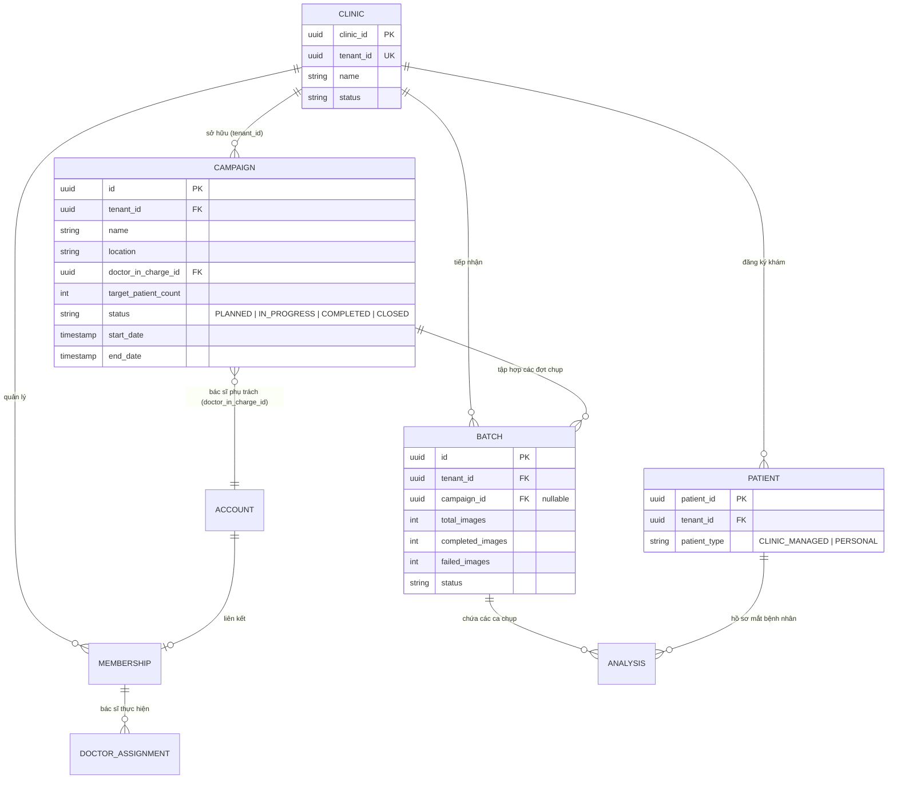
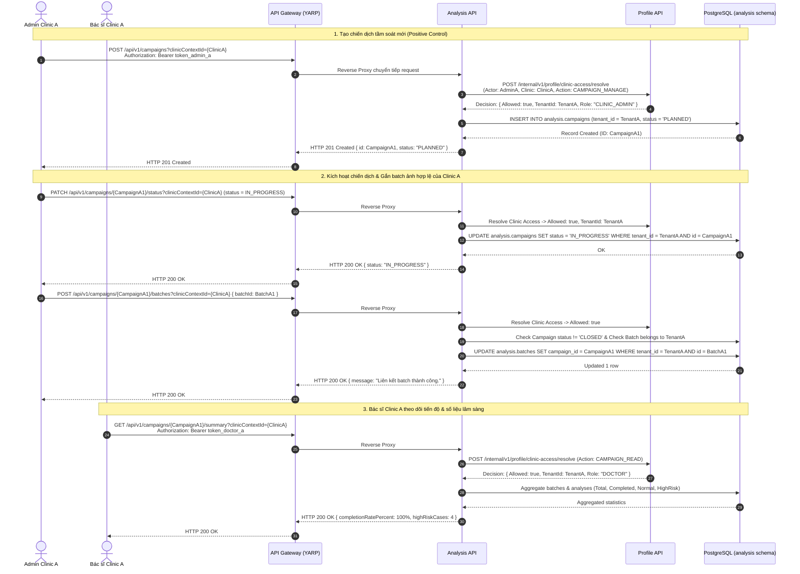
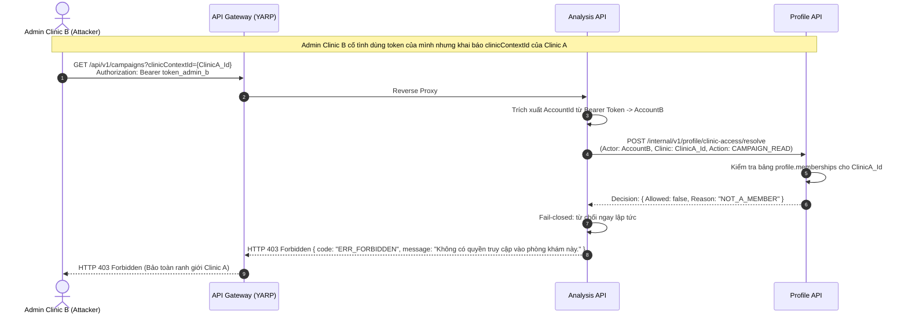
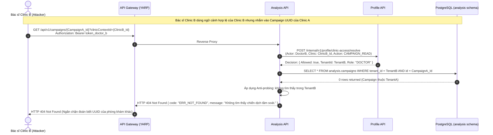
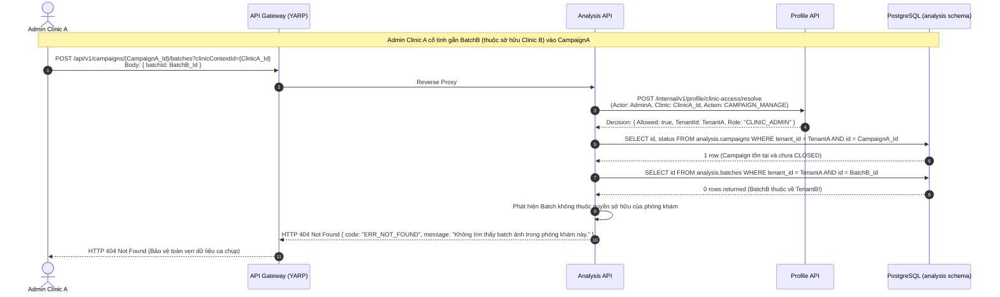
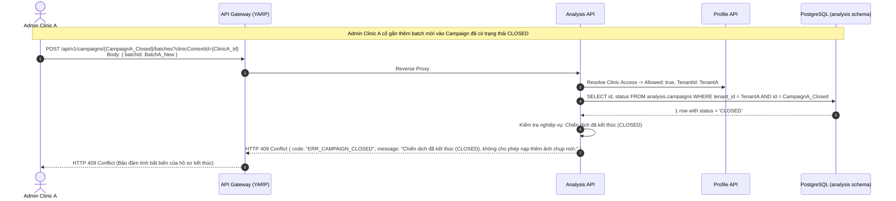

# THIẾT KẾ NGHIỆP VỤ & PHÂN QUYỀN ĐA KHÁCH THUÊ PHÂN HỆ CHIẾN DỊCH TẦM SOÁT (SCREENING CAMPAIGN)

> **Mã task**: `W5-M6-03` · **Jira**: `SCRUM-379`
> **Người thực hiện**: M6 (Security, Auth, Identity & QA Lead)
> **Sprint**: Sprint 5 (02/11/2026 – 08/11/2026) · **Dự án**: AURA (`SP26SE025`)
> **Chuẩn kiến trúc**: Microservices, Multi-tenant Isolation, ADR-005 D2 Authoritative Resolution, Zero Trust.

---

## 1. Tổng Quan Nghiệp Vụ & Mô Hình Thực Thể Đa Khách Thuê

Trong các đợt khám sàng lọc sức khỏe mắt cộng đồng (ví dụ: tầm soát bệnh võng mạc đái tháo đường, tăng huyết áp võng mạc cho người cao tuổi tại địa phương), các phòng khám hoặc bệnh viện đối tác (Clinics) tổ chức các **Chiến dịch Tầm soát (Screening Campaigns)**. Mỗi chiến dịch đại diện cho một đợt khám lưu động có mục tiêu, bác sĩ phụ trách, địa điểm, thời gian và chỉ tiêu số lượng bệnh nhân.

### 1.1. Mối Quan Hệ Giữa Các Thực Thể Nghiệp Vụ



* **Clinic (Phòng khám / Tổ chức Y tế)**: Khách thuê độc lập (**Tenant**). Sở hữu dữ liệu chiến dịch, danh sách bệnh nhân và hạn ngạch tín dụng (Credit Wallet).
* **Doctor / Staff (Bác sĩ / Nhân viên)**: Là tài khoản người dùng (`identity.accounts`) được cấp quyền thông qua liên kết thành viên (`profile.memberships`). Bác sĩ chỉ có quyền truy cập dữ liệu của phòng khám mà họ đang có tư cách thành viên `ACTIVE`.
* **Campaign (Chiến dịch Tầm soát)**: Thuộc về **duy nhất một phòng khám** (`tenant_id = clinic.tenant_id`). Mọi truy vấn đọc, sửa, thêm batch, xuất báo cáo bắt buộc phải kiểm tra ranh giới `tenant_id`.
* **Batch (Đợt ảnh tải lên)**: Một batch gồm nhiều ảnh ($\ge 100$ ảnh) được liên kết vào một Campaign nếu cùng thuộc một Clinic tenant. Cấm tuyệt đối liên kết chéo batch của phòng khám này vào chiến dịch của phòng khám khác.
* **Patient & Analysis (Bệnh nhân & Ca phân tích)**: Bệnh nhân tham gia chiến dịch được phân loại là `CLINIC_MANAGED` dưới sự quản lý của phòng khám đó.

---

## 2. Nguyên Tắc Bảo Mật & Ranh Giới Đa Khách Thuê (Tenant Boundary)

### 2.1. Quyết Định Kiến Trúc ADR-005 D2 (Authoritative Context Resolution)

* **Cấm tin cậy thông tin do Client tự khai báo**: API Gateway và Analysis API **tuyệt đối không tin cậy** các header như `X-Clinic-Context-Id` hoặc claim tự tạo trong client request.
* **Phân giải thẩm quyền qua Profile Service**:
  Mọi request tới Campaign API bắt buộc truyền query param `clinicContextId={clinicId}`. Analysis API trích xuất tài khoản từ Bearer token, sau đó gọi sang dịch vụ Profile Service qua endpoint nội bộ an toàn:
  `POST /internal/v1/profile/clinic-access/resolve`
  kèm chữ ký Service JWT (scope `profile:resolve`).
  Profile Service sẽ truy vấn database trung tâm kiểm tra:
  1. Tài khoản có trạng thái `ACTIVE` trong `identity.accounts` không?
  2. Tài khoản có tư cách thành viên `ACTIVE` tại phòng khám `clinicId` không?
  3. Phòng khám có trạng thái `ACTIVE` không?
  4. Vai trò của tài khoản có đủ thẩm quyền thực hiện thao tác tương ứng (`CAMPAIGN_MANAGE`, `CAMPAIGN_READ`, `CAMPAIGN_EXPORT`) không?
* **Fail-Closed**: Nếu Profile Service gặp sự cố hoặc token không thể xác minh, hệ thống trả về ngay `HTTP 503` hoặc `HTTP 401/403`, tuyệt đối không có cơ chế bypass hoặc cho phép mặc định.

### 2.2. Nguyên Tắc Chống Dò Quét Tài Nguyên (Anti-Probing Principle)

* Khi người dùng thuộc Clinic B gửi request truy cập chi tiết chiến dịch, gắn batch, xem thống kê hoặc xuất báo cáo của Campaign thuộc Clinic A (bằng cách truyền đúng `clinicContextId` của Clinic B nhưng nhắm vào UUID của Campaign Clinic A):
  Analysis Repository thực hiện truy vấn:

  ```sql
  SELECT ... FROM analysis.campaigns WHERE tenant_id = @TenantClinicB AND id = @CampaignClinicA;
  ```

* Do không tồn tại bản ghi khớp cả `tenant_id` và `id`, hệ thống phản hồi:
  `HTTP 404 Not Found (ERR_NOT_FOUND)`
* **Lý do y tế & bảo mật**: Trả về `404 Not Found` thay vì `403 Forbidden` giúp ngăn chặn kẻ tấn công biết được UUID của Campaign phòng khám khác có thực sự tồn tại trong hệ thống hay không (Anti-Enumeration & Anti-Probing).

### 2.3. Ràng Buộc Vòng Đời Chiến Dịch (Campaign Lifecycle & Closed Protection)

* Chiến dịch có 4 trạng thái tuần tự: `PLANNED` $\rightarrow$ `IN_PROGRESS` $\rightarrow$ `COMPLETED` $\rightarrow$ `CLOSED`.
* **Khóa bất biến khi CLOSED**: Khi chiến dịch đã được chốt sổ (`CLOSED`), cấm tuyệt đối việc thêm ảnh hoặc liên kết thêm batch mới. Bất kỳ nỗ lực nào đều nhận lỗi:
  `HTTP 409 Conflict (ERR_CAMPAIGN_CLOSED)`.
* Dữ liệu chiến dịch đã CLOSED vẫn cho phép đọc (`GET`) và xuất CSV (`GET /export`) phục vụ lưu trữ y khoa và thanh tra kiểm toán.

---

## 3. Ma Trận Phân Quyền (RBAC & Multi-Tenant Authority Matrix)

| Vai trò người gọi | Ngữ cảnh phòng khám | Thao tác (`Action`) | Endpoint | Quyết định | HTTP Response |
| --- | --- | --- | --- | --- | --- |
| **CLINIC_ADMIN** | Clinic của mình (Active) | Tạo chiến dịch mới (`CAMPAIGN_MANAGE`) | `POST /api/v1/campaigns` | **ALLOW** | `201 Created` |
| **CLINIC_ADMIN** | Clinic của mình (Active) | Đổi trạng thái (`CAMPAIGN_MANAGE`) | `PATCH /api/v1/campaigns/{id}/status` | **ALLOW** | `200 OK` |
| **CLINIC_ADMIN** | Clinic của mình (Active) | Gắn batch hợp lệ (`CAMPAIGN_MANAGE`) | `POST /api/v1/campaigns/{id}/batches` | **ALLOW** | `200 OK` |
| **CLINIC_ADMIN** | Clinic của mình (Active) | Xuất báo cáo CSV (`CAMPAIGN_EXPORT`) | `GET /api/v1/campaigns/{id}/export` | **ALLOW** | `200 OK (CSV)` |
| **DOCTOR** | Clinic của mình (Active) | Xem danh sách / chi tiết (`CAMPAIGN_READ`) | `GET /api/v1/campaigns/{id}` | **ALLOW** | `200 OK` |
| **DOCTOR** | Clinic của mình (Active) | Xem tóm tắt thống kê (`CAMPAIGN_READ`) | `GET /api/v1/campaigns/{id}/summary` | **ALLOW** | `200 OK` |
| **DOCTOR** | Clinic của mình (Active) | Cố tình tạo / đóng campaign (`CAMPAIGN_MANAGE`) | `POST /api/v1/campaigns` | **DENY** (ROLE_DENIED) | `403 Forbidden` |
| **DOCTOR** | Clinic của mình (Active) | Cố tình xuất báo cáo CSV (`CAMPAIGN_EXPORT`) | `GET /api/v1/campaigns/{id}/export` | **DENY** (ROLE_DENIED) | `403 Forbidden` |
| **Bất kỳ vai trò Clinic B** | Khai báo `clinicContextId` Clinic A | Mọi thao tác | Bất kỳ endpoint nào | **DENY** (NOT_A_MEMBER) | `403 Forbidden` |
| **Bất kỳ vai trò Clinic B** | Khai báo `clinicContextId` Clinic B | Nhắm vào `campaignId` của Clinic A | Bất kỳ endpoint nào | **DENY** (WHERE tenant_id) | `404 Not Found` |
| **CLINIC_ADMIN Clinic A** | Clinic A | Gắn Batch của Clinic B | `POST /api/v1/campaigns/{id}/batches` | **DENY** (WHERE tenant_id) | `404 Not Found` |
| **CLINIC_ADMIN Clinic A** | Clinic A | Gắn Batch vào Campaign đã CLOSED | `POST /api/v1/campaigns/{id}/batches` | **DENY** (STATUS_CLOSED) | `409 Conflict` |
| **Bệnh nhân (PATIENT)** | Bất kỳ | Mọi thao tác Campaign | Bất kỳ endpoint nào | **DENY** (NOT_A_MEMBER) | `403 Forbidden` |
| **Chưa xác thực** | Không có token | Mọi thao tác | Bất kỳ endpoint nào | **DENY** (UNAUTHORIZED) | `401 Unauthorized` |

---

## 4. Các Sơ Đồ Tuần Tự Chi Tiết (Sequence Diagrams)

### 4.1. Sequence 1: Luồng Hợp Lệ (Positive Control - Clinic Admin & Doctor)



---

### 4.2. Sequence 2: Chặn Giả Mạo Ngữ Cảnh Chéo Tenant (Negative Control - HTTP 403 Forbidden)



---

### 4.3. Sequence 3: Chặn Dò Quét Tài Nguyên Chéo Tenant (Negative Control - HTTP 404 Not Found)



---

### 4.4. Sequence 4: Chặn Gắn Batch Ngoại Lai (Negative Control - HTTP 404 Not Found)



---

### 4.5. Sequence 5: Chặn Thao Tác Khi Chiến Dịch Đã Khóa (Negative Control - HTTP 409 Conflict)



---

## 5. Bảng Đối Soát 10+ Ca Kiểm Thử Chéo Tenant (Test Verification Matrix)

Bảng dưới đây quy định tập hợp các ca kiểm thử bảo mật tự động trong bộ kiểm thử `CampaignMultiTenantHttpTests`:

| Mã Ca Test | Phân loại | Mô tả kịch bản kiểm thử | Token Người Gọi | Clinic Context | Tài nguyên mục tiêu | Kết quả kỳ vọng (Status & Code) |
| --- | --- | --- | --- | --- | --- | --- |
| **TC-POS-01** | Positive Control | Clinic Admin tạo chiến dịch mới đầy đủ thông tin | `token_admin_a` | `ClinicA` | N/A | **201 Created** |
| **TC-POS-02** | Positive Control | Clinic Admin đọc chi tiết chiến dịch vừa tạo | `token_admin_a` | `ClinicA` | `CampaignA` | **200 OK** |
| **TC-POS-03** | Positive Control | Clinic Admin cập nhật trạng thái sang `IN_PROGRESS` | `token_admin_a` | `ClinicA` | `CampaignA` | **200 OK** |
| **TC-POS-04** | Positive Control | Bác sĩ Clinic A xem tóm tắt lâm sàng chiến dịch | `token_doctor_a` | `ClinicA` | `CampaignA` | **200 OK** |
| **TC-POS-05** | Positive Control | Clinic Admin gắn batch 50 ảnh hợp lệ của Clinic A | `token_admin_a` | `ClinicA` | `CampaignA` + `BatchA` | **200 OK** |
| **TC-POS-06** | Positive Control | Clinic Admin xuất báo cáo y tế CSV tổng kết | `token_admin_a` | `ClinicA` | `CampaignA` | **200 OK** (`text/csv`) |
| **TC-NEG-01** | Negative Control | Admin Clinic B gọi API với `clinicContextId` Clinic A | `token_admin_b` | `ClinicA` | Danh sách Campaign A | **403 Forbidden** (`ERR_FORBIDDEN`) |
| **TC-NEG-02** | Negative Control | Bác sĩ Clinic B gọi API với `clinicContextId` Clinic A | `token_doctor_b` | `ClinicA` | Chi tiết Campaign A | **403 Forbidden** (`ERR_FORBIDDEN`) |
| **TC-NEG-03** | Negative Control | Admin Clinic B dùng context Clinic B xem Campaign A | `token_admin_b` | `ClinicB` | `CampaignA` | **404 Not Found** (`ERR_NOT_FOUND`) |
| **TC-NEG-04** | Negative Control | Bác sĩ Clinic B dùng context Clinic B xem Campaign A | `token_doctor_b` | `ClinicB` | `CampaignA` | **404 Not Found** (`ERR_NOT_FOUND`) |
| **TC-NEG-05** | Negative Control | Admin Clinic B cố sửa trạng thái Campaign Clinic A | `token_admin_b` | `ClinicB` | `CampaignA` | **404 Not Found** (`ERR_NOT_FOUND`) |
| **TC-NEG-06** | Negative Control | Bác sĩ Clinic B cố xem thống kê (summary) Campaign A | `token_doctor_b` | `ClinicB` | `CampaignA` | **404 Not Found** (`ERR_NOT_FOUND`) |
| **TC-NEG-07** | Negative Control | Admin Clinic B cố xuất CSV báo cáo của Campaign A | `token_admin_b` | `ClinicB` | `CampaignA` | **404 Not Found** (`ERR_NOT_FOUND`) |
| **TC-NEG-08** | Negative Control | Admin Clinic A cố gắn Batch của Clinic B vào Campaign A | `token_admin_a` | `ClinicA` | `CampaignA` + `BatchB` | **404 Not Found** (`ERR_NOT_FOUND`) |
| **TC-NEG-09** | Negative Control | Admin Clinic B cố gắn Batch của Clinic B vào Campaign A | `token_admin_b` | `ClinicB` | `CampaignA` + `BatchB` | **404 Not Found** (`ERR_NOT_FOUND`) |
| **TC-NEG-10** | Negative Control | Cố gắn batch vào Campaign đã khóa (`CLOSED`) | `token_admin_a` | `ClinicA` | `CampaignA_Closed` | **409 Conflict** (`ERR_CAMPAIGN_CLOSED`) |
| **TC-NEG-11** | Negative Control | Bác sĩ Clinic A cố tạo chiến dịch (vượt quyền Admin) | `token_doctor_a` | `ClinicA` | N/A | **403 Forbidden** (`ERR_FORBIDDEN`) |
| **TC-NEG-12** | Negative Control | Bệnh nhân cá nhân (Patient) cố truy cập Campaign | `token_patient` | `ClinicA` | N/A | **403 Forbidden** (`ERR_FORBIDDEN`) |
| **TC-NEG-13** | Negative Control | Request không có Bearer token hợp lệ | Không có | `ClinicA` | N/A | **401 Unauthorized** (`ERR_UNAUTHORIZED`) |
| **TC-NEG-14** | Negative Control | Bỏ qua query param, chỉ gửi header `X-Clinic-Context-Id` | `token_admin_a` | Header only | `CampaignA` | **400 Bad Request** (`clinicContextId`) |

---
*Tài liệu được ban hành chính thức cho Sprint 5 — Đề tài AURA SP26SE025.*
