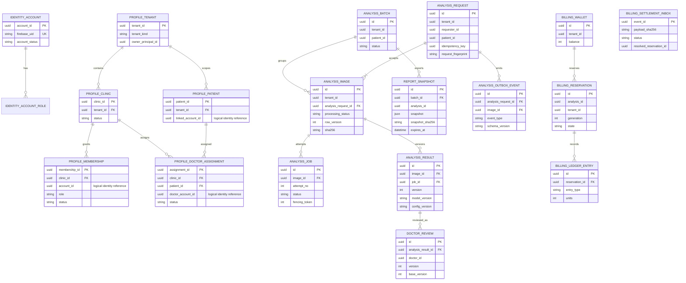
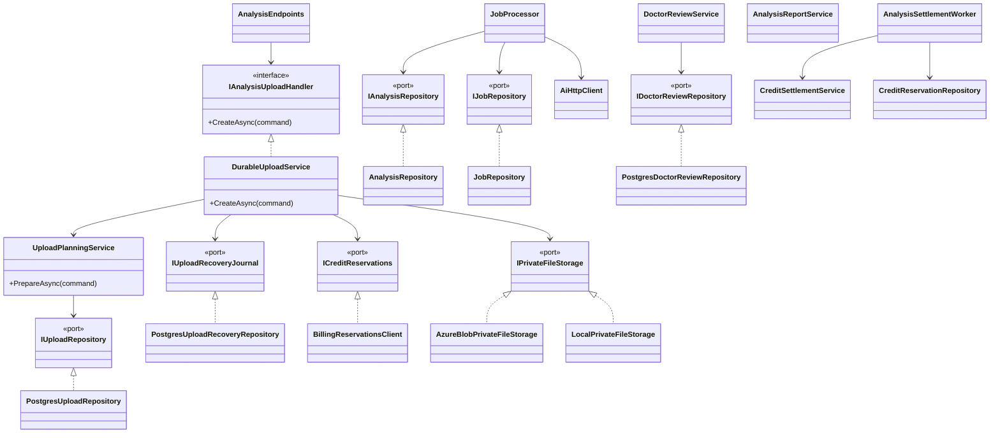
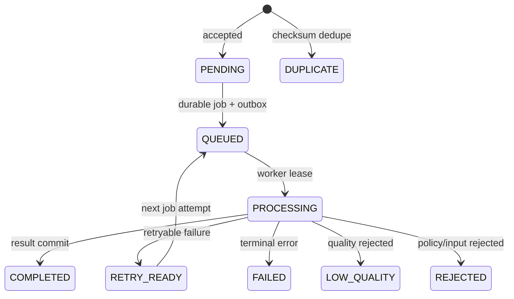
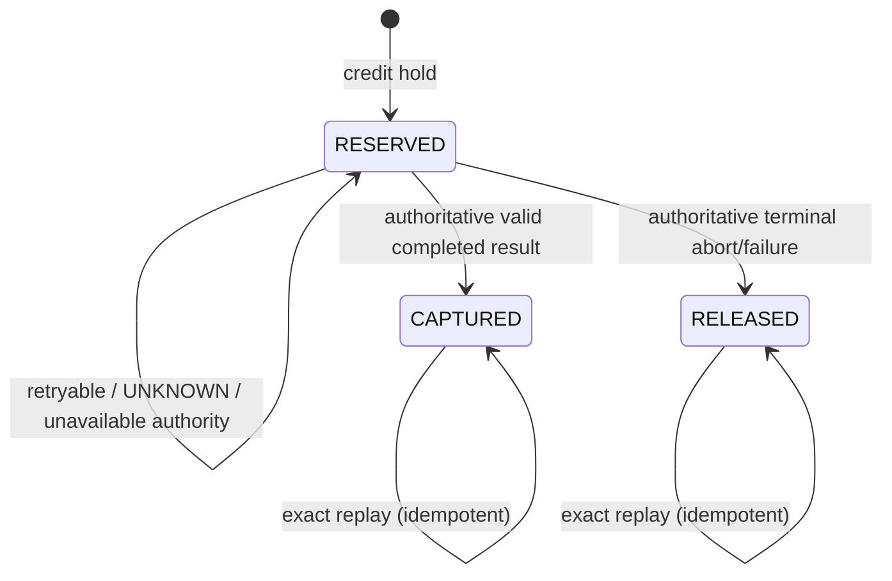
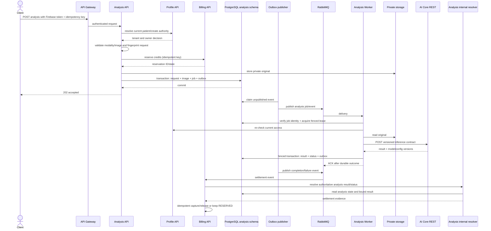

# SCRUM-404 — Backend defects and OOP design from current source

**Reviewed candidate:** `develop` at `e3ccf92` (same as `origin/develop` at review time).
**Jira:** [SCRUM-404](https://nguyentruonghau2202.atlassian.net/browse/SCRUM-404), W7-M2-03.
**Scope:** NFR-17 modularity and NFR-21 REST service boundaries; current backend implementation only.

## Finding and disposition

The Sprint 7 entry manifest at `scripts/release/sprint7-entry-gate.json` has an empty `defects` array. A Jira query for open `Bug` issues in project `SCRUM` returned no issues. This audit therefore found no registered P0/P1 backend defect to reproduce or close. No production-code or database change is made for SCRUM-404; inventing a defect would make the severity report misleading.

This is a source-based design and defect inventory, not a release or clinical acceptance. Jira dependencies SCRUM-402 and SCRUM-403 were `In Review` at review time; SCRUM-397 was also `In Review`. The local entry-gate manifest separately lists open or pending-verification work with owners and scope-reduction notes. These statuses remain independent of this design artifact.

## Service and data ownership

| Boundary | Owns | Evidence in current source |
|---|---|---|
| API Gateway | Public routing and Firebase bearer-token validation; no business database | `src/gateway/AURA.ApiGateway/Program.cs`, `GatewayFirebaseAuthMiddleware.cs` |
| Identity API | Firebase UID to internal account mapping, global account roles and service-client identity (`identity.*`) | `src/services/AURA.Identity.Api/Program.cs`, `IdentityRepository.cs`; `infra/postgres/migrations/002_identity_and_profile.sql` |
| Profile API | Profiles, tenants, clinics, patients, memberships, doctor assignments and current access decisions (`profile.*`) | `src/services/AURA.Profile.Api/Program.cs`, `ProfileRepository.cs`, `ProfileRepository.Security.cs`; `infra/postgres/migrations/002_identity_and_profile.sql`, `003_doctor_assignments.sql` |
| Analysis API + Analysis Worker | Accepted requests, images, jobs, immutable result versions, doctor reviews, report snapshots, recovery journal and event outbox (`analysis.*`) | `src/services/AURA.Analysis.Api/Upload`, `src/services/Aura.Worker.Analysis`; `infra/postgres/migrations/analysis/` |
| Billing API | Wallets, reservations, ledger, settlement inbox and reconciliation (`billing.*`) | `src/services/AURA.Billing.Api`; `infra/postgres/migrations/004_billing_business_schema.sql`, `006_billing_settlement_inbox.sql` |
| AI Core | Versioned inference request/response over HTTP; no identity, profile, billing or PostgreSQL ownership | `src/ai-core/app`; `contracts/ai-request-1.3.schema.json`, `contracts/ai-response-1.3.schema.json` |
| Private object storage | Original and derived bytes. Analysis persists object keys, ownership metadata, dimensions and hashes; reads re-check current authority | `src/services/AURA.Analysis.Api/Upload/IPrivateFileStorage.cs`, `AzureBlobPrivateFileStorage.cs`, `LocalPrivateFileStorage.cs` |

Identity/profile/billing IDs carried by Analysis are logical references across service boundaries, not cross-schema foreign keys. Analysis Worker is an Analysis-domain writer; it does not own a separate copy of Analysis data. Report snapshot rows are immutable after insert; source result/review versions and checksums are serialized in the snapshot.

## ERD (logical cross-service view)

The solid relationships below are Analysis-schema foreign keys or same-schema relations. Profile and Billing links are logical IDs resolved through their owning APIs.



The Profile role/assignment and Billing reservation references do not imply cross-service foreign keys. Analysis owns its `tenant_id`, `patient_id`, `requester_id`, and source-version references after authoritative Profile resolution. Billing owns the authoritative credit state and ledger.

## Class and pattern map



| OOP concept | Concrete use in source | Test/evidence location |
|---|---|---|
| Repository / ports-and-adapters | `IUploadRepository`, `IUploadRecoveryJournal`, `IJobRepository`, `IAnalysisRepository`, `IDoctorReviewRepository`; Postgres adapters persist domain state | `src/services/AURA.Analysis.Api.Tests`, `tests/Aura.Worker.Analysis.Tests`, `src/services/AURA.Billing.Api.Tests` |
| Application service / orchestration | `DurableUploadService`, `JobProcessor`, `DoctorReviewService`, `AnalysisReportService` coordinate validation, authority, persistence and external ports | `DurableUploadTests.cs`, `JobProcessorTests.cs`, `DoctorReviewTests.cs`, `DoctorReviewServiceTests.cs`, `ReportSnapshotPostgresTests.cs` |
| Strategy via interface | `IPrivateFileStorage` selects Azure Blob or local private storage through DI without changing upload/report callers | `Storage*Tests.cs`, Analysis API tests |
| Transactional outbox / idempotent inbox | Analysis commits job/result and outbox state in PostgreSQL; Billing records settlement events, hashes, status and leases before applying idempotent ledger actions | `Outbox*Tests.cs`, `PostgresBillingInvariantsTests.cs`, `Settlement*Tests.cs` |
| Optimistic concurrency | Review command carries `BaseVersion`; append-only review versions and image `row_version` serialize concurrent writes, stale writes return conflict | `DoctorReviewTests.cs`, `DoctorReviewServiceTests.cs`, `ReportSnapshotPostgresTests.cs` |
| SRP and DIP | Planning, durable side-effects, worker orchestration, repositories, access clients and storage adapters are separate collaborators injected through constructors | Concrete constructor/interface references above |

These are patterns visible in the implementation, not a claim that every class perfectly satisfies every SOLID rule. `UploadPlanningService` and `AnalysisReportService` still contain substantial coordination/query logic; future refactors require behavior-preserving regressions first.

## State diagrams





Doctor review is append-only and versioned: `(baseVersion=n, row_version=n)` creates version `n+1`; a concurrent or stale `baseVersion` gets conflict and does not replace the prior review. A report snapshot binds the selected analysis-result ID/version, model/config/threshold versions, latest eligible review ID/version, source hashes and snapshot digest. Download resolves current Profile authority and checks expiry before returning protected bytes.

## Sequences



```mermaid
sequenceDiagram
    actor Doctor
    participant API as Analysis API
    participant Profile as Profile API
    participant ADB as PostgreSQL analysis schema
    participant Report as Report service
    participant Storage as Private storage

    Doctor->>API: POST review with baseVersion
    API->>ADB: resolve analysis identity
    API->>Profile: check current doctor assignment
    Profile-->>API: allowed/denied
    API->>ADB: compare version and append review
    alt stale or simultaneous baseVersion
        ADB-->>API: conflict (409); keep existing review
    else current baseVersion
        ADB-->>API: new immutable review version
    end
    Doctor->>API: POST report export
    API->>ADB: read exact result version + eligible review
    API->>Storage: render/store report snapshot
    API-->>Doctor: report ID + expiry
    Doctor->>API: GET protected report content
    API->>Profile: re-check current authorization
    API->>ADB: verify snapshot expiry and metadata
    API->>Storage: return bytes only when allowed and unexpired
```

## Schema, regression, and remaining gates

- No migration is introduced by SCRUM-404. Existing analysis, profile, identity and billing schemas remain service-owned; report snapshots keep immutable JSON plus SHA-256 and are not update/delete mutable by the runtime role.
- On 2026-11-24, all 42 migrations listed by `scripts/dev/Initialize-AuraDevDatabase.ps1` applied successfully to a fresh, disposable PostgreSQL 17 database. No upgrade-path migration run was needed because SCRUM-404 adds no migration.
- On 2026-11-24, the current `develop` worktree passed the Analysis API suite (481/481), Billing API suite (31/31), and Analysis Worker suite (37/37), with zero failures and zero skips. The PostgreSQL-backed suites used the disposable test database. These results verify the current source state; they do not prove every release or clinical gate.
- Relevant regressions include Analysis review/report snapshot tests, Worker lease/fencing tests, Billing replay/settlement/reconciliation tests, and the SCRUM-403 report-version/replay regressions.
- Remaining entry-gate work and its accountable owner/scope plan, as recorded in the manifest:

| Jira / manifest item | Owner | Status | Scope boundary / mitigation |
|---|---|---|---|
| SCRUM-396 (W6-M6-04) | M6 | OPEN | Prerequisites are SCRUM-391/394/385; if they miss freeze, retain it as an explicit Sprint 7 entry defect and verify socket-revoke plus generic push before the QA gate. |
| SCRUM-380/381/383 (W6-M1-01/02/04) | M1 | PENDING_VERIFICATION | Await final integration SHA; defer non-essential analytics export extensions if the core pipeline smoke passes. |
| SCRUM-386 (W6-M2-03) | M2 | PENDING_VERIFICATION | Await final integration SHA; retain core alert/inbox and defer optional alert filters. |
| SCRUM-392/388 (W6-M4-02/03) | M4 | PENDING_VERIFICATION | Await final integration SHA; preserve `unavailable=null+reason` and do not fabricate metrics. |
| SCRUM-393/389 (W6-M5-01/03) | M5 | PENDING_VERIFICATION | Await final integration SHA; prioritize core doctor workspace/analytics and defer cosmetic UI polish. |

- The Jira task’s acceptance does not let this artifact claim SCRUM-397’s integration gate or SCRUM-373’s scientific gate as passed. The current manifest itself says SCRUM-373 is OPEN and auto-close is not allowed.
- Candidate source SHA reviewed: `e3ccf92` (`develop`, matching `origin/develop` before this uncommitted design artifact). Record the final commit SHA after committing this document if it is used as the SCRUM-404 submission candidate.
